# 성공 중심 온라인 학습은 언제 VLA 강화학습을 대체할 수 있는가 — 연구 패키지 v0.8

**데이터 갱신, 음의 정책 업데이트, 회복 행동에 대한 통제 연구**

- 작성일: 2026-10-15 · 버전 v0.8 (결정 기록과 변경 이력: 부록 C, 외부 검토 대응: 부록 E)
- 상태: **파일럿 착수 가능 (2026-10-15)**. 4차 외부 검토는 "파일럿 착수, 학습 설계 유지, 통계 명세는 본실험 전(G-PRE)에 정리"로 판정했고, 이 판에서 통계 명세와 문구 정합성을 반영했다. 지금 할 수 있는 것은 두 갈래다: **렌더링이 필요 없는 학습 없는 단위 시험(P4의 수식·저장 배치 시험)은 WSL 시험과 병행**할 수 있고, ManiSkill이 필요한 단계(P2·P3·P5)는 WSL 시험(6.0절) 결과에 따라 위치를 정한다. 판정 기준과 임계값은 파일럿 착수 전과 본실험 착수 전에 **사전 고정**한다 (9절).
- 장비: 파일럿 RTX 4090 24GB · RAM 64GB (Windows PC, WSL2 Ubuntu) / 본실험 H200 ×4 · H100 ×2
- 작업 폴더: `D:\VLA_ReinforceLearning`
- 시각화: Mermaid 다이어그램 15개 (Mermaid 11.16.1로 렌더링 확인. GitHub, Obsidian, VS Code 미리보기, Typora 등에서 표시)
- 읽는 순서: 처음이면 0절 → 1.3~1.6절(질문·가설) → 2.3절(남는 질문) → 3절(설계) → 4절(분석). 용어는 부록 A. 실행 담당자는 6절부터. v0.7을 읽은 사람은 아래 상자와 부록 E의 4차 대응표(E-4)부터.

> **v0.7 대비 바뀐 핵심 (4차 외부 검토 반영, 항목별 대응은 부록 E-4. 이전 변경은 부록 C·E-1~E-3)**
>
> 설계(갈래·E1~E4·주지표·시드)는 바뀌지 않았다. 바뀐 것은 통계 명세와 문구다.
>
> 1. **묶음별 오류 통제의 범위를 명시했다.** 보조 분석은 연구 질문별로 사전 지정한 검정군 안에서 오류를 통제한다. 세 묶음을 각각 5%로 통제해도 전체가 5%로 통제되는 것은 아니다 (독립 가정 시 세 묶음 중 하나 이상의 오류 확률 ≈ 14.3%). 전체 보조 결과를 하나의 "확증된 발견 목록"으로 제시하지 않는다.
> 2. **"유의성 문턱"과 "최소 탐지 차이(MDE)"를 구분했다.** 계보 8개·대비 SD 5%p·α 0.025에서 문턱에 대응하는 관측 차이는 약 5.0%p이지만, 실제 효과가 5%p일 때 그 문턱을 넘을 검정력은 약 53%이고, 검정력 80%를 주는 효과는 약 6.7%p다. MDE는 80% 검정력 기준으로 정의한다.
> 3. **E2·E3·E4-b의 분석 함수를 분리했다.** E2는 계보 단위 짝지은 대비(8개), E3는 네 평균의 선형 대비(표본 5·5·8·8, 독립 가정 시 SE ≈ 4.0%p, MDE ≈ 13%p), E4-b는 두 집단의 독립 비교(8 대 8, MDE ≈ 8.5%p). "계보 8개" 계산을 세 실험에 똑같이 적용하지 않는다.
> 4. **G-mid의 확증 강등 규칙을 없앴다.** 확증·기술 분석의 구분은 G-PRE에서 고정한다. G-mid에서는 사전 규칙에 따른 표본 수 조정과 정밀도 전망만 갱신하고, 정밀도가 부족한 분석은 기존의 **미판정** 범주로 보고한다.
> 5. **C9 동일성 시험의 이름을 정리했다.** "C9를 끄면 원 PPO 재현"이라는 표현 대신, "원 코드형 계산(joint log-prob 7칸 복제)"과 "통제 학습기 계산(joint 1개 × 정책 계수 7)"의 총 손실·기울기·같은 optimizer 상태에서의 1회 업데이트를 비교한다. 계수 7·1은 유지한다.
> 6. **E2-a 코사인 예측은 정책 손실 기울기에 한정**했다. 같은 value 기울기를 더한 총 기울기와 Δθ의 코사인은 비례 관계가 깨지므로 진단으로만 본다. 기울기 노름이 0에 가까우면 코사인은 "정의 불가"로 기록한다.
> 7. **E4-b의 시간 복원과 회복 시간 부여를 분리했다.** 과제 상태 재현을 위해 원래 경과 스텝은 보존하고, 평가 종료는 복원 뒤 별도의 회복 카운터 H스텝으로 정한다.
> 8. **문구 정합성:** H1은 "PPO보다 δ 이상 낮지 않음"(양방향 동등이 아님), 8.3절 7번은 1.4절과 일치, "롤아웃 비용이 같다"는 "환경 상호작용 수가 같다"로, "24GB 불가"는 7.4절 방침과 통일, 부록 B의 "충분한 조건"은 "대체 가능성"으로, 상태 줄은 학습 없는 시험의 병행 가능을 명시.
---

## 목차

0. [한눈에 보기](#0-한눈에-보기)
1. [배경과 연구 질문](#1-배경과-연구-질문)
2. [선행연구와 남는 질문](#2-선행연구와-남는-질문)
3. [실험 설계](#3-실험-설계)
4. [분석 계획](#4-분석-계획)
5. [로드맵과 게이트](#5-로드맵과-게이트)
6. [4090 파일럿 검증](#6-4090-파일럿-검증)
7. [자원·장비 배치](#7-자원장비-배치)
8. [위험·한계·우려 사항](#8-위험한계우려-사항)
9. [사전 고정 체크리스트와 기록 항목](#9-사전-고정-체크리스트와-기록-항목)
10. [참고문헌과 공개 자원](#10-참고문헌과-공개-자원)
- [부록 A. 용어 정리](#부록-a-용어-정리)
- [부록 B. 주제 선정 경위](#부록-b-주제-선정-경위)
- [부록 C. 결정 기록과 변경 이력](#부록-c-결정-기록과-변경-이력)
- [부록 D. 미결 사항](#부록-d-미결-사항)
- [부록 E. 외부 검토 대응표](#부록-e-외부-검토-대응표)

---

## 0. 한눈에 보기

같은 출발 정책과 같은 온라인 상호작용 예산에서, **로봇이 스스로 굴린 롤아웃 중 성공한 것만 따라 하는 학습**(성공 중심 온라인 학습)이 PPO의 OOD 성능을 어디까지 재현하는지 사전 고정된 비열등성 검정으로 판정한다. 재현하지 못하는 차이가 **음의 actor-loss 항**(특정 행동의 확률을 직접 낮추는 업데이트 항)과 어떻게 연결되는지는, advantage 추정기를 명시적으로 고정한 동일 배치 분기 실험으로 따로 측정한다. 초기 성공 데이터 공급(웜업 수준)과 회복 능력은 결론이 달라지는 조건으로 다룬다.

| 항목 | 결정 |
|---|---|
| 제목 (가제) | 성공 중심 온라인 학습은 언제 VLA 강화학습을 대체할 수 있는가? 데이터 갱신, 음의 정책 업데이트, 회복 행동에 대한 통제 연구 |
| RQ1 대체 가능성 | 같은 온라인 상호작용 예산에서 성공 중심 학습(A2⁺)이 PPO(A3⁰)의 OOD 성능을 어느 정도 재현하는가 |
| RQ2 메커니즘 | 동일 정책·동일 롤아웃 배치에서, 결과 상수 기준선과 GAE 두 advantage 추정기 각각에 대해 음의 actor-loss 항을 제거하면 업데이트와 실행 강건성이 어떻게 달라지는가 |
| 조건 변수 | 웜업 수준(초기 성공 데이터 공급), 회복 행동 범위 |
| 주지표 (확증 1개) | 실행 축 Δ_replacement = SR(A2⁺) − SR(A3⁰). 비열등성 한계 δ (후보 5%p, G2 후 사전 고정) |
| 주 PPO 갈래 A3⁰ | **terminal PPO**: 마지막 스텝에서만 성공 라벨 Y를 보상으로 받음. A2⁺와 같은 정보 (C5) |
| 결론 범위 | 비열등이면 "이 웜업·환경·예산에서 성공 중심 학습이 terminal PPO의 실행 OOD 성공률을 δ 안에서 재현했다"까지. 두 방법의 절대 성공률과 실측 비용을 함께 보고한다. "충분하다"는 응용 요구 수준 없이는 쓰지 않는다 (4.3절) |
| 출발 논문 | *What Can RL Bring to VLA Generalization?* (NeurIPS 2025). 코드(MIT)·체크포인트 공개 |
| 1단계 범위 | OpenVLA-7B, 원 논문 ManiSkill 집기-놓기. E1 장기 비교(5갈래), E2 분기, E3 웜업 조건, E4 회복 평가 |
| 학습 시드 | 핵심 갈래(A2⁺·A3⁰) 8개. 맹검 분산 재추정으로 최대 12개. E3의 A2⁺·A3⁰ 5개. 나머지 갈래(A1·A2±·A3ˢ) 3개 (4.5절) |
| 2단계 (예산 사전 확보) | 모델과 벤치마크 중 **하나만** 바꾼 연결 실험에서 핵심 2~3갈래를 재검증한다 (3.10절) |
| 투고 | SCIE 저널 우선, 최상위 학회도 검토. 결과의 방향이 아니라 신규성·식별 수준·정밀도·외부 검증으로 정한다 (4.8절) |
| 데이터 | 전부 공개 시뮬레이터·스크립트로 생성. 실물 로봇·사람 시연 불필요 |
| 현재 상태 | 파일럿 착수 가능. 학습 없는 단위 시험(P4)은 바로, ManiSkill 단계는 WSL 시험(6.0절) 후 위치 확정 |

운영 원칙:

1. **비교마다 "고정되는 것과 바뀌는 것"을 표로 적는다** (3.4·3.6절). 표에 없는 차이를 결론으로 말하지 않는다.
2. **4090 파일럿 통과(G1) 전에는 H200을 본실험 규모로 쓰지 않는다.** 단위 시험·렌더링 확인·G2 실측 목적의 제한적 사용은 상한 안에서 허용한다 (5.1절). G1은 구현이 의도대로 동작하는지만 본다. 성능 향상 여부는 판정 기준이 아니다.
3. **파일럿 수치는 논문 근거로 쓰지 않는다.**
4. **OOD 결과를 보고 체크포인트·임계값·지표를 고르지 않는다** (4.7절).

### 0.1 연구 구조 한 장 요약

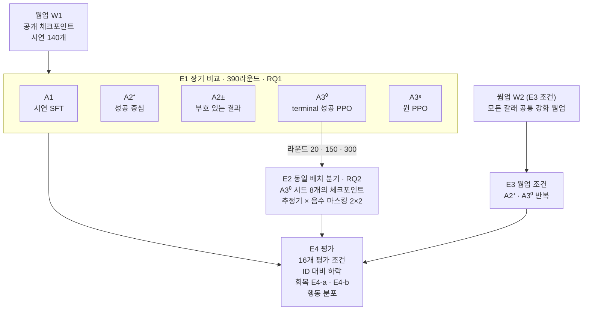

---

## 1. 배경과 연구 질문

### 1.1 SFT, RL, 그리고 성공 중심 학습

- **SFT(지도 미세조정)**: 남이 만든 시연(정답 궤적)을 따라 하도록 학습한다. 시연 근처를 벗어나면 본 적 없는 상태에 빠지고 오차가 누적된다.
- **RL(강화학습 미세조정)**: 로봇이 직접 시도한 롤아웃의 결과(보상)로 학습한다. 원 논문은 PPO를 쓴다. PPO는 가치 함수(critic)로 각 시점의 행동이 기대보다 나았는지(advantage)를 추정해서, 나은 행동의 확률은 올리고 못한 행동의 확률은 내린다.
- **성공 중심 학습**: 로봇이 직접 굴린 롤아웃 중 성공한 것만 골라 지도학습한다. 실패한 롤아웃은 버린다. 필터링 BC, 0-1 REINFORCE, self-bootstrap이라고도 부른다. **새로운 방법이 아니다.** 이미 여러 로봇 연구가 기준선으로 쓴다 (2.1절). 이 연구가 묻는 것은 이 방법이 **언제 PPO를 대체할 수 있는가**다.

성공 중심 학습이 PPO를 대체할 수 있다면 얻는 것이 있다. critic이 없고, 보상 설계가 필요 없고(성공 여부만 있으면 된다), 학습이 지도학습과 같은 형태라서 구현과 튜닝이 단순하다. 계산 절감 폭은 실측 사항이다. 환경 상호작용 수는 두 방법이 같지만, 실제 시간·메모리·저장 비용은 측정해야 알 수 있다 (7.4절).

#### 핵심 직관: 같은 실수를 해도 결과가 갈린다

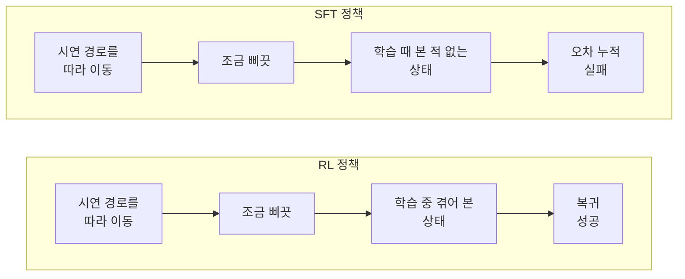

두 정책은 똑같이 삐끗한다. 원 논문은 RL이 학습 중에 그런 상태를 직접 많이 겪어서 복귀하는 법을 안다고 설명한다. RL이 "실패한 집기에서 회복하는 법을 배웠다"는 관찰도 있다. 다만 이 설명은 학습 궤적 그림(원 논문 그림 8)을 보고 한 해석이고, 인과적으로 검증되지는 않았다.

성공 중심 학습도 자기 롤아웃으로 배운다. 그러면 회복 행동도 배울까? 실패한 뒤 회복해서 성공한 궤적이 데이터에 들어 있다면 배울 수 있다. 하지만 회복에 실패한 궤적에서 "어느 행동이 잘못이었는지"는 배우지 못한다. 이 차이가 실제 성능 차이로 이어지는지가 이 연구의 질문이다.

### 1.2 출발 논문의 결과

OpenVLA-7B(LoRA rank 32), ManiSkill WidowX 집기-놓기 과제에서 SFT-16k(시연 수가 포화되는 지점)와 PPO를 비교한 결과다. 수치는 3개 시드 평균 성공률(%)이고 괄호는 표준편차다. 출처는 원 논문 부록 표 1~3이며, 환경 ID는 원 저장소 README 기준이다.

> 주의: 원 논문은 이 3개 시드가 학습 시드인지 평가 시드인지 밝히지 않는다. 공개 README는 체크포인트 하나를 평가 시드 0·1·2로 평가한다. 따라서 괄호의 표준편차는 평가 반복의 분산일 가능성이 있다. **학습 시드 분산의 근거로 쓰지 않는다** (4.5절).

| 축 | 조건 | 환경 ID (split) | SFT | RL (PPO) | 격차 (%p) |
|---|---|---|---|---|---|
| 학습 분포 | 학습 조건 | `PutOnPlateInScene25Carrot-v1` (train) | 78.1 (1.3) | 93.8 (1.3) | +15.7 |
| 시각 | 새 테이블 | `PutOnPlateInScene25VisionImage-v1` (test) | 71.9 (5.1) | 84.4 (3.4) | +12.5 |
| 시각 | 질감 덧씌움 약 | `PutOnPlateInScene25VisionTexture03-v1` (test) | 71.9 (7.8) | 83.3 (4.8) | +11.4 |
| 시각 | 질감 덧씌움 강 | `PutOnPlateInScene25VisionTexture05-v1` (test) | 55.7 (4.1) | 63.0 (3.9) | +7.3 |
| 시각 | 이미지 노이즈 약 | `PutOnPlateInScene25VisionWhole03-v1` (test) | 70.8 (3.2) | 85.4 (2.7) | +14.6 |
| 시각 | 이미지 노이즈 강 | `PutOnPlateInScene25VisionWhole05-v1` (test) | 50.5 (2.7) | 66.7 (4.8) | +16.2 |
| 의미 | 새 물체 | `PutOnPlateInScene25Carrot-v1` (test) | 45.3 (4.4) | 71.4 (1.9) | +26.1 |
| 의미 | 새 접시 | `PutOnPlateInScene25Plate-v1` (test) | 61.5 (1.9) | 75.0 (2.2) | +13.5 |
| 의미 | 다른 지시문 | `PutOnPlateInScene25Instruct-v1` (test) | 67.2 (3.4) | 89.1 (3.4) | +21.9 |
| 의미 | 새 물체 2개 | `PutOnPlateInScene25MultiCarrot-v1` (test) | 29.7 (1.3) | 57.8 (3.4) | +28.1 |
| 의미 | 새 접시 2개 | `PutOnPlateInScene25MultiPlate-v1` (test) | 45.8 (6.5) | 59.9 (6.3) | +14.1 |
| 실행 | 물체·접시 위치 | `PutOnPlateInScene25Position-v1` (test) | 56.8 (7.0) | 80.7 (1.9) | +23.9 |
| 실행 | 로봇 초기 자세 | `PutOnPlateInScene25EEPose-v1` (test) | 33.9 (5.2) | 79.7 (6.4) | +45.8 |
| 실행 | 도중 물체 이동 | `PutOnPlateInScene25PositionChangeTo-v1` (test) | 28.6 (4.1) | 74.5 (4.8) | +45.9 |

축별 평균 격차는 **시각 +12.4%p, 의미 +20.7%p, 실행 +38.5%p**다. 학습 분포 변형 과제 2개(물체 2개 학습 조합, 방해 접시)는 표에서 제외했다.

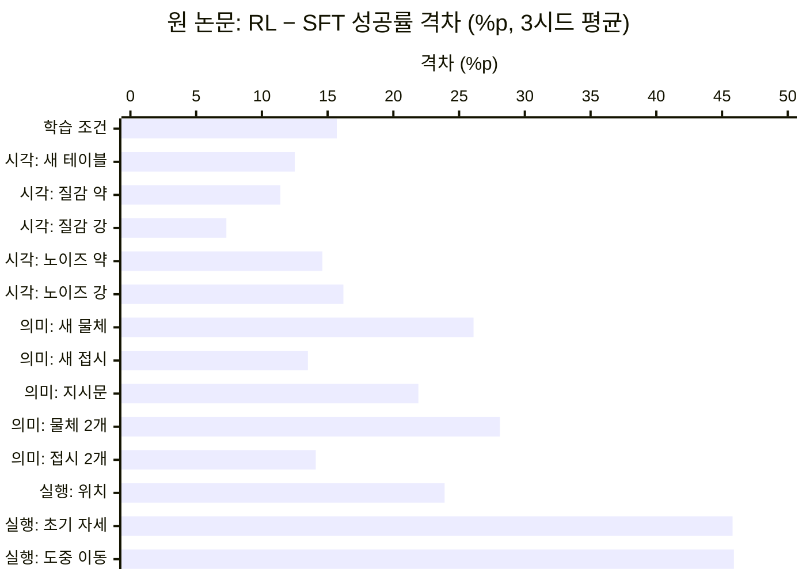

#### ID 대비 하락: OOD 성공률이 높다고 강건해진 것은 아니다

RL은 학습 조건(ID)에서도 SFT보다 15.7%p 높다. OOD 성공률 격차에는 이 기본 수행 능력 차이가 섞여 있다. 그래서 "OOD 격차 − ID 격차"를 따로 본다. 이 값은 (SFT의 하락 폭) − (RL의 하락 폭)과 같다. 양수면 RL이 OOD로 갈 때 덜 떨어진다는 뜻이다.

| 축 | RL − SFT 격차 평균 (%p) | ID 격차 15.7%p를 뺀 값 | 읽는 법 |
|---|---|---|---|
| 시각 | +12.4 | **−3.3** | RL의 하락 폭이 오히려 3.3%p 더 크다. 시각 OOD 성공률이 높은 것은 기본 수행 능력 때문일 수 있다 |
| 의미 | +20.7 | +5.0 | 약한 강건성 신호 |
| 실행 | +38.5 | **+22.8** | RL의 하락 폭이 훨씬 작다. 강건성 차이가 가장 분명한 축 |

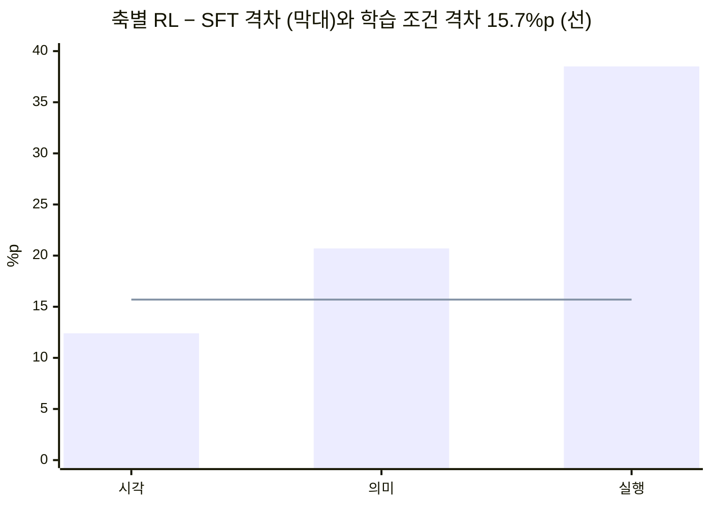

막대가 선보다 낮으면 RL이 OOD로 갈 때 SFT보다 더 많이 떨어진 것이다. 시각 축만 선 아래에 있다.

이 계산은 검정이 아니다. 하지만 **실행 축을 확증 분석의 주 대상으로 정한 근거**이고 (4.3절), 모든 갈래에 ID 대비 하락을 함께 보고하는 이유다 (3.8절).

### 1.3 '실패 신호'는 하나가 아니다

v0.4까지는 실패 신호를 하나의 변수처럼 다뤘다. 실제로는 최소 네 요소가 다르다. PPO는 이 넷을 한꺼번에 쓰고, 성공 중심 학습은 대부분 쓰지 않는다.

| 요소 | 뜻 | A1 시연 SFT | A2⁺ 성공 중심 | A2± 부호 있는 결과 | A3⁰ terminal PPO | E2의 C⁺ (음수 마스킹 PPO) |
|---|---|---|---|---|---|---|
| 실패 데이터의 존재 | 학습 중 실패 궤적을 관측하는가 | 없음 (시연뿐) | 있음 (관측 후 버림) | 있음 | 있음 | 있음 |
| 실패 데이터의 활용 | critic·기준선·가중치 계산에 쓰는가 | 없음 | 성공 판정에만 | 기준선 계산 | critic 학습 | critic 학습 |
| 음의 actor update | 특정 행동의 확률을 직접 낮추는가 | 없음 | 없음 | 있음 (궤적 단위) | 있음 (시점 단위) | **없음** (정책 손실 기준) |
| 시간적 credit assignment | 에피소드 안에서 어느 시점이 문제였는지 구분하는가 | 없음 | 없음 | 없음 (궤적 전체에 같은 값) | 있음 (critic·GAE) | 있음 (양의 쪽만) |

**공유 backbone 주의:** 원 코드의 value head는 backbone을 공유하고, value 경로에 `detach()`가 없으며, 정책 손실과 value 손실을 더해 한 번에 역전파하고 LoRA·value head 파라미터를 함께 클리핑한다 (`openvla_train.py` L310–315, 2026-10-14 확인). 그래서 실패 데이터가 critic 학습을 거쳐 공유 LoRA, 즉 행동 확률에도 간접적으로 영향을 준다. E2에서는 네 칸 모두에 같은 value 손실을 똑같이 적용하고, 위 표의 "음의 actor update 없음"은 **정책 손실 기준**의 표현으로 한정한다. 기울기 진단은 정책 손실만의 기울기와 총 기울기를 따로 잰다 (3.6절).

실패 정보를 쓰면서도 음의 actor update는 하지 않는 방법도 있다. 예를 들어 advantage-weighted regression의 가중치 $e^{A/\beta}$는 advantage가 음수여도 양수다. 실패 경험은 가치 추정과 가중치에 반영되지만, 해당 행동의 확률을 직접 낮추지는 않는다 (Dissecting Advantage-Guided, 2.1절).

**따라서 A2⁺와 A3⁰의 차이를 '실패 신호의 효과' 하나로 부를 수 없다.** 이 문서는 차이를 위 네 요소와 PPO의 나머지 구성(클리핑, 보상 정보)으로 나눠 이름 붙인다.

### 1.4 이진 결과 보상에서 성립하는 관계 (설계의 수학적 근거)

에피소드의 최종 성공을 $Y\in\{0,1\}$, 현재 정책으로 새로 수집한 궤적의 score를 $g(\tau)=\sum_t \nabla_\theta \log \pi_\theta(a_t\mid h_t)$라고 하자. 원 환경은 조기 종료 없이 모든 에피소드가 80스텝이다 (3.2절 C5).

**(1) 성공만 보상하는 정책경사**

$$\mathbb{E}[Y g(\tau)] = \nabla_\theta P_\theta(Y=1)$$

**(2) 상수 기준선을 빼도 기대 방향은 같다.** $\mathbb{E}[g(\tau)]=0$이므로

$$\mathbb{E}[(Y-b)\,g(\tau)] = \mathbb{E}[Y g(\tau)]$$

**(3) 실패에 −1을 줘도 크기만 바뀐다.**

$$\mathbb{E}[(2Y-1)\,g(\tau)] = 2\,\mathbb{E}[Y g(\tau)]$$

**(4) 성공 중심 학습은 0-1 REINFORCE다.** 라운드마다 새로 수집한 $N$개 궤적 중 $N_s$개가 성공했고 성공률이 $\bar Y=N_s/N$라고 하자. OpenVLA는 한 스텝의 행동을 토큰 7개로 내므로 궤적 하나는 토큰 560개(80스텝 × 7)이고, $g_i$는 이 토큰들의 log-확률 기울기의 합이다. 성공 궤적의 토큰 평균 log-likelihood $J_{\text{succ}}$를 올리는 방향은

$$\nabla J_{\text{succ}} = \frac{1}{560N_s}\sum_{i:Y_i=1} g_i = \frac{1}{560N}\sum_i \frac{Y_i}{\bar Y}\, g_i$$

이다 (NLL 손실의 기울기는 이것의 부호를 바꾼 것). 즉 가중치 $Y_i/\bar Y$인 0-1 REINFORCE이고, 배치 성공률에 반비례하는 보폭이 붙는다. PLD도 self-bootstrap 데이터를 0-1 REINFORCE와 같다고 설명한다.

**(5) 공통 상수 기준선의 결과 advantage에서 음수를 지우면 성공 중심 학습이 된다.** $b\in(0,1)$이 배치 전체에 공통인 상수이면

$$\max(Y-b,\,0) = (1-b)\,Y$$

이 관계는 기댓값이 아니라 **모든 표본에서** 성립한다. 결과 수준 advantage에서 음의 항을 지운 것은 성공 중심 학습에 상수를 곱한 것과 같다.

**(6) 기준선이나 advantage가 상태·조건·시점에 따라 달라지면 일반적으로 재가중이 달라진다.** 이것은 critic이 있어야만 생기는 현상이 아니다. 한 번 행동하고 끝나는 문제에서 두 상황의 성공 확률이 $p_1 = 0.2$, $p_2 = 0.8$이고 상황별 성공 확률을 기준선으로 쓰면, 양수 마스킹 뒤 성공 표본의 가중치는 $\max(Y-p_c,0) = (1-p_c)Y$이므로 어려운 상황 0.8, 쉬운 상황 0.2가 된다. 공통 기준선에서는 모든 성공 표본에 같은 상수가 붙지만, 상황별 기준선에서는 **어려운 상황과 쉬운 상황의 학습 비중이 달라진다.** 긴 궤적도 시간적 credit assignment도 없는 문제에서 생기는 일이다. GAE의 시점별 advantage $\hat A_t$는 상태·시점에 따라 달라지므로 $\max(\hat A_t,0)$는 $\hat A_t$의 상수배가 아니고, 일반적으로 $\mathbb{E}[\max(\hat A,0)\,g] \ne \mathbb{E}[\hat A\, g]$이다. 다만 그 차이의 원인에는 상태별 재가중, 시간적 credit, advantage 추정 오차, 정규화, 업데이트 크기가 모두 들어 있다.

**(7) 위 관계는 샘플이 $\pi_\theta$ 자체에서 나왔을 때 성립한다.** $\mathbb{E}[g]=0$은 행동을 $\pi_\theta$에서 뽑았을 때의 성질이다. 공개 코드는 행동을 HF `generate()`로 뽑는데 `top_k`를 지정하지 않아 라이브러리 기본값 50이 적용되고, 저장·재계산 log-prob는 처리 전 logit에서 256개 행동 토큰 전체로 계산한다 (C4). 그러면 샘플링 분포 $q$(상위 50개)와 학습 분포 $\pi$(256개)가 달라 $\mathbb{E}_{a\sim q}[\nabla\log\pi(a)]\ne 0$이고, (2)의 기준선 불변성이 그대로 성립하지 않는다. 그래서 통제 연구에서는 top-k를 해제하고 두 분포가 같은지 시험한다 (P4).

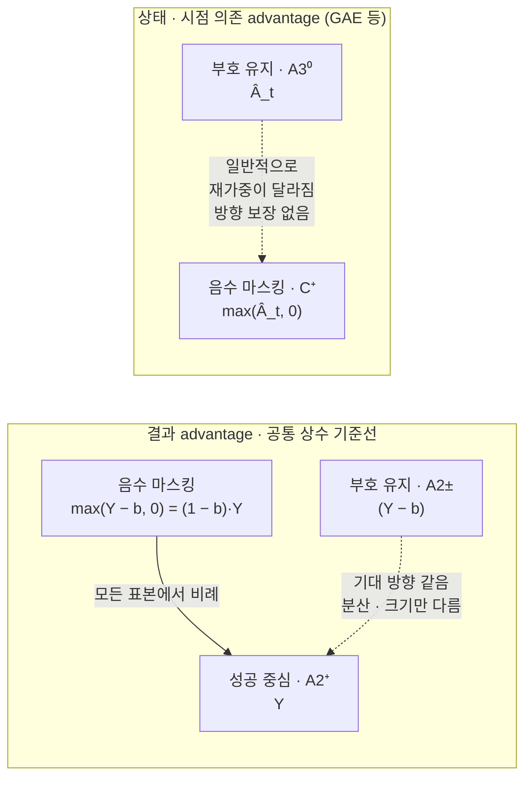

**설계에 주는 의미**

- **A2⁺ 대 A2±**: 기대 방향이 근사적으로 같다 (A2±의 정규화 Ȳ가 같은 배치에서 계산되므로 정확한 등식은 아니며, 배치 크기 64에서 차이는 작다). 다만 장기 학습에서는 라운드당 optimizer 스텝 수도 다르다 (A2⁺는 성공 수에 비례, A2±는 32). 그래서 E1의 A2⁺ 대 A2± 차이를 "기준선 차감의 분산 효과"로만 읽지 않고, 같은 배치에서 누적 기울기 하나를 비교하는 E2-a와 구분한다 (3.6절).
- **E2가 재는 것:** "결과 상수 기준선과 GAE 두 advantage 추정기에서 음의 actor-loss 항을 제거했을 때의 효과가 어떻게 다른가". (5)에 따라 결과 상수 기준선 행에서는 마스킹이 성공 중심 업데이트와 비례하므로, 이 행이 "음의 항 제거의 효과"를 보여 주는 기준이 되고, GAE 행과의 차이(상호작용)가 추정기 의존성을 보여 준다. 그 차이를 설명하는 **후보 메커니즘**은 상태별 재가중, 시간적 credit, advantage 추정 오차, 정규화, 업데이트 크기, optimizer와의 상호작용이다. E2만으로 그중 하나를 고유하게 고르지는 못한다.
- **(1)~(5)는 가정 아래 정확한 등식이다.** 등식이 근사인 것이 아니라, 실제 학습법(Adam, 라운드 안 여러 번의 optimizer 스텝, 배치 정규화, 클리핑, 라운드 후반 미니배치의 off-policy 성질)이 그 등식과 정확히 일치하지 않는 것이다. 같은 기대 기울기 방향이 유한 예산에서 같은 최종 성능을 보장하지도 않는다. 그래서 H2(A2±와 A2⁺의 성능 동등)는 수학적 귀결이 아니라 검증할 경험적 가설이고, 가정하지 않고 측정한다 (E2-a).

### 1.5 연구 질문

- **RQ1 — 실용적 대체 가능성**: 같은 온라인 상호작용 예산에서 성공 중심 학습(A2⁺)이 PPO(A3⁰)의 OOD 성능을 어느 정도 재현하는가?
  - RQ1-a: 축별로 본다. 실행 축이 확증 대상이고, 의미·시각 축은 사전 지정 보조 분석이다.
  - RQ1-b: ID 대비 하락 폭을 갈래별로 함께 보고한다 (기술 보고, 4.3절).
- **RQ2 — 메커니즘**: 동일한 정책·동일한 롤아웃 배치에서, 명시적으로 고정한 advantage 추정기(결과 상수 기준선, GAE) 각각에 대해 음의 actor-loss 항을 제거하면 업데이트와 실행 강건성이 어떻게 달라지는가? 두 추정기 사이의 차이는 얼마나 큰가?
  - RQ2-a: 단일 누적 기울기에서 정책 손실 기울기·총 기울기·실제 파라미터 변화의 방향과 크기가 어떻게 달라지는가.
  - RQ2-b: 짧은 분기 학습 뒤 실행 OOD 성능과 회복 성능이 어떻게 달라지는가.
- **조건 변수**: 위 두 답이 두 웜업 조건(W1·W2)에서 달라지는가 (E3). 회복 능력은 배포형 교란 평가(E4-a)와 공통 상태 회복 평가(E4-b)로 측정한다.

### 1.6 가설과 예측

이 연구는 특정 가설이 맞아야 성립하는 설계가 아니다. 경쟁 가설을 나란히 두고, 어떤 결과가 어느 가설을 지지하는지 미리 정한다.

| 가설 | 내용 | 지지하는 결과 | 반박하는 결과 |
|---|---|---|---|
| **H1 대체 가능** (RQ1) | 실행 축에서 성공 중심 학습이 terminal PPO보다 δ 이상 낮지 않다 (비열등. 양방향 동등이 아님) | Δ_rep 하한 > −δ (비열등) | Δ_rep 상한 < −δ |
| **H1′ 조기 포화** (로봇 선행연구의 예측) | 성공 중심 학습은 초반에 빨리 오르다 포화하고, PPO가 δ 넘게 앞선다. Batch Online RL·So You Think·PLD의 결과와 같은 방향 | Δ_rep 상한 < −δ, A2⁺ 학습 곡선의 조기 평탄화 | Δ_rep 하한 > −δ |
| **H2 부호 있는 결과 업데이트** (경험적 가설) | A2±와 A2⁺는 기대 방향이 같지만, 그것이 같은 최종 성능을 보장하지는 않는다. 차이가 있다면 기울기 분산이나 업데이트 구성(스텝 수) 경로다 | A2± − A2⁺의 90% 구간이 ±δ 안 (TOST, 기술 보고), E2-a의 O행 코사인이 평균 배치 수에 따라 1에 접근 | 구간이 ±δ 밖에 **완전히** 있음 (걸치면 미판정). A2±는 시드 3개라 미판정 가능성이 크다 |
| **H3 추정기 의존** (RQ2) | 음의 actor-loss 항의 효과는 advantage 추정기에 따라 다르다. GAE 행에서는 음의 항을 지우면 실행 강건성이 낮아지고, 결과 상수 기준선 행에서는 그 효과가 작다 | ⑥ C± − C⁺ > 0 유의 **그리고** ⑦ I > 0 유의 (묶음 B 안 Holm 보정 후). 평균 배치 수를 늘려도 C행의 **정책 손실 기울기** 코사인이 1에 접근하지 않음 | ⑥·⑦의 구간이 모두 (−δ, δ) 안에 완전히 있음. 그 밖은 미판정 |
| **H4 웜업 조건** (언제) | 약한 웜업(W1)보다 강한 웜업(W2)에서 성공 중심 학습이 PPO에 더 가깝다. W1과 W2는 성공 데이터 공급 외에 데이터 구성도 다르므로 "공급량 하나의 효과"로 읽지 않는다 | ⑧ 상호작용 대비 Δ_rep(W2) − Δ_rep(W1) > 0 유의 (묶음 C 안 Holm 보정 후. 표본 5·5·8·8의 네 평균 대비라 정밀도가 낮아 미판정 가능성이 큼, 4.5절) | 구간이 (−δ, δ) 안에 완전히 있음. 그 밖은 미판정 |
| **H5 측정 구분** (DRIVE 재해석) | RL은 전체 행동 분포를 수축시키면서 성공 조건부 다양성은 늘릴 수 있다. 실행 강건성은 전체 엔트로피보다 회복 평가와 더 강하게 연결된다 | A3의 전체 분포 수축 + 성공 다양성 증가, 회복률과 실행 축 성공률의 연관 | 회복률과 실행 축 성공률이 무관 |

- H1과 H1′은 서로 반대 방향이다. 실제 결과가 둘 사이(구간이 −δ를 가로지름)일 수 있으며, 그때는 4.8절 시나리오 E의 규칙을 따른다.
- **"반박"은 구간이 가설이 예측한 영역을 완전히 벗어날 때만이다.** 유의하지 않음은 효과가 없다는 증거가 아니라 미판정이다 (4.8절).
- H5는 원 논문과 DRIVE 중 어느 쪽이 맞는지 판정하는 가설이 아니다. 두 논문은 다른 것을 쟀다 (2.2절).

**배제해야 할 대안 설명**

| 대안 설명 | 통제 방법 |
|---|---|
| 갈래 간 경험량 차이 | 모든 온라인 갈래가 390라운드 × 5,120전이로 같은 환경 상호작용 예산을 씀 (3.3절) |
| 데이터 갱신 주기 차이 | 성공 중심 갈래도 PPO처럼 매 라운드 새 롤아웃 사용. K=5 누적은 보조 변형으로만 (3.9절) |
| 보상 정보 차이 (PPO의 집기 부분 보상, 중간 성공 시점) | 주 비교는 마지막 스텝에서만 Y를 받는 terminal PPO A3⁰ (C5). 원 보상 A3ˢ는 따로 비교 |
| 하이퍼파라미터 튜닝 불균형 | 갈래마다 같은 크기의 튜닝 예산, ID 검증 기준으로 선택 (3.5절) |
| 행동 정규화·adapter 초기화 차이 | 모든 갈래 bridge_orig 통계, 병합 W1 위에 같은 초기값의 새 LoRA (C1·C2) |
| 샘플링 분포와 학습 log-prob 분포의 불일치 (top-k 절단) | 통제 연구에서 top-k 해제·top-p 1.0 명시, P4에서 분포 일치 시험 (C4) |
| 정책 손실 스케일 (log-prob 7칸 복제) | 수식대로 1회 합산한 뒤 정책 계수 7·value 계수 1로 원 코드의 총 손실을 재현 (C9) |
| 시연 전처리 차이 | A1–A2⁺ 비교에서만 문제. 차이로 기록하고 민감도 실험 (C3) |
| 출발점 차이 | 모든 갈래 같은 웜업에서 출발 |
| 학습 시드 운 | 핵심 갈래 시드 8~12, 검정력 시뮬레이션 (4.5절) |
| 평가 잡음 | 평가 시드·초기 상태 고정, 조건당 192 에피소드 |
| ID 수행 능력 향상의 혼입 | ID 대비 하락을 함께 보고 (3.8절) |
| 체크포인트 선택 | 고정 예산의 마지막 체크포인트만 주 분석 (4.7절) |

**사전 기대 (판정에는 쓰지 않음):** 로봇 쪽 선행연구는 H1′ 쪽을 시사한다. Batch Online RL에서 filtered IL은 빨리 수렴한 뒤 준최적에서 멈췄고, So You Think에서 자율 수집 데이터의 이득은 10% 수준이었고, PLD에서 self-bootstrap 데이터는 RL로 탐색한 데이터보다 못했다. LLM 쪽 선행연구(RL's Razor, Debunk the Myth)는 on-policy 데이터만으로 상당 부분이 설명된다는 쪽이다. 우리 기대는 "W1에서는 Δ_rep < −δ일 가능성이 비열등보다 높고, W2에서는 불확실"이다. 결과를 본 뒤 "예상했던 결과"라고 말하지 않기 위해 미리 기록한다.

### 1.7 기대 기여

1. 같은 출발점, 같은 온라인 상호작용 예산, 같은 갱신 주기에서 성공 중심 학습이 PPO의 실행 OOD 성능을 비열등 범위 안에서 재현하는지 사전 고정된 검정으로 판정한다.
2. 명시적으로 고정한 advantage 추정기(결과 상수 기준선, GAE)에서 **음의 actor-loss 항을 제거하는 동일 배치 개입**으로, 그 항의 효과와 추정기 의존성을 측정한다. 결과 상수 기준선에서는 제거가 성공 중심 업데이트와 비례한다는 관계(1.4절 (5))가 두 행을 잇는 다리다. 시간적 credit 등 메커니즘은 후보로 둔다.
3. 두 웜업 조건(E3)과 배포형·공통 상태 회복 평가(E4)로, 성공 중심 학습이 **언제** PPO에 가까워지는지 조건을 제시한다. 결론은 시험한 두 조건에 한정한다.
4. 공통 학습기, 궤적 저장, 회복 평가 환경, 통제 항목 점검 스크립트를 재현 패키지로 공개한다.

이 연구가 하지 않는 주장은 2.4절에 모았다.

---

## 2. 선행연구와 남는 질문

2026-10-13~15에 원 논문(arXiv v4), DRIVE, PLD, Batch Online RL, So You Think, VLA-OPD, RL's Razor, Agarwal 외(통계)의 본문을 직접 확인했다. Dissecting은 일부만 확인했다 (표 II의 Filter 값은 이쪽 환경에서 접근하지 못했고, 3차 검토가 원문에서 확인했다고 보고). Action-Chunked PPO + Self BC는 초록만 확인했다. 나머지는 초록과 외부 검토 의견에 근거한다. 확인 수준은 10절에 표시했다.

### 2.1 가장 가까운 연구

| 연구 | 한 것 | 이 연구와 겹치는 부분 | 남는 차이 |
|---|---|---|---|
| **PLD** (Xiao 외, ICLR 2026) | 잔차 RL로 탐색해 VLA(π0) 학습 데이터를 생성. 기본 정책의 자기 성공 궤적(self-bootstrap, 논문이 0-1 REINFORCE와 같다고 명시)과 **같은 데이터 양·학습 예산**에서 비교. 학습하지 않은 과제로의 일반화(LIBERO-90 부분집합, LIBERO-10 일부) 포함 | 자기 성공 데이터 지도학습 대 RL 계열 데이터. "VLA에서 자기 성공 롤아웃을 SFT하면 일반화가 좋아지는가"는 이미 다룸 | PLD의 RL은 데이터 생성기(잔차 정책)다. VLA 자체를 PPO로 학습한 결과와의 비교, 동일 배치 음의 업데이트 개입, 시각·의미·실행 축 분해는 없음 |
| **What Matters for Batch Online RL in Robotics?** (Dong, Mirchandani, Sadigh, Finn, ICLR 2026) | 확산 정책으로 반복적 자율 수집·재학습. IL, filtered IL, 가치기반 RL(IQL 계열, IDQL 추출) 비교. filtered IL은 빨리 수렴하고 준최적에서 포화. 가치기반 RL이 자율 데이터를 더 잘 쓰고 더 다양한 데이터를 만듦 | "자기 데이터만으로 되는가, 실패까지 쓰는 RL이 필요한가"라는 큰 질문 | 가치기반 오프라인 추출(배치 단위)이지 on-policy PPO가 아님. 7B 토큰 VLA, OOD 축, actor update 개입 없음 |
| **So You Think You Can Scale Up Autonomous Robot Data Collection?** (Mirchandani 외, CoRL 2024) | 성공 에피소드만 받는 filtered BC를 2~4라운드 반복. 데이터 혼합·재가중·오프라인 RL(IDQL) 비교. 자율 데이터 이득은 10% 수준, 사람 데이터 추가가 더 효과적 | 반복적 성공 필터링 자체 | 성공 필터링 BC는 기준선이지 새 방법이 아님을 확인시켜 줌 |
| **Dissecting Advantage-Guided Post-Training** (Cao 외, arXiv 2026-09) | advantage 추정·보정·사용을 단계별로 통제 비교. 같은 데이터·예산에서 연속 가중(평균 성공률 0.74)이 이진 필터보다 높다고 보고 (필터 쪽 수치는 원문 표를 직접 확인하지 못함). 필터는 배치 분위수 기준의 **전이 단위** advantage 필터. 양손 실물 과제 4개, 과제당 20회 | 실패 정보를 양의 가중치로만 쓰는 방식 | 고정된 혼합 데이터(시연·자율·사람 개입)에서의 오프라인 비교. 에피소드 단위 성공 필터도, 온라인 PPO와의 동일 예산 OOD 비교도 아님. 필터 수치는 이쪽 환경에서 원문 표가 잘려 확인하지 못함 (3차 검토가 원문 PDF에서 0.50 확인 보고, 10절) |
| **RL's Razor** (Shenfeld, Pari, Agrawal, ICLR 2026) | Science Q&A에서 GRPO·1-0 REINFORCE·SFT·SimPO로 on-policy 데이터와 음의 신호를 분리. 기준선은 기대 방향을 바꾸지 않는 control variate라고 설명 (부록 A) | 분해 논리 | 대상이 망각(LLM)이다. 로봇 부록은 기준선 있는 REINFORCE로 망각만 측정. 폐루프 실행 OOD로 바로 옮길 수 없음 |
| **DRIVE** (Li 외, arXiv 2026-10) | ManiSkill3에서 π0·π0.5의 RL 미세조정 분석. "RL contracts behavior globally, yet diversifies successful trajectories." Pass@K, SFT 성공 기준 Coverage@K. 다양성 보상 방법 제안 | 행동 분포 측정 | 원 논문과 충돌하지 않음 (2.2절). 데이터 대 업데이트 규칙 분리 없음 |
| **VLA-OPD** (Zhong 외, arXiv 2026-03) | OpenVLA-OFT 학생이 방문한 상태에서 SimpleVLA-RL 교사의 logit으로 학습하는 on-policy 증류. 본문 4.4절에서 reverse KL·forward KL·hard-label CE가 다른 결과를 냄 | A4 증류 해석 | A4는 교사의 성공 궤적을 오프라인으로 모방하는 것이라 OPD와 다름. A4가 PPO를 따라잡아도 "이전 가능"이지 "RL 불필요"가 아님 |
| Hi-ORS (2510.26406) | 성공 필터링 + 사람 교정 + 가중 학습. 일부 과제에서 사람 교정을 빼면 성능이 크게 하락 | 성공 필터링 | 자율 성공 데이터만으로 충분하다는 근거가 아님. 회복 데이터 공급 문제를 시사 |
| Debunk the Myth of SFT Generalization, Why Does RL Generalize Better Than SFT? | LLM·VLM에서 데이터 구성·난도 선택이 SFT 일반화를 좌우 | 데이터 품질 | 성공 필터링이 쉬운 조건을 과대표집할 수 있으므로 조건별 공급을 측정해야 함 (3.8절, P3) |
| πRL, OmniVLA-RL, What to Ignore, What to React | flow 계열 VLA의 RL 구현, LIBERO-Plus RL 실험, 보조 목적함수로 시각 강건성 | 현상(RL > SFT)은 확립됨 | flow 정책에서 정책경사는 손실 교체로 끝나지 않음. LIBERO-Plus 사용만으로 미사용 OOD 평가라 볼 수 없음. 보조 목적함수는 순수 PPO와 구분 |
| **VLA Model Post-Training via Action-Chunked PPO and Self Behavior Cloning** (Wang 외, arXiv 2025-09, MetaWorld) | 행동 청크 PPO에 학습 중 갱신되는 고품질 자기 시행 버퍼의 BC 보조 손실을 결합. 두 손실의 가중치를 온라인 조정 | 성공 데이터 활용 | PPO와 self-BC를 **결합**하는 방법이다. 성공 중심 단독 학습 대 terminal PPO의 대체 가능성, 동일 배치 음의 항 제거와는 다름 (2026-10-15 초록 확인) |
| **OGPO: Offline Goal-conditioned Policy Optimization for Recoverable VLA Models** (arXiv 2610.12914, 2026-10-09. 3차 검토 제시, 이쪽 환경에서 원문 접근 실패) | 검토 보고: 오프라인 데이터의 목표 상태 재라벨링과 advantage 가중 학습, 실행 중 교란 평가 LIBERO-ReAct(그리퍼 상태 변경, 엔드이펙터 동작 교란 포함) | "회복 능력을 평가한다"는 넓은 주장, 교란 종류 | 오프라인 방법이며 동일 배치 2×2 개입과 다름. **E4의 교란 종류 자체를 새 기여로 내세우지 않는다** |
| HABC, FAN 계열 (검토자 제시, 본문 미확인) | 결과를 전이별 신호로 바꾸는 credit assignment, 행동 분포 기하와 강건성 | 키워드 | "실패 신호"나 "행동 다양성"이라는 키워드만으로는 신규성이 없음. 무엇을 고정하고 무엇에 개입하는지가 기여여야 함 |

### 2.2 DRIVE 재해석: 같은 것을 잰 것이 아니다

v0.4는 DRIVE를 "RL이 성공 행동을 소수 모드로 좁힌다"는 근거로 쓰고, 원 논문의 "커버리지 확장" 설명과 정면 충돌한다고 썼다. DRIVE 원문을 확인한 결과 이는 오독이다. DRIVE는 붕괴 해석에 명시적으로 반대한다.

| 측정 대상 | DRIVE가 보고한 방향 | 원 논문의 주장 | 이 연구에서 재는 방법 |
|---|---|---|---|
| 학습 중 상태 방문 범위 | 다루지 않음 | RL 궤적이 더 넓은 작업 공간과 엔드이펙터 방향을 덮음 (그림 8, 정성) | 온라인 갈래의 학습 롤아웃. A1은 시연 데이터 |
| 최종 정책의 전체 행동 분포 (성공 + 실패) | **수축** | 다루지 않음 | 진단 롤아웃 (온도 1.0) |
| 성공 궤적 사이의 다양성 | **증가** | 다루지 않음 | 같은 초기 상태 반복 샘플. 성공이 적으면 "추정 불가" |
| 제한된 시도 안의 성공 (Pass@K) | 작은 K에서 개선 | 다루지 않음 | 보조 보고 |
| SFT 성공 행동 기준 Coverage@K | 작은 K에서 더 높음 | 다루지 않음 | 보조 보고. "SFT가 이미 하던 성공에 더 쉽게 접근"과 "새 성공 행동 획득"을 구분 |
| 교란 뒤 회복 | 다루지 않음 | "실패한 집기에서 회복하는 법을 배움" (정성) | **E4 고정 교란 회복 평가** |

두 논문은 양립한다. 실패를 포함한 불필요한 행동은 줄고, 실제로 성공하는 행동의 범위는 넓어질 수 있다. 그래서 이 연구의 질문은 "어느 쪽이 맞는가"가 아니라 다음이다.

> 학습 중 상태 방문 범위, 최종 정책의 전체 행동 분포, 성공 조건부 행동 다양성이 각각 어떻게 달라지며, 그중 어느 것이 실행 강건성과 관계가 있는가.

### 2.3 이 연구에 남는 질문 (G0 기준 문단)

PLD와 Batch Online RL은 "성공 데이터 모방 대 RL"이라는 질문을 이미 다뤘다. PLD는 잔차 RL 탐색으로 만든 데이터가 기본 정책의 자기 성공 데이터(0-1 REINFORCE와 같음)보다 낫다는 것을 같은 데이터 양과 학습 예산에서 보였다. Batch Online RL은 확산 정책에서 filtered IL이 빨리 포화하고 가치기반 RL이 자율 데이터를 더 잘 쓴다는 것을 보였다. 이 연구에 남는 질문은 그 사이에 있다. 첫째, **같은 출발 정책, 같은 온라인 상호작용 예산, 같은 갱신 주기**에서 7B VLA 자체를 on-policy PPO로 학습한 결과와 성공 중심 업데이트를 비교하고, 그 차이를 시각·의미·실행 축과 ID 대비 하락으로 나눠 본다. 둘째, advantage 추정기를 명시적으로 고정한 채 **동일 배치에서 음의 actor-loss 항만 지우는 개입**으로 그 차이의 일부를 측정한다. 결과 상수 기준선에서는 이 개입이 성공 중심 업데이트와 비례하므로, 두 추정기(결과, GAE) 사이의 차이가 곧 추정기 의존성이다. 셋째, 초기 성공 데이터 공급과 회복 능력에 따라 결론이 달라지는지 본다.

이 문단을 유지할 수 없게 만드는 논문(같은 예산의 PPO 대 성공 중심 비교, 또는 VLA에서 advantage 추정기를 고정한 음의 항 제거 실험)이 나오면 G0에서 범위를 다시 정한다. 기여는 "같은 온라인 상호작용 예산과 최종 성공 정보에서의 대체 가능성 평가 + advantage 추정기를 고정한 음의 actor-loss 항 제거 개입 + 공통 상태 회복 평가"라는 **조합**에 있다. 그 요소 하나하나(성공 필터링, 음의 항 제거, 교란 회복 평가)는 각각 선행연구가 있다. 3차 검토의 추가 검색(2026-10-15)에서도 이 조합을 그대로 수행한 연구는 확인되지 않았지만, 그것이 선점 부재의 증명은 아니다.

### 2.4 하지 않을 주장

| 하지 않을 주장 | 이유 |
|---|---|
| "VLA에서 자기 성공 롤아웃과 RL을 처음 비교한다" | PLD, Batch Online RL, So You Think가 선행 |
| "성공 필터링 BC라는 새 방법을 제안한다" | 기존 기준선이다 |
| "RL 이득의 X%는 자기 데이터 때문이다" | R은 성능 격차 회복 비율이지 원인 기여율이 아니다 (4.4절) |
| "A2±가 A2⁺보다 좋으므로 실패 정보가 새 학습 방향을 줬다" | 두 갈래는 기대 방향이 같다 (1.4절) |
| "음수 마스킹 PPO가 나빠졌으므로 모든 실패 정보가 필요하다" | critic은 여전히 실패 데이터로 학습하고, 공유 backbone을 통한 간접 영향도 남는다. 제거한 것은 직접적인 음의 actor update뿐이다 |
| "A4가 PPO를 따라잡았으므로 RL은 필요 없었다" | 이전 비용과 획득 비용은 다르다. A4의 비용에는 교사(A3)를 만드는 비용이 들어 있다 |
| "원 논문과 DRIVE 중 어느 쪽이 맞는지 판정한다" | 두 논문은 다른 대상을 쟀다 (2.2절) |
| "커버리지 지표가 높아서 일반화된다" | 상관이지 인과가 아니다. E4는 교란에 대한 반응을 재는 것이지 학습 경로의 인과 증명이 아니다 |
| "E2의 상호작용이 양수이므로 시간적 credit이 원인이다" | 상태별 재가중, 추정 오차, 정규화, 업데이트 크기도 같은 결과를 만들 수 있다 (1.4절 (6)) |
| "I > 0이므로 GAE 행에서 음의 항이 유익하다" | I는 두 행의 차이다. 직접 대비 C± − C⁺를 따로 봐야 한다 (4.3절 ⑥) |
| "초기 성공률이 X%를 넘으면 충분하다" | E3는 두 웜업 조건의 비교다. 임계 성공률을 일반화할 자료가 아니다 |
| "E4의 교란 종류(집기 실패 유도, 자세 교란, 접시 이동)가 새 기여다" | OGPO의 LIBERO-ReAct 등 실행 중 교란 평가가 이미 있다. 기여는 공통 상태·동일 남은 스텝 조건과 E1·E2와의 결합이다 |
| "성공 중심 학습으로 충분하다" (비열등만으로) | "충분"은 응용 요구 수준이 있어야 하는 말이다. 주장은 "대체 가능성 재현"과 절대 성공률·비용의 병기까지 (4.3절) |
| "시각 OOD에 더 강해졌다" (OOD 성공률만 보고) | ID 대비 하락을 함께 봐야 한다 (1.2절) |

**검색 한계와 감시:** 위 표는 2026-10-13 기준이다. 원 논문, RL's Razor, PLD, Batch Online RL의 인용 알림을 주 1회 확인한다 (R1).

---
## 3. 실험 설계

### 3.1 실험 구성

연구 구조 그림은 0.1절에 있다.

| 실험 | 답하는 질문 | 내용 | 분석 등급 |
|---|---|---|---|
| **E1 장기 비교** | RQ1 | A1·A2⁺·A2±·A3⁰·A3ˢ를 전체 예산(390라운드)으로 학습하고 16개 평가 조건에서 평가 | 확증 1개 + 보조 |
| **E2 동일 배치 분기** | RQ2 | A3⁰ 체크포인트에서 같은 배치에 2×2(advantage 추정기 × 음의 항 마스킹) 업데이트 규칙을 적용하고 짧게 분기. 조건부로 장기 마스킹 PPO(A3⁰₊)까지 확장 | 보조 (사전 지정) |
| **E3 웜업 조건** | 조건 (언제) | 강화 웜업 W2에서 A2⁺·A3⁰ 반복 | 보조 |
| **E4 회복 평가** | 메커니즘 진단 | E4-a 배포형 교란(각 정책이 스스로 도달한 상태), E4-b 공통 상태 회복(사전 고정 물리 상태, 같은 남은 스텝). 모든 최종 체크포인트 | 보조 |
| **E5 보조 실험** | 범위 확인 | A4 증류, K=5 누적 변형, 전처리 민감도 | 탐색 |

### 3.2 공통 조건과 통제 항목 (공개 코드 확인 반영)

**공통 조건:** 모든 갈래는 같은 웜업에서 출발하고, LoRA rank 32, 같은 학습 과제 분포(테이블 16 × 물체 16 × 위치 섭동), 같은 입력(640×480 RGB 1장 + 지시문), 같은 평가 스크립트를 쓴다.

아래 표의 "확인한 사실"은 2026-10-13·14에 `gen-robot/RL4VLA` 커밋 `de46e01`(2025-08-25), 공개 HuggingFace 체크포인트, 원 논문 arXiv v4(2026-01-14)를 직접 읽어 확인한 것이다. 파일 위치는 저장소 기준이다. **원 레시피 재현 경로(P2, 공개 체크포인트 평가)와 통제 연구 경로(E1~E4, 자체 학습)를 분리한다.** 아래 통제는 통제 연구 경로에만 적용하고, P2는 원 코드를 고치지 않고 돌린다.

| ID | 항목 | 확인한 사실 | 위치 | 이 연구의 통제 |
|---|---|---|---|---|
| C1 | 행동 정규화 | 웜업·RL은 `bridge_orig` 통계를 쓴다. SFT는 SFT 데이터로 새로 계산한 `sft` 통계를 쓴다. **수치가 실제로 다르다** (예: x 1% 분위 −0.02678 대 −0.02873, roll 1% 분위 −0.00509 대 −0.08092) | `finetune.py` L211, `rlds/dataset.py` L514–521, 공개 체크포인트 config | 모든 갈래를 `bridge_orig` 통계로 통일한다. A1도 이 통계로 다시 학습한다. 같은 토큰이 같은 실행 명령(그리퍼 포함)으로 바뀌는지 단위 시험 (P4) |
| C2 | adapter 초기화 | 원 PPO 레시피는 기본 모델 위에 **웜업 LoRA adapter 디렉터리**(`lora_002000`)를 이어 학습한다 (`--vla_load_path`). SFT는 웜업을 병합한 모델에 새 rank-32 LoRA(`all-linear`)를 붙인다. 두 레시피의 LoRA 대상 모듈도 다르다 (PPO: 비전·프로젝터·LLM·lm_head 명시 목록, gaussian 초기화 / SFT: all-linear). **공개 웜업 체크포인트는 병합된 전체 모델(safetensors 4개)이고 adapter 파일이 없다.** 그래서 v0.5의 "웜업 LoRA 이어 학습"은 공개 자료로는 불가능하다 | `openvla_train.py` L50–64, README L177–183, L215–229, `finetune.py` L174, HF `openvla-7b-rlvla-warmup` 파일 목록 | 모든 갈래가 **병합된 W1 위에 같은 LoraConfig(원 PPO 레시피의 대상 모듈, rank 32, alpha 16, gaussian A·0 B)의 새 LoRA를 같은 초기화 시드로** 붙인다. 초기 함수와 학습 가능한 파라미터 공간이 갈래 간 같아진다. 원 PPO(adapter 이어 학습)와는 다르므로 원 결과 재현은 P2의 공개 RL 체크포인트 평가로만 한다. P4: 고정 입력에서 갈래 간 초기 logit 일치 확인 |
| C3 | 시연 전처리 | 모션 플래너 시연에서 작은 이동(<0.01)·회전(<0.06) 행동을 버린다. 약 1/3이 제거된다. 그리퍼 전환은 남긴다 | 원 논문 부록 A.2, `filter_small_actions` | A1은 원 전처리를 유지한다. 온라인 갈래는 자기 행동을 그대로 쓴다. 그래서 A1–A2⁺ 비교를 "순수 자기 데이터 효과"로 부르지 않는다. 민감도: A2⁺에 같은 필터 적용 (E5) |
| C4 | 샘플링과 log-prob 분포 | 학습 롤아웃 온도 1.0, 평가 온도 0.6. `deterministic=True`여도 온도가 0이 아니면 샘플링 (**기본 평가는 greedy가 아님**). 행동은 HF `generate()`로 뽑고, 허용 토큰을 256개로 제한하는 logits processor만 쓴다. `top_k`·`top_p`는 어디에도 넘기지 않고 공개 체크포인트의 `generation_config.json`도 bos/eos/pad만 지정하므로 **transformers 4.40.1 기본값 top_k = 50이 적용된다.** 저장 log-prob는 처리 전 `output.logits`의 256개 행동 토큰 slice에 log-softmax (온도 1, top-k 없음). `evaluate_action`도 같은 256개 slice. EOS는 생성되지 않고 손실에서도 제외 | `openvla_train.py` L148–156, `modeling_prismatic.py` L596–597, L704–711, L798–822, HF `generation_config.json` | 통제 연구는 **수집: 온도 1.0, top_k = 0, top_p = 1.0 / 평가: 온도 0.6, top_k = 0**을 명시한다. 학습 NLL과 PPO ratio는 256개 행동 토큰 분포로 계산하고 EOS를 제외한다. P4: 고정 관측·지시문·prefix에서 **샘플링 직전의 처리된 확률벡터**와 학습 경로의 log-prob 분포를 직접 비교, 뽑힌 토큰의 저장·재계산 log-prob 왕복 검사, top-k 바깥에 질량을 넣은 합성 logits 대조 시험. ratio = 1 검사만으로는 부족하고, 빈도 검정은 보조다 |
| C5 | 보상·종료·라벨 | 잠재함수 Φ = 0.1·집기(래치) + 0.1·연속 집기(5스텝 이상, 래치) + 1.0·(성공 ∧ 집기). 보상 r_t = Φ_t − Φ_{t−1}. 성공은 매 스텝 다시 판정하므로 성공 항은 처음 성공할 때 +1, 잃으면 −1, 되찾으면 +1. 조기 종료 없이 80스텝 고정이고, 80스텝 절단은 GAE에서 **마스크 0으로 종결 처리**된다 (V(s_80)를 계산하지만 쓰지 않음) | `simpler_wrapper.py` L41–49, L103, L110, `put_on_in_scene_multi.py` L443–480, `train_ms3_ppo.py` L165, `replay_buffer.py` L44–54 | **A3⁰는 terminal PPO다: r_t = Y·𝟙[t = T], Y = 마지막 스텝(T = 80)의 성공 판정.** 할인율 γ = 0.99, 절단 종결 처리는 원 코드와 같다. 같은 Y를 받는 에피소드는 중간 이력과 무관하게 같은 수익 γ^{T−1}·Y를 갖는다. v0.5의 "성공 항만 남긴 잠재함수 변화량"은 중간 성공 도달·이탈 시점이 보상에 들어가므로 terminal이 아니다 (아래 설명). A3ˢ는 원 보상 전체를 쓴다. Y는 A2⁺·A2±·평가와 동일 정의 |
| C6 | 궤적 저장 | 렌더링 경로는 스텝별 관측·행동·정보를 모은 뒤 mp4와 통계만 저장하고 버린다. `eval_ms3_collect.py`는 저장하지만 성공 스텝이 6개 이상인 에피소드만 남긴다 (Y 정의와 다름) | `train_ms3_ppo.py` L237–321, `eval_ms3_collect.py` L176–185 | 저장 모듈을 새로 작성한다. 성공 정의는 C5의 Y로 통일 |
| C7 | PPO 설정 | 환경 64개 × 80스텝 = 라운드당 5,120전이, **390라운드**(1,996,800스텝). 1 에폭, 미니배치 크기 8, 누적 20 → 라운드당 optimizer 32스텝 (일반식 ⌈N/160⌉, 마지막 부분 묶음은 손실을 항상 20으로 나누므로 과소 스케일). LoRA lr 1e-4, value head lr 3e-3, γ 0.99, λ 0.95, clip 0.2, 엔트로피 계수 0. advantage는 버퍼 전체로 1회 정규화. value head는 backbone 공유 MLP, value 경로에 `detach()` 없음, 정책+value 손실을 더해 1회 역전파, LoRA·value head 함께 노름 10으로 클리핑 | `train_ms3_ppo.py` L43–76, L326, `openvla_train.py` L266–269, L310–319, `replay_buffer.py` L57–60, L86–87 | 모든 온라인 갈래가 같은 라운드 구조를 쓴다. 부분 묶음의 손실은 실제 미니배치 수로 나눈다. value 손실의 공유 경로는 모든 PPO 갈래와 E2 네 칸에 같게 둔다 |
| C8 | 공통 학습기 | (신규 작성) | — | 데이터 로더, optimizer, 로깅을 공유하고 갱신 규칙만 바꾼다. 단위 시험: 원 코드형 계산(joint log-prob 7칸 복제)과 통제 학습기 계산(joint 1개 × 정책 계수 7)의 총 손실·기울기·같은 optimizer 상태에서의 1회 업데이트 동일성, 공통 정규화 후 마스킹, O⁺ ∝ 성공 중심 기울기 (P4) |
| C9 | log-prob 저장 형상과 손실 스케일 | 정책은 7개 토큰의 log-prob 합 **1개**를 돌려주는데, 버퍼는 마지막 차원을 행동 차원 **7**로 잡아 같은 값이 7칸으로 복제된다. PPO 손실은 ratio를 마지막 차원으로 합산하므로 **정책 손실이 수식의 7배**로 들어가고, value 손실(계수 1)과의 실효 비율은 7:1이다 | `replay_buffer.py` L18, L29, L109, `modeling_prismatic.py` L821–822, `openvla_train.py` L288–291, L304, L310 | 통제 연구는 **joint log-prob 1개를 [B, 1]로 저장하고 정책 손실을 1회만 합산**한 뒤, **정책 손실 계수 7, value 손실 계수 1**로 총 손실을 만든다. 이러면 L = 7·L_π + L_V로 원 코드의 총 손실과 수치적으로 같아서 상대 비율뿐 아니라 클리핑(노름 10)·Adam 동작도 원 코드와 같다. (v0.6의 "value 계수 1/7"은 비율은 같지만 총 기울기가 1/7이 되어 클리핑·Adam 동작이 달라지므로 대체.) 계수는 튜닝 대상이 아니다. "원 PPO 코드와 같음"과 "수식과 같음"은 다른 시험이다 (P4). P2 재현은 원 코드 그대로 |

**A3⁰의 보상이 terminal이어야 하는 이유 (2차 검토 지적):** 성공 상태를 $S_t\in\{0,1\}$, $Y = S_T$라고 하자. v0.5의 A3⁰ 보상 $r_t = S_t - S_{t-1}$의 할인 수익은

$$\sum_{t=1}^{T}\gamma^{t-1}(S_t - S_{t-1}) = -S_0 + (1-\gamma)\sum_{t=1}^{T-1}\gamma^{t-1}S_t + \gamma^{T-1}S_T$$

이므로 중간에 성공 상태를 얼마나 유지했는지가 목적함수에 들어간다. $T = 80$, $\gamma = 0.99$에서 "10스텝에 성공해 유지하다 80스텝에 잃은 궤적"(Y = 0)의 수익은 $0.99^{9} - 0.99^{79} \approx 0.4615$이고, "80스텝에 처음 성공한 궤적"(Y = 1)은 $0.99^{79} \approx 0.4520$이다. **최종 실패가 최종 성공보다 높은 수익을 받는다.** 이 보상으로는 A2⁺(마지막 성공 여부만 앎)와 "같은 보상 정보"라는 3.4절의 통제가 성립하지 않는다. terminal 보상 $r_t = Y\cdot\mathbb{1}[t=T]$에서는 수익이 $\gamma^{T-1}Y$로 중간 이력과 무관하다. PPO의 GAE와 시점별 가중은 REINFORCE와 여전히 다르며, 그 차이는 알고리즘 구성 차이로 남긴다 (3.4절).

**라운드당 optimizer 스텝 수:** 원 코드의 규칙(미니배치 8, 누적 20)을 그대로 쓰면 성공 궤적 4개(320전이)인 A2⁺ 라운드는 2스텝, 전체 궤적을 쓰는 A2±·PPO는 32스텝이다. E1에서는 이 차이를 허용하되 기록하고, 같은 배치에서 누적 기울기 하나를 비교하는 것은 E2-a에서 한다.

공개 체크포인트에도 확인할 점이 있다. 코드상 웜업 데이터는 140개(Octo 70 + 모션 플래너 70), SFT는 16,384개인데, 공개 config에는 각각 146개와 16,424개로 적혀 있다. 공개 체크포인트는 재현 기준으로만 쓰고 본 비교는 자체 학습분으로 한다 (R19).

### 3.3 E1 장기 비교의 갈래

| ID | 갈래 | 학습 데이터 | 갱신 규칙 | 보상 정보 | critic | 음의 actor update | 역할 |
|---|---|---|---|---|---|---|---|
| A0 | 웜업 W1 | 시연 140개 | — | — | — | — | 공통 출발점 (평가만) |
| A1 | 시연 SFT | 모션 플래너 시연 16,384개 | 토큰 NLL | 없음 (시연) | 없음 | 없음 | 원 논문과 연결되는 기준선 |
| **A2⁺** | 성공 중심 온라인 학습 | 매 라운드 새 롤아웃 중 Y = 1 | 성공 궤적 토큰 NLL (= 가중치 Y/Ȳ인 0-1 REINFORCE) | 최종 성공 | 없음 | 없음 | **RQ1 핵심** |
| A2± | 부호 있는 결과 업데이트 | 매 라운드 새 롤아웃 전체 | 가중치 (Y − b₋ᵢ)/Ȳ. b₋ᵢ는 같은 라운드에서 자신을 뺀 평균 성공률 | 최종 성공 | 없음 | 있음 (궤적 단위) | A2⁺와 기대 방향이 같은 대조 |
| **A3⁰** | terminal 성공 PPO | 매 라운드 새 롤아웃 전체 | PPO (C7·C9) | **r_T = Y, 그 외 0** (C5) | 있음 | 있음 (시점 단위) | **RQ1 주 비교 대상**, E2 출발점 |
| A3ˢ | 원 보상 PPO | 같음 | PPO (C7·C9) | 원 잠재함수 변화량 (집기·연속 집기·성공 상태) | 있음 | 있음 | 실용 기준선. "같은 튜닝 예산에서 terminal 보상 PPO 대 원 보상 PPO" 비교의 상대. C2·C9 때문에 원 레시피의 정확한 재현은 아님 |

갈래별 규칙:

- **모든 온라인 갈래(A2⁺·A2±·A3⁰·A3ˢ)는 390라운드 × 라운드당 5,120전이, 온도 1.0**으로 같은 환경 상호작용 예산과 같은 갱신 주기를 쓴다.
- **A2⁺는** 성공이 0개인 라운드에서 업데이트하지 않는다. 그 횟수를 기록한다. 이것은 성공 중심 학습의 실제 성질이지, A2⁺만 따로 보정할 대상이 아니다.
- **A2±의** 가중치 스케일은 기대 기울기가 A2⁺와 근사적으로 같아지도록 정했다 (1.4절 (2)·(4)). 정규화 Ȳ에 자기 자신의 Y가 들어가므로 정확히 같지는 않지만, 배치 크기 64에서 차이는 작다. 자신을 뺀 평균(leave-one-out)을 기준선으로 써서 같은 배치 기준선의 편향을 피한다. Ȳ가 0이거나 1이면 업데이트하지 않는다.
- **A2⁺·A2±는** 클리핑 없는 우도 업데이트(AdamW)다. 학습률과 라운드당 반복 횟수는 3.5절의 튜닝으로 정한다. 라운드당 optimizer 스텝 수는 A2⁺가 성공 수에 따라 달라지므로(3.2절) 라운드마다 기록한다.
- 각 갈래는 따로 학습한다. 아래 그림은 한 라운드의 구조가 갈래끼리 같다는 것을 보여 준다.

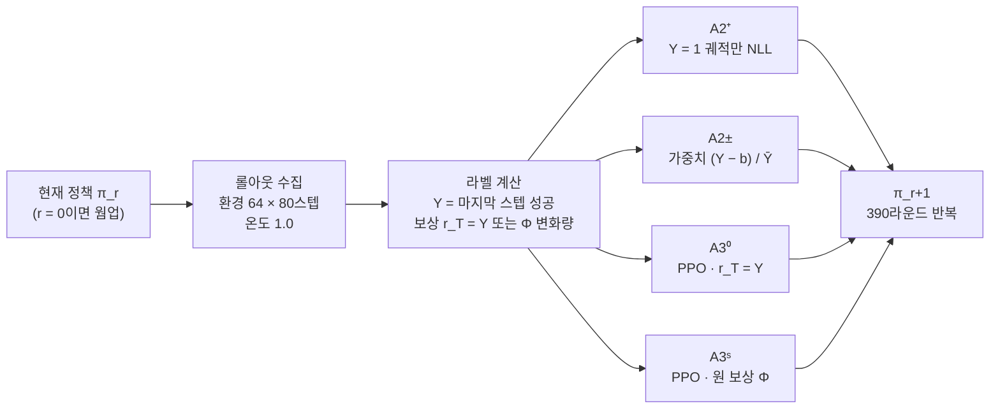

### 3.4 비교마다 고정되는 것과 바뀌는 것

| 비교 | 같은 것 | 다른 것 | 주장할 수 있는 것 | 주장하면 안 되는 것 |
|---|---|---|---|---|
| **A2⁺ 대 A3⁰ (주 비교)** | 출발점, 상호작용 예산, 갱신 주기, 보상 정보(마지막 스텝 Y만, C5) | 실패 궤적 사용, critic(공유 경로 포함), GAE 시점별 가중, 클리핑, 라운드당 스텝 수, 갱신 규칙 | 같은 최종 성공 정보에서 성공 중심 학습과 PPO의 실용적 차이 | 차이가 '실패 신호' 하나 때문이다 |
| A2⁺ 대 A2± | 위 항목 + 수집 규칙, 기대 기울기 방향 | 기준선 차감 (실패 궤적에 음의 가중치), 라운드당 optimizer 스텝 수 (성공 수에 비례 대 32) | 부호 있는 결과 업데이트와 그에 따른 업데이트 구성의 효과 | 실패 정보가 새 학습 방향을 줬다. 차이가 분산 효과뿐이다 |
| A2± 대 A3⁰ | 보상 정보, 음의 업데이트의 존재 | critic(공유 backbone으로 들어가는 value 손실 포함), GAE, 클리핑 | critic·시간적 advantage·PPO 구성의 추가 효과 | 특정 구성 요소 하나의 효과 |
| A3⁰ 대 A3ˢ | 출발점, 예산, 갱신 주기, PPO 구조, 튜닝 예산 | 보상 함수 (중간 집기·연속 집기 신호, 중간 성공 도달·이탈 시점, 보상의 시간적 배치, 최적화하는 할인 수익), 그리고 각자 ID 검증으로 선택된 하이퍼파라미터 | 같은 튜닝 예산에서 terminal 보상 PPO와 원 보상 PPO의 성능 차이 | "집기 부분 보상만의 효과", "보상 함수 변경만의 효과" (같은 하이퍼파라미터를 고정한 비교가 아님) |
| A1 대 A2⁺ | 출발점 | 데이터 생성자, 방문 상태, 조건별 구성, 전처리(C3), 오프라인 대 온라인 | 시연 학습을 자기 성공 데이터 학습으로 바꾼 전체 효과 | 순수한 자기 데이터 효과 |
| E2 (3.6절) | 체크포인트, 배치, critic, value 손실 경로, optimizer 상태, 미니배치 순서 | advantage 추정기(결과 상수 기준선 대 GAE) × 음의 항 마스킹 | 각 추정기에서 음의 actor-loss 항 제거의 국소 효과와 두 추정기 사이의 차이 | 모든 실패 정보를 없앤 효과. 차이의 원인이 시간적 credit이다 |

### 3.5 하이퍼파라미터 공정성

같은 학습률을 강제하는 것과 공정한 비교는 다르다. 두 종류의 비교에 다른 원칙을 쓴다.

- **실용 비교 (E1)**: 갈래마다 같은 크기의 튜닝 예산을 준다. 단축 예산(150라운드), 시드 1개로 설정 후보를 돌리고, **ID 검증 성공률**(학습 조건, 평가와 겹치지 않는 초기 상태 집합)로 고른다. OOD 결과는 보지 않는다.
  - A2⁺·A2±: 학습률 {1e-4, 3e-4} × 라운드당 반복 {1, 2}, 각 4개 후보.
  - A3⁰·A3ˢ: LoRA 학습률 {5e-5, 1e-4} × value head 학습률 {1e-3, 3e-3}, 각 4개 후보 (원 설정 1e-4·3e-3 포함).
  - 선택 규칙: 150라운드 시점 ID 검증 성공률이 가장 높은 설정. 2%p 안에서 같으면 학습률이 작은 쪽.
  - 한계: 후보 수는 같지만 PPO 후보는 원 저자가 이미 튜닝한 설정 주변이라 출발점이 유리하다. 또 단축 예산 튜닝은 초반에 빨리 오르는 설정에 유리하므로, A2⁺가 초반에 빨리 오르는 경향이 있다면 그쪽에 유리할 수 있다 (R26).
- **메커니즘 비교 (E2)**: optimizer, 학습률, 갱신 규칙을 모두 고정한다. 변형마다 따로 튜닝하지 않는다.

### 3.6 E2 동일 배치 분기 실험 (RQ2)

같은 체크포인트와 같은 롤아웃 배치를 복제한 뒤, 다음 2×2 업데이트 규칙을 적용한다. 모든 칸에 PPO 클리핑(0.2)과 같은 손실 계수(정책 7, value 1, C9)를 쓴다.

| | 음의 항 유지 | 음의 advantage 마스킹 (공통 정규화 후 max(Â, 0)) |
|---|---|---|
| **결과 advantage** Ã^O (배치 표준화 이진 결과, 궤적 전체에 같은 값) | **O±** = Ã^O | **O⁺** = max(Ã^O, 0) (1.4절 (5)에 따라 성공 중심 업데이트에 비례. 클리핑이 작동하지 않는 범위에서) |
| **GAE advantage** (Â_t, 상태·시점 의존) | **C±** (= A3⁰의 원래 업데이트) | **C⁺** |

**E2가 재는 것:** "결과 상수 기준선과 GAE 두 추정기에서 음의 actor-loss 항을 제거했을 때의 효과가 어떻게 다른가". 시간적 credit assignment는 그 차이를 설명하는 후보 메커니즘이지 E2가 고유하게 식별하는 원인이 아니다 (1.4절 (6)).

**결과 advantage의 정의 (식 하나로 확정):** 배치의 궤적 $i$, 시점 $t$에 대해

$$\tilde A^{O}_{it} = \frac{Y_i - \bar Y}{\sqrt{\bar Y(1-\bar Y)} + \epsilon}, \qquad t = 1,\dots,T$$

$$A^{O,\pm}_{it} = \tilde A^{O}_{it}, \qquad A^{O,+}_{it} = \max(\tilde A^{O}_{it}, 0)$$

이것은 E1의 A2± 가중치 $(Y_i - b_{-i})/\bar Y$를 그대로 쓴 것이 아니다. $Y_i - b_{-i} = \frac{N}{N-1}(Y_i - \bar Y)$이므로 두 값은 비례하지만, 배치 표준화를 거치면 크기가 $\sqrt{\bar Y(1-\bar Y)}$ 기준으로 바뀐다. **O행은 "배치 표준화된 이진 결과 advantage"이고, E1의 A2±와 같은 결과 신호를 쓰지만 정규화와 PPO 클리핑 때문에 같은 업데이트 규칙은 아니다.** 기준선 $\bar Y$는 배치 안에서 공통 상수이므로 1.4절 (5)가 그대로 적용된다: $\max(\tilde A^{O},0) = (1-\bar Y)Y/(\sqrt{\bar Y(1-\bar Y)}+\epsilon)$, 즉 성공 궤적에 같은 양의 상수. GAE 행은 GAE를 계산한 뒤 같은 규칙(버퍼 전체 표준화 → 마스킹)을 적용한다.

**전부 성공·전부 실패 배치:** $\tilde A^{O}$는 모두 0이므로 O행의 정책 손실은 0이다. 이때도 **value 손실은 그대로 적용하고 optimizer 스텝을 수행**한다 ("정책 손실이 0"과 "optimizer를 건너뜀"은 다르다). GAE 행은 그런 배치에서도 0이 아닌 advantage를 갖는다. 발생 횟수를 기록한다.

**고정하는 것:** 체크포인트, 롤아웃 배치, critic, value 손실과 그 공유 역전파 경로, PPO 클리핑, optimizer 상태(Adam 모멘트 복사), 미니배치 순서, 학습률. advantage는 버퍼 전체로 먼저 정규화한 뒤 음수를 지운다. 지운 뒤 다시 정규화하면 다른 차이가 섞이기 때문이다.

**분기 지점:** E1의 A3⁰ 학습 시드 8개(계보) 각각의 라운드 20, 150, 300 체크포인트 (사전 고정). 라운드 0은 쓰지 않는다. 그 시점의 value head는 무작위 초기화 상태라 GAE advantage가 잡음이기 때문이다. 각 지점의 학습 조건 성공률과 critic의 설명 분산(explained variance)을 함께 기록한다.

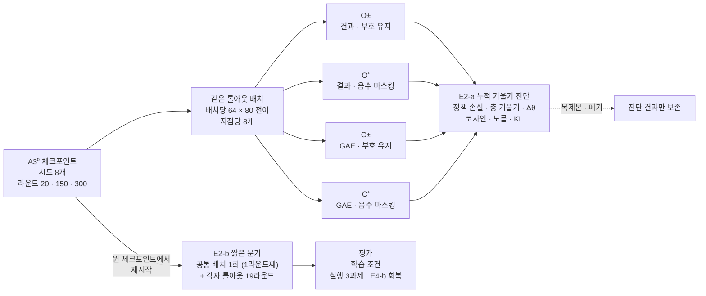

**E2-a 누적 기울기 진단 (완전히 같은 입력)**

- 지점마다 같은 정책으로 배치 8개(64 × 80 전이)를 수집한다. 변형마다 **공통 전체 배치에서 가중치만 바꾼 누적 기울기 하나**를 계산한다 (여러 optimizer 스텝이 아니라). 진단 크기 1·2·4·8마다 **해당 배치들을 합친 뒤 한 번 정규화**해서 누적 기울기를 구한다 (배치별로 따로 정규화해 평균하면 성공률이 다른 배치의 상대 가중치가 달라진다). 배치 1은 아래 E2-b가 쓰는 공통 배치와 같다.
- **E2-a는 복제본에서 수행하고 폐기한다.** 진단용 업데이트는 어떤 변형의 학습 경로에도 들어가지 않는다.
- **세 층위를 따로 잰다.** (i) 정책 손실만의 기울기 (advantage 마스킹이 정책 손실의 방향을 어떻게 바꾸는가), (ii) 정책 + value 손실의 총 기울기 (공유 backbone에서 실제로 역전파되는 방향), (iii) optimizer를 거친 실제 파라미터 변화 Δθ (Adam 모멘트·클리핑·weight decay까지 거친 결과). 총 기울기를 정책 손실만의 이론과 대조하지 않는다.
- 행마다 코사인 cos(g±, g⁺)과 노름 비율 ‖g⁺‖/‖g±‖. **1.4절의 예측은 정책 손실만의 기울기 (i)에 대한 것이다.** 배치 하나에서는 O행에도 기준선 항(−b·Σg)이라는 잡음이 있어 코사인이 1보다 한참 낮을 수 있다. 평균 배치 수를 늘리면 O행의 정책 손실 기울기 코사인은 1에 가까워지고(기대 방향이 같으므로), C행은 1보다 낮은 값에 머물 것으로 예측한다. 그래서 단일 배치 값이 아니라 평균 배치 수에 따른 변화를 본다. 총 기울기 (ii)와 Δθ (iii)는 다르다: 정책 손실 기울기가 g⁺ = c·g±로 비례해도 같은 value 기울기 v를 더한 c·g± + v와 g± + v는 일반적으로 비례하지 않으므로, (ii)·(iii)의 코사인이 1보다 낮다는 것만으로 수식이나 구현이 틀렸다고 판단하지 않는다. (ii)·(iii)는 optimizer와 공유 value 경로의 영향을 보여 주는 진단이다. 기울기 노름이 0에 가까운 경우(전부 성공·실패 배치의 O행 등)의 코사인은 0이나 1을 넣지 않고 **정의 불가**로 기록한다.
- 업데이트 전후 정책 변화: 고정 진단 상태 집합(학습 조건 + 실행 OOD 상태)에서 KL(π_old ‖ π_new). 다른 배치에서 뽑은 성공 행동과 실패 행동의 log-likelihood 변화, 행동 엔트로피 변화.
- **기울기 크기 보정 진단 C⁺ₙ:** 마스킹한 정책 기울기를 원 기울기의 노름으로 다시 키운 것. 원시 기울기의 노름을 맞춰도 Adam을 거친 ‖Δθ‖가 같아지지는 않으므로, "크기 효과를 완전히 제거한 대조"가 아니라 보정 진단으로만 부른다.

**E2-b 짧은 분기 (국소 알고리즘 비교)**

- E2-b는 **원 분기 체크포인트와 optimizer 상태에서 다시 시작**해, 사전 지정한 공통 배치(해당 계보가 그 라운드에 실제로 수집한 배치) 하나에 각 업데이트 규칙을 적용한다. 이 첫 업데이트가 20라운드의 **1라운드째**다. 그 뒤 각 변형이 **자기 정책으로 롤아웃을 수집하며** 19라운드 더 학습한다. 이때부터 변형끼리 데이터가 달라진다. 두 정책 모두에게 on-policy인 같은 롤아웃은 첫 업데이트에서만 가능하기 때문이다. 그래서 E2-a(같은 데이터, 누적 기울기 비교)와 E2-b(각자 on-policy, 짧은 알고리즘 비교)를 나눈다.
- **분기 코드의 검사:** 공통 배치가 계보의 실제 라운드 배치이므로, C±의 첫 업데이트 결과는 그 계보의 실제 다음 체크포인트와 수치 오차 안에서 같아야 한다. 같지 않으면 다른 변형과의 차이를 해석하기 전에 분기 코드부터 점검한다 (P4·G2).
- 독립 단위는 계보(A3⁰ 학습 시드)다. 계보 8개 × 분기 지점 3개 × 변형 4개이고, 분기 시드는 계보마다 1개다. 변형들이 같은 계보에서 갈라지므로 변형 간 상관이 크고, 대비의 분산은 원 성공률의 분산으로 추정할 수 없다 (4.5절 G-mid 규칙).
- 평가: 학습 조건, 실행 3과제, E4-b 공통 상태 회복 (에피소드 수는 사전 고정, E1보다 적음).

**E2의 판정량 (실행 축 성공률, 계보 단위 짝지은 t):**

- **직접 대비** $D_C = C^{\pm} - C^{+}$ (보조 확증 ⑥). GAE 행에서 음의 항을 지우면 실행 성능이 낮아지는가.
- **상호작용** $I = (C^{\pm} - C^{+}) - (O^{\pm} - O^{+})$ (보조 확증 ⑦). 그 효과가 결과 상수 기준선 행과 얼마나 다른가.
- 둘은 다른 질문이다. 예를 들어 C± 80, C⁺ 82, O± 70, O⁺ 80이면 I = 8%p > 0이지만 GAE 행에서는 음의 항을 지운 쪽이 더 높다. 반대로 두 행 모두에서 음의 항이 +10%p 유익하면 I = 0이다.
- 계보마다 세 분기 지점의 값을 평균해 계보 수준 값 8개를 만든다. 분기 지점별 값과 $D_O = O^{\pm} - O^{+}$는 기술 보고한다.

**조건부 장기 갈래 A3⁰₊ (E2 확장):** E2-b에서 계보 평균 |D_C|가 실행 축에서 5%p 이상(사전 고정 임계값)이면, 음수 마스킹 PPO를 390라운드 전체로 시드 5개 학습한다. 예산은 미리 확보하고, 조건이 안 되면 쓰지 않는다.

**해석 한계:** critic은 여전히 실패 데이터로 학습하고, value 손실은 공유 LoRA로 역전파된다 (네 칸에 같게 둠). E2가 지우는 것은 **정책 손실의 음의 actor-loss 항**이지 모든 실패 정보가 아니다. E2의 O±는 E1의 A2±와 같은 결과 신호(Y)를 쓰지만 배치 표준화와 클리핑이 달라서 같은 갈래로 보지 않는다.

### 3.7 E3 웜업 조건 실험

- **W1**: 공개 웜업 체크포인트 (병합 전체 모델, Octo 70 + 모션 플래너 70 시연). E1의 기본 조건.
- **W2**: 모든 갈래가 공유하는 강화 웜업. 병합된 W1에서 출발해 같은 전처리의 모션 플래너 시연을 추가로 지도학습한 뒤 병합한다. 시연 수는 P3에서, 학습 조건의 **수집 온도(1.0) 성공률이 사전 목표(제안 40~50%)에** 닿는 최소 수로 정한다. OOD는 보지 않는다. W2는 웜업 수준이어야 하므로 SFT-16k보다 훨씬 적어야 한다.
- **갈래**: A2⁺와 A3⁰, 학습 시드 각 5개. 분석량은 상호작용 대비 Δ_rep(W2) − Δ_rep(W1)이다 (H4, 보조 확증 ⑧). W1과 W2에서 비열등 판정이 각각 다르게 나왔다는 사실만으로 조건 의존을 말하지 않는다.
- **E3가 보여 주는 것:** "서로 다른 두 웜업 조건에서 성공 중심 학습의 대체 가능성이 달라지는가". W1과 W2는 성공 데이터 공급량뿐 아니라 데이터 생성자 비중(Octo 대 모션 플래너), 초기 행동 분포, 초기 회복 능력도 다르다. 그래서 "초기 성공률이 X%를 넘으면 충분하다"나 "공급량 하나가 원인이다"는 주장하지 않는다. 초기 수집 성공률은 설명 변수 중 하나로 기록하고, 결론은 두 조건에 한정한다.
- **주 조건 전환 규칙 (사전 고정, P3 측정 기준):** 조건 분류와 시행 수를 먼저 고정한다. 1,024 에피소드를 물체 16종 × 테이블 16종 × 4회의 완전 교차 배치로 수집해 **물체별 64회, 테이블별 64회**가 되게 한다 (조합별 4회는 판정에 쓰지 않는다). 다음 중 하나면 E1의 주 조건을 W2로 바꾸고 W1을 E3 조건으로 내린다.
  - 전체 수집 성공률의 90% 구간 **상한**이 5% 미만.
  - 물체 기준 성공률의 90% 구간 상한이 8% 미만인 물체가 8종 이상 (테이블 기준도 같은 규칙). 64회에서 성공 0회의 상한은 약 4.6%, 1회는 약 7.2%, 2회는 약 9.5%이므로, 이 기준은 "64회 중 성공 1회 이하"에 해당한다.
  - 관측 성공 0을 곧바로 "성공 불가"로 읽지 않는다. 모든 조건의 실제 성공률이 15%라도 4회씩이면 절반 이상이 0으로 관측된다 ((1 − 0.15)⁴ ≈ 52%).
- P3를 본실험과 다른 렌더러(WSL 저하 모드의 CPU 렌더러 등)에서 쟀다면 그 값은 잠정치다. G2에서 본실험 기기로 W1의 수집 성공률을 다시 재고, 전환 규칙은 그 값으로 적용한다.
- **하지 않는 것:** A2⁺에만 시연을 더 주거나, 성공이 나올 때까지 A2⁺의 환경 예산만 늘리는 것. 그러면 주 비교 자체가 바뀐다. 성공 데이터가 적은 조건에서 A2⁺가 불리한 것은 인위적 편향이 아니라 성공 중심 학습의 실제 적용 한계일 수 있다.

### 3.8 평가

**성공률 (주 평가)**

- 원 논문의 평가 조건 16개 (1.2절 표의 14개 + 학습 분포 변형 2개).
- 공개 코드는 렌더링 1회에 환경 64개를 한 번 초기화한다. 그래서 체크포인트마다 **조건당 평가 시드 3 × 64 에피소드 = 192 에피소드**를 쓴다. 성공은 마지막 스텝에서 판정한다.
- 온도 0.6 샘플링 (C4). 축 집계는 시각 5, 의미 5, 실행 3개 조건의 평균.
- **ID 대비 하락**: 갈래·시드마다 drop_axis = SR_ID − SR_axis를 구하고, 갈래 간 차이를 보고한다.

**E4 회복 평가**

원 논문의 설명은 "학습 중 겪은 상태가 회복 능력을 만들었다"는 것이다. 최종 정책의 엔트로피만으로는 이 경로를 확인할 수 없다. 엔드이펙터가 여기저기 헤매기만 해도 방문 엔트로피는 높아진다. 그래서 지표보다 먼저 "**어떤 상태에서 다시 성공할 수 있게 되었는가**"를 직접 잰다. 다만 E4는 교란에 대한 반응을 재는 것이지, "학습 중 커버리지가 늘어서 회복 능력이 생겼다"는 학습 경로의 인과 증명이 아니다.

"같은 과제 단계"는 "같은 상태"가 아니다. 정책마다 그 단계에 도달하는 비율이 다르고(약한 정책은 쉬운 초기 상태만 남는다), 같은 집기 단계라도 물체 자세·잡은 위치·그리퍼 방향·관절 상태가 다르며, 80스텝 제한 안에서 남은 회복 시간도 다르다. 그래서 두 평가로 나눈다.

| 평가 | 시작점 | 남은 시간 | 해석 | 미도달 처리 |
|---|---|---|---|---|
| **E4-a 배포형 교란 평가** | 각 정책이 자기 행동으로 단계에 도달한 상태 | 원래 80스텝의 나머지 | 실제 실행 중 교란에 대한 종합 강건성 (교란 전 수행 능력 + 상태 차이 + 회복 능력이 섞임) | 단계 도달률을 함께 보고. 도달 조건부 성공률은 "조건부"로 표기하고, 무조건부(도달 × 회복)도 보고 |
| **E4-b 공통 상태 회복 평가** | 사전에 고정한 동일 물리 상태 집합 S_rec (M_rec개) | 복원한 원래 경과 스텝은 과제 상태 재현용으로 보존하고, 평가 종료는 복원 뒤 별도의 회복 카운터로 모든 정책에 같은 H스텝 (제안 40) | 같은 교란 상태에서의 회복 능력 비교. **메커니즘 근거는 이쪽** | 해당 없음 (모든 정책이 같은 상태에서 시작) |

| 교란 | 시점 (E4-a: 과제 단계 / E4-b: 고정 상태) | 무엇을 바꾸는가 |
|---|---|---|
| R-a 집기 실패 유도 | 처음 집기가 감지된 직후 | 그리퍼를 열고 물체를 테이블 위 고정 오프셋 위치로 되돌림 → 다시 집는 능력 |
| R-b 운반 중 자세 교란 | 집은 뒤 고정 스텝 수가 지난 시점 | 엔드이펙터에 사전 정의한 유효 범위의 위치·회전 오프셋 |
| R-c 접시 이동 | 집은 직후 | 접시를 고정 오프셋만큼 이동 (기존 '도중 물체 이동'과 다른 대상) |
| 대조 | — | 같은 시작 상태, 교란 없음 |

- **S_rec 만들기:** 기준 정책(W1 웜업, 온도 0.6)을 학습 조건 초기 상태에서 굴려 각 단계에 도달한 시점의 **전체 시뮬레이터·과제 상태**(로봇 관절 위치·속도, 물체·접시 pose와 속도, 그리퍼 상태, 제어기 목표값, **에피소드 경과 스텝, 과제 판정용 래치·카운터(집기, 연속 집기), 난수 상태, 장면·자산 식별 정보**)를 저장하고, 교란을 적용한 상태를 S_rec로 고정한다. 모든 체크포인트에 같은 S_rec를 쓴다. 기준 정책이 W1이므로 S_rec는 W1이 도달할 수 있는 상태에 치우친다. 이것은 한계로 기록한다.
- **상태 복원의 검증 (P4):** 저장 → 복원 → 같은 행동 재생 시 관측과 접촉 상태가 일치하는지 확인한다. pose만 복원하면 속도·제어기 상태가 달라 같은 상태가 아니다.
- **시간 복원과 회복 시간 부여의 분리 (E4-b):** 복원 상태에는 원래 경과 스텝이 들어가므로, 원 환경의 80스텝 제한을 그대로 두면 70스텝 시점에서 복원한 평가는 10스텝 뒤에 끝난다. 그래서 과제 판정에 쓰이는 경과 시간은 보존하되, E4-b의 종료는 복원 이후 별도 카운터로 H스텝을 센다. 과제 내부 판정에 경과 시간이 쓰이는지는 P4의 상태 복원 시험에서 확인한다.
- 지표: 회복률 = 교란 조건의 성공률, 회복 손실 = 대조 성공률 − 교란 성공률. E4-b의 A2⁺ − A3⁰이 보조 확증 ⑨다 (E1에서 독립적으로 학습한 두 집단의 비교, 4.5절).
- 교란 종류 자체는 새로운 것이 아니다 (OGPO의 LIBERO-ReAct 등). 이 연구에서 E4의 역할은 E1·E2 결과의 진단이고, 차별성은 공통 상태·동일 남은 스텝 조건에 있다.
- ManiSkill 상태를 직접 조작·복원하는 환경 코드가 필요하다 (R18, 부록 D).

**행동 분포 진단 (2.2절의 측정 대상별)**

| 측정 대상 | 자료 | 규칙 |
|---|---|---|
| 학습 중 상태 방문 범위 | 온라인 갈래의 학습 롤아웃, A1은 시연 데이터 | 엔드이펙터 위치·방향 격자의 방문 엔트로피. 격자는 파일럿 자료를 보기 전에 고정 |
| 전체 행동 분포 | 진단 롤아웃: 고정 초기 상태 M개 × 온도 1.0 샘플 N회 | 행동 토큰 엔트로피, 궤적 간 거리 |
| 성공 조건부 다양성 | 같은 진단 롤아웃의 성공 궤적 | 같은 초기 상태끼리만 비교. 성공이 m_min(제안 5)개 미만인 초기 상태는 **"추정 불가"** (0으로 두지 않음). 추정 가능한 초기 상태 수를 함께 보고 |
| 조건별 성공 공급 | 온라인 갈래의 학습 롤아웃 | 물체·테이블·초기 위치별 성공 수. A2⁺의 학습 데이터가 쉬운 조건에 몰리는지 확인 |
| Pass@K, Coverage@K | 진단 롤아웃 | 보조 보고. Coverage@K는 기존 성공 행동에 대한 접근이지 새 능력의 증거가 아님 |

### 3.9 보조 실험(E5)과 제외한 것

| 실험 | 내용 | 위치 |
|---|---|---|
| A4 증류 SFT | A3⁰ 최종 정책의 성공 롤아웃을 오프라인 SFT | 보조, 우선순위 낮음. 주장은 "PPO로 얻은 행동을 성공 궤적 지도학습으로 일부 이전할 수 있다"까지. 비용에 교사(A3⁰) 학습비가 포함됨 |
| A2⁺ᴷ⁵ | v0.4의 K=5 라운드 누적 방식 | 실용적 BC 변형, 민감도 |
| 전처리 민감도 | A2⁺에 C3의 작은 행동 필터 적용 | 민감도 |
| ~~A5 오프라인 대조~~ | 시연 + 외부 실패 궤적의 선호·대조 손실 | **제외**. '실패 신호' 주장 검증에는 E2가 더 직접적 |
| 회복 데이터 통제 개입 | 성공 데이터 중 회복 행동의 비율을 조작하고 양·조건·길이를 맞춘 BC | 계획하지 않음. PLD가 회복 데이터 생성을 다뤘으므로, 한다면 단순 추가가 아니라 통제된 개입이어야 함 |

### 3.10 2단계: 외부 검증 (예산 사전 확보)

- **한 번에 하나만 바꾼다.** (가) 같은 ManiSkill 과제에서 모델만 바꾸거나 (예: flow 계열 π0. DRIVE가 ManiSkill3에서 π0·π0.5를 RL로 미세조정한 전례가 있다), (나) 같은 모델 계열에서 벤치마크만 바꾼다 (예: LIBERO-Plus·PRO. 학습·평가 분할을 먼저 확인하고, OOD 데이터가 학습·튜닝에 들어가지 않게 한다).
- **반복할 갈래**: 결론을 좌우하는 A2⁺와 A3⁰, 그리고 E2의 C± 대 C⁺ (분기 지점 1개). 모든 갈래를 반복하지 않는다.
- **예산은 1단계 착수 전에 확보하고, 1단계 결과의 방향과 상관없이 실행한다.** 유리한 결과가 나왔을 때만 2단계를 하면 선택 편향이 생긴다.
- flow 계열에서는 성공 중심 학습이 성공 궤적의 flow-matching 손실이 되고, PPO는 우도 근사가 필요하다 (πRL). 1.4절의 관계가 그대로 옮겨지지 않으므로 주장 범위를 그에 맞게 조정한다.
- 원 논문 arXiv v4(2026-01-14) 부록에는 B.4 sim-to-real 예비 평가(Franka Panda), B.5 행동 청크 비교, B.6 관절 물체 열기 확장이 **있다** (2026-10-15 목차·본문 확인. 이전 두 차례의 확인 실패는 이쪽 조회 오류였다, 부록 E-3 #12). 그래서 "다른 모델·과제를 추가한다"는 것만으로는 원 논문을 넘어서지 못한다.

### 3.11 데이터와 공개 자원

| 필요한 것 | 확보 방법 | 비고 |
|---|---|---|
| 사전학습 VLA | 공개 (OpenVLA-7B) | Llama 2 라이선스 (R16) |
| 웜업 W1 | 공개 체크포인트 `gen-robot/openvla-7b-rlvla-warmup` | 병합 전체 모델, adapter 없음 (C2). config의 궤적 수 표기(146)와 코드(140)가 다름 (3.2절) |
| 웜업 W2 시연 | 공개 스크립트로 생성 | 모션 플래너, 수는 P3에서 결정 |
| A1 시연 16k | 공개 스크립트로 생성 | 모션 플래너로 16,400개 생성 (학습 16,384 + 검증 16). 사람 원격조작 불필요 |
| 온라인 갈래 학습 데이터 | 학습 중 직접 생성 | 매 라운드 저장 (C6) |
| A4 데이터 (보조) | A3⁰ 정책 롤아웃 | |
| OOD 평가 | 공개 (16개 조건) | 원 논문과 같은 조건 |
| 회복 평가 환경과 공통 상태 집합 S_rec | 신규 작성 | 공개 예정 |
| 외부 검증 | 공개 (ManiSkill3 또는 LIBERO-Plus·PRO) | 3.10절 |

실물 로봇과 사람 시연이 필요 없다. 모든 데이터를 스크립트로 다시 만들 수 있으므로 재현 패키지를 공개할 수 있다.

---

## 4. 분석 계획

### 4.1 분석 단위와 집계

- **분석 단위는 학습 시드다.** 갈래 a, 시드 s의 축 성공률 $Y_{a,s}$는 해당 축 조건들의 성공률 평균이다 (조건마다 192 에피소드).
- 평가 잡음 크기: 성공률 75% 근처에서 조건 하나의 표준오차는 약 3.1%p, 실행 축(3개 조건) 평균의 표준오차는 약 1.8%p다.
- 평가 에피소드를 늘리면 **이 학습 결과 하나의 평가 오차**가 줄어든다. **다시 학습했을 때 정책이 얼마나 달라지는가**는 학습 시드를 반복해야만 알 수 있다. 부트스트랩 10,000회는 새 학습 10,000회가 아니다.

### 4.2 주지표: Δ_replacement와 비열등성

$$\Delta_{\text{rep}}^{\text{exec}} = \overline{SR}^{\,\text{exec}}_{A2^+} - \overline{SR}^{\,\text{exec}}_{A3^0}$$

- 가설: $H_0: \Delta \le -\delta$ 대 $H_1: \Delta > -\delta$.
- 판정: 시드 단위 값으로 구한 Welch t 기반 **90% 양측 구간**(각 방향 단측 5%).
  - 하한 > −δ → **비열등**.
  - 상한 < −δ → **PPO가 δ 넘게 우세**.
  - 하한 > 0 → A2⁺가 우세.
  - 구간이 −δ를 가로지름 → **부정확** (4.8절 시나리오 E).
- **δ 정하는 절차**: δ는 "성공 중심 학습으로 바꿔서 얻는 이득을 생각할 때 감수할 수 있는 성능 손실"이다. 관행적인 숫자를 넣지 않는다. G2에서 A2⁺와 A3⁰의 1회 학습 GPU 시간, 피크 메모리, 구현·튜닝 부담을 실측하고, 그 근거와 함께 E1 착수 전에 δ를 고정한다. **후보값은 5%p**다 (원 논문 실행 축 격차 38.5%p의 약 13%). δ를 바꾸면 필요한 시드 수가 바뀐다 (4.5절).

### 4.3 확증·보조·기술·탐색의 구분

| 등급 | 분석 | 오류 통제 |
|---|---|---|
| **확증 (1개)** | 실행 축 Δ_rep 비열등성 (A2⁺ 대 A3⁰, 주 웜업 조건) | 단측 α = 0.05 |
| **보조 확증 (사전 지정, 세 묶음)** | 묶음 A (RQ1 축): ① 의미 축 Δ_rep ② 시각 축 Δ_rep / 묶음 B (RQ2): ⑥ E2 직접 대비 D_C = C± − C⁺ (실행) ⑦ E2 상호작용 I (실행) / 묶음 C (조건): ⑧ E3 상호작용 대비 Δ_rep(W2) − Δ_rep(W1) ⑨ E4-b 회복률 A2⁺ − A3⁰ | 묶음 안에서 Holm 보정 (각 2개). 묶음별 통제이지 전체 통제가 아님 (아래). 정밀도가 부족하면 미판정 (4.5절) |
| **기술 보고 (사전 지정 대비)** | ③ A2± − A2⁺ (실행, TOST) ④ A3⁰ − A2± (실행) ⑤ A3ˢ − A3⁰ (실행, 같은 튜닝 예산의 terminal 대 원 보상). 시드 3개 갈래가 들어가므로 구간만 보고 | 구간만 제시 |
| **기술 보고 (기타)** | 절대 성공률(모든 갈래·축), A3⁰ − A1·A2⁺ − A1 (실행), 실측 비용(GPU 시간·피크 메모리·구현 요소), ID 대비 하락, R, C_c, 학습 곡선, 조건별 성공 공급, 0-성공 라운드 수, 라운드당 optimizer 스텝 수, E2의 D_O와 분기 지점별 값, E4-a 전체 | 구간만 제시 |
| **탐색** | 행동 분포 지표와 성공률의 관계, 실패 사례 정성 분석, 조건별 결과 | "탐색"으로 표기 |

**보조 확증의 판정과 오류 통제의 범위:** 보조 분석은 연구 질문별로 사전 지정한 검정군(묶음) 안에서 오류를 통제한다. **연구 전체의 모든 보조 주장에 대한 통합 5% 오류 통제를 뜻하지 않는다.** 세 묶음이 각각 5%로 통제되고 서로 독립이라는 가상 조건에서 세 묶음 중 하나 이상에서 오류가 날 확률은 1 − 0.95³ ≈ 14.3%다 (실제로는 검정 간 상관이 있어 그대로 적용되지 않는다). 그래서 전체 보조 결과를 하나의 "확증된 발견 목록"으로 제시하지 않고, 묶음별로 보고한다. v0.7에서 묶음을 나눈 것은 같은 오류 통제를 유지한 채 문턱을 낮춘 것이 아니라 **어떤 주장들을 함께 통제할지를 바꾼 것**이다. 묶음 안에서 p값에 Holm 보정을 적용한다. 단위는 학습 시드(E1·E3·E4) 또는 계보(E2, 짝지은 t)다. "유의"는 Holm 보정 후 유의하고 점추정의 부호가 가설 방향인 경우다. **유의하지 않음은 효과가 없다는 증거가 아니다.** 반박은 구간이 가설 영역을 완전히 벗어날 때만이고, 그 밖은 미판정이다. 유의한 결과와 유의하지 않은 결과의 차이를 곧바로 효과 차이로 읽지 않는다. 9개를 한 묶음으로 보정하면 첫 문턱이 0.05/9라 계보 8개(자유도 7)에서 임계 t ≈ 3.95가 되고, 계보별 D_C의 표준편차가 5%p라면 약 7.0%p 차이가 있어야 넘는다. 세 묶음으로 나누면 첫 문턱이 0.025, 임계 t ≈ 2.84, 같은 가정에서 약 5.0%p다. **이 값은 유의성 문턱에 대응하는 관측 차이이지 최소 탐지 차이(MDE)가 아니다.** 실제 효과가 5%p일 때 그 문턱을 넘을 검정력은 약 53%이고, 검정력 80%를 주는 효과는 약 6.7%p다 (4.5절). 묶음은 연구 질문 단위로 사전 지정한 것이고, 결과를 본 뒤 바꾸지 않는다.

**결론의 범위 (시나리오 A):** 비열등 결과가 지지하는 것은 "이 웜업·환경·예산에서 성공 중심 학습이 terminal PPO의 실행 OOD 성공률을 사전 설정한 δ 안에서 재현했다"이다. 세 질문을 분리해서 보고한다. (i) 재현했는가 — Δ_rep와 δ. (ii) 두 정책의 절대 성능은 어느 정도인가 — 실제 성공률과 구간. (iii) 대체할 실용적 이점이 있는가 — GPU 시간·피크 메모리·필요 시연·구현 요소의 실측. "충분하다"는 응용의 요구 수준이 있어야 쓸 수 있는 말이고 이 문서에는 그 수준이 없으므로, 주장은 "대체 가능성 재현"까지다. v0.6의 "A3⁰ − A1 ≥ 10%p" 적용 조건은 지웠다. 그 조건은 세 방법이 모두 90% 안팎으로 잘 작동하는 유용한 결과를 "비교 무의미"로 버리고, 모두 낮은 수준(예: 2%·15%·14%)인 결과는 통과시키는 규칙이었다. A1 대비 이득은 기술 보고로 남긴다.

### 4.4 R과 C_c (보조 기술)

$$R_{\text{axis}} = \frac{\overline{SR}_{A2^+} - \overline{SR}_{A1}}{\overline{SR}_{A3^0} - \overline{SR}_{A1}}$$

- R은 **성능 격차 회복 비율**이지 원인 기여율이 아니다. A2⁺와 A3⁰의 차이가 실패 신호 하나가 아니기 때문이다 (1.3절). 그래서 R = 0.8을 "RL 이득의 80%는 자기 데이터 때문"이라고 읽지 않는다. 올바른 표현은 "이 설정과 예산에서 성공 중심 학습이 PPO–SFT 성능 격차의 80%를 재현했다"이다.
- 분모(A3⁰ − A1)의 90% 구간 하한이 0보다 클 때만 R을 계산한다. 점추정이 10%p를 넘어도 구간이 0 근처를 포함하면 R은 불안정하기 때문이다.
- 비율을 나누지 않는 대안으로 임계값 c에 대해

$$C_c = (\overline{SR}_{A2^+} - \overline{SR}_{A1}) - c\,(\overline{SR}_{A3^0} - \overline{SR}_{A1})$$

를 c = 0.3, 0.7에서 구간과 함께 보고한다. $C_{0.7}$의 하한이 0보다 크면 "격차의 70% 이상 재현"이다.

### 4.5 학습 시드 수와 검정력

**적은 시드의 한계 예시:** 시드 단위 짝지은 부호반전 검정의 최소 양측 p값은 3쌍에서 2/2³ = 0.25, 5쌍에서 2/2⁵ = 0.0625, 8쌍에서 2/2⁸ ≈ 0.008이다. 모든 검정법이 이렇다는 뜻은 아니지만, 적은 시드에서는 검정이 어떤 가정에 기대는지 분명히 해야 한다.

**검정력 시뮬레이션 (이 문서에서 계산, 2만 회 반복):** 실제 차이 0, 비열등성 한계 δ, Welch 단측 검정 α = 0.05. 시드 단위 표준편차는 학습 시드 표준편차 σ와 평가 잡음 1.8%p(성공률 75% 가정. 50%면 약 2.1%p)를 제곱합으로 더해 구성했다: √(σ² + 1.8²). 1종 오류율은 모든 조건에서 0.044~0.05로 확인했다.

| 학습 시드 표준편차 σ (%p) | n=3 | n=5 | n=8 | n=10 | n=12 | n=16 |
|---|---|---|---|---|---|---|
| δ = 5%p, σ = 3 | 0.37 | 0.64 | **0.85** | 0.92 | 0.96 | 0.99 |
| δ = 5%p, σ = 4 | 0.27 | 0.48 | 0.70 | **0.79** | **0.85** | 0.93 |
| δ = 5%p, σ = 5 | 0.20 | 0.37 | 0.55 | 0.64 | 0.72 | 0.83 |
| δ = 5%p, σ = 6 | 0.17 | 0.29 | 0.45 | 0.52 | 0.60 | 0.71 |
| δ = 8%p, σ = 4 | 0.52 | 0.82 | 0.96 | 0.99 | 1.00 | 1.00 |
| δ = 8%p, σ = 6 | 0.31 | 0.56 | 0.78 | 0.86 | 0.92 | 0.97 |

실제 차이가 −2%p라면(A2⁺가 조금 낮음) 검정력은 크게 떨어진다. δ = 5%p, σ = 4에서 n = 8일 때 0.36, n = 12일 때 0.49다.

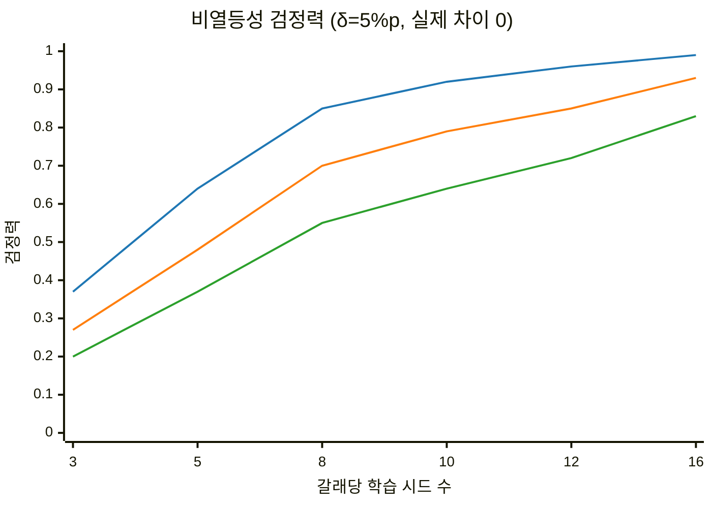

선 색: 파랑 σ = 3%p, 주황 σ = 4%p, 초록 σ = 5%p (σ는 학습 시드 표준편차). 검정력 0.8을 넘기려면 σ = 3에서 8개, σ = 4에서 10~12개가 필요하다.

**결정:**

- 학습 시드 표준편차 σ는 아직 모른다. 원 논문의 표준편차는 평가 반복의 분산일 가능성이 있고 (1.2절), 다른 모델의 시드 분산(What Makes an Efficient VLA?)이나 원문을 확인하지 못한 평가 분산 연구(Same Scene, Different Answer)도 빌려 쓰지 않는다.
- 핵심 갈래(A2⁺·A3⁰)에 **시드 8개**를 처음부터 배정한다. 각 갈래에서 시드 4개가 끝나면 **맹검 분산 재추정**을 한다. 갈래 이름을 가린 채 합친 분산으로 필요한 n을 다시 계산하고, n을 8~12 범위에서 확정한다. 이 규칙은 E1 착수 전에 고정한다.
- E3의 A2⁺·A3⁰는 시드 5개. 나머지 갈래(A1·A2±·A3ˢ)는 시드 3개로 시작한다. 확대 여부는 **결과 비의존 규칙**으로만 정한다: 핵심 갈래(E1 A2⁺·A3⁰, E2-b, E3)가 끝난 시점의 잔여 GPU 예산이 사전에 정한 양 이상이면 사전 순서(A1 → A3ˢ → A2±)로 5개까지 늘린다. 성능 차이나 p값을 보고 늘리지 않으며, 늘린 뒤의 분석도 기술 보고다.
- **최소 탐지 차이(MDE)의 정의:** MDE는 선택한 검정과 다중비교 절차 아래에서 **검정력 80%를** 달성하는 효과 크기다. 임계 t값에 표준오차를 곱한 값은 "유의성 문턱에 대응하는 관측 차이"로 따로 표시하고 MDE라고 부르지 않는다. 아래는 대비 표준편차 5%p를 가정한 계산 예이고, 실제 값은 G-mid의 분산 추정으로 갱신한다.

| 분석 | 단위와 구조 | 표준오차 (SD 5%p 가정) | 문턱 대응 관측 차이 (α 0.025) | MDE (검정력 80%) |
|---|---|---|---|---|
| E2 D_C, I | 같은 A3⁰ 계보에서 분기한 결과의 **짝지은 대비**, 계보 8개 (자유도 7) | 5/√8 ≈ 1.77%p | 약 5.0%p | 약 6.7%p |
| E3 웜업 상호작용 | W1·W2 각각의 A2⁺ − A3⁰를 다시 빼는 **네 평균의 선형 대비**. 표본 W2 5·5, W1 8·8, 네 집단 독립 가정 | √(25/5 + 25/5 + 25/8 + 25/8) ≈ 4.03%p (Welch 자유도 ≈ 17) | 약 9.9%p | 약 13.4%p |
| E4-b A2⁺ − A3⁰ | E1에서 **독립적으로 학습한** 두 집단의 비교, 8 대 8. 같은 시드 번호는 짝지음이 아니다 (같은 S_rec로 평가하므로 평가 잡음만 상관) | √(25/8 + 25/8) ≈ 2.5%p | 약 6.3%p | 약 8.5%p |

- E3는 "계보 8개의 짝지은 대비"가 아니다. 같은 가정에서 E3의 정밀도는 E2의 절반 이하이고, 13%p 미만의 조건 의존 효과는 미판정으로 남을 가능성이 크다. 이것은 E3를 빼거나 갈래를 더할 이유가 아니라, E3 결론이 추정값과 구간 중심이 될 것을 미리 적어 두는 것이다. E3 시드 확대는 5.1절의 결과 비의존 규칙으로만 한다. 웜업과 갈래 사이에 짝지은 설계를 쓰려면 어떤 공분산 구조를 가정하는지 G-PRE에서 명시해야 하며, 같은 시드 번호를 붙였다는 사실만으로 공분산 구조가 정해지지 않는다.
- **G-mid에서 하는 것 (단순화):** 확증·기술 분석의 구분은 **G-PRE에서 고정**하고 G-mid에서 바꾸지 않는다. G-mid에서는 (i) 주 비교의 사전 규칙에 따른 n 조정 (8~12), (ii) 핵심 갈래 시드 4개 계보의 E2-b·E3(완료분)·E4-b를 먼저 돌려 **대비값의 분산만** 맹검 스크립트로 추정하고 (평균·부호는 출력하지 않는다), 위 표의 정밀도 전망(표준오차·MDE)을 실제 분산으로 갱신한다. 필요한 정밀도를 확보하지 못한 분석은 결과 단계에서 **미판정**으로 보고한다. v0.7의 "MDE가 상한을 넘으면 확증에서 기술 보고로 내린다"는 강등 규칙은 지웠다. 사전에 정한 가설과 분석법을 그대로 적용했는데 구간이 넓다면 그것은 정밀도가 부족한 사전 지정 분석이지 지위를 바꿀 일이 아니고, 표본 수 재추정·검정군 구분·중간 정밀도 평가·등급 변경을 함께 쓰면 절차의 설명과 검증이 복잡해지기 때문이다.
- **분석 함수의 분리 (G-PRE):** E2는 계보별 D_C·I를 만든 뒤 짝지은 분석, E3는 네 평균의 선형 대비와 실제 표본 수·공분산 구조, E4-b는 두 집단의 독립 비교(Welch)로 각각 구현하고, 합성 자료로 각 함수의 1종 오류율을 점검한다.
- **절차 전체의 시뮬레이션 (G-PRE에서 수행):** 위 표는 RQ1 주 비교의 고정 n 검정력이다. "시드 4 + 4 중간 자료 → 맹검 합동 분산 → n 선택 규칙(합동 SD → n 대응표, 8~12) → 추가 수집 → 최종 Welch 검정" 전체를 σ ∈ {3, 4, 5, 6}에서 시뮬레이션해, 1종 오류율은 **비열등성 경계 Δ = −δ**에서, 검정력은 Δ = 0에서 확인한다. Δ = 0의 A/A 시뮬레이션은 비열등성에서는 대립가설에 속하므로 오류율 검증이 아니다. 갈래 이름을 가렸다는 사실만으로 오류율이 보장되지는 않는다. 대응표는 이 시뮬레이션 결과로 확정하고 E1 전에 고정한다.
- σ가 6%p 이상으로 나오면 δ = 5%p에서는 12개로도 검정력이 0.6에 그친다. 이때는 δ를 다시 정하지 않고 (결과를 본 뒤 기준을 바꾸는 것이 되므로), 정밀도 한계를 보고한다 (시나리오 E).

### 4.6 불확실성 계산 방법

- **주 방법:** 시드 단위 값에 Welch t 구간.
- **민감도:** 시드 라벨 순열 검정 (8 + 8개면 12,870가지 분할)과 계층적 부트스트랩(시드 → 에피소드). 순열 검정은 비열등성에 맞게 고친다: A2⁺ 값을 δ만큼 이동시켜 경계 가설 Δ = −δ 아래에서 라벨을 섞고, 분산 차이를 고려해 Welch t 통계량(studentized)을 쓴다. 원자료의 라벨을 그대로 섞는 검정은 비열등성 검정이 아니다. 분산이 다르면 교환 가능성이 깨지므로 이 결과는 민감도로만 보고한다.
- **부트스트랩은 판정에 쓰지 않는다.** 군집(시드) 수가 적으면 부트스트랩 구간이 좁게 나오는 경향이 있다. v0.4의 "반대쪽 꼬리 비율의 2배" p값 계산은 폐기한다. 부트스트랩을 보고하기 전에 합성 데이터로 실제 1종 오류율을 점검하되, 비열등성 검정의 오류율은 Δ = −δ 경계에서 점검한다.
- Holm 보정은 잘못 보정된 개별 검정을 고쳐 주지 않는다. 그래서 개별 검정의 보정 상태를 먼저 점검한다.

### 4.7 체크포인트와 결과 보고 규칙

- **주 분석은 고정 예산(390라운드)의 마지막 체크포인트**다.
- ID 성능이 비슷한 체크포인트끼리의 비교는 보조 진단으로만 쓴다. 이때 체크포인트는 ID 검증 성공률로만 고르고, OOD 결과로 고르지 않는다. 고정 예산의 전체 효과와 성능을 맞춘 진단은 서로 다른 질문이다.
- 모든 시드 값을 표와 점 그림으로 낱낱이 싣는다.
- 사전 고정에서 벗어난 모든 변경은 날짜·사유와 함께 이탈 기록에 남긴다.

### 4.8 결과 시나리오와 논문화

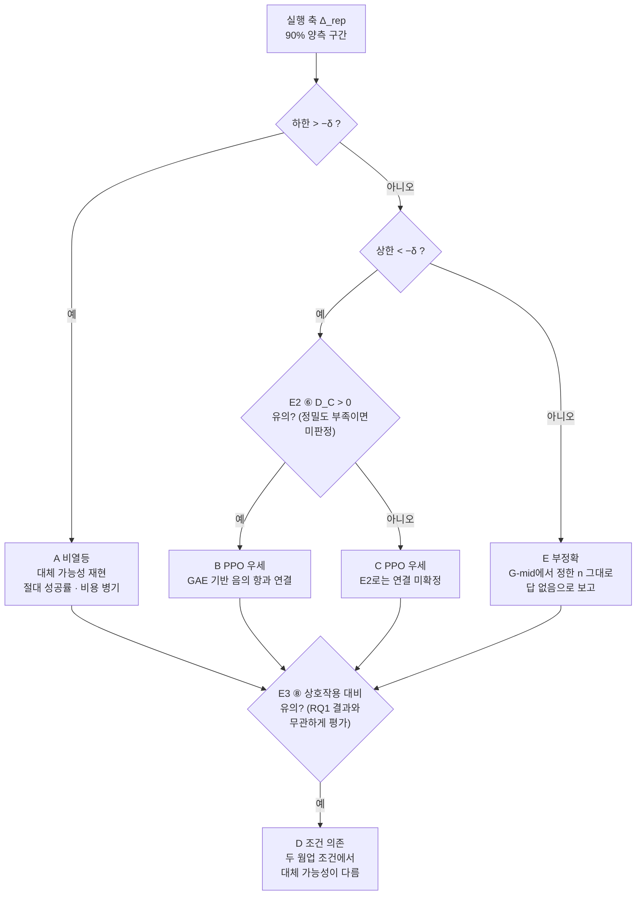

| 시나리오 | 결과 패턴 | 결론 |
|---|---|---|
| A 비열등 | Δ_rep 하한 > −δ | 이 웜업·환경·예산에서 성공 중심 온라인 학습이 terminal PPO의 실행 OOD 성공률을 δ 안에서 재현했다. 두 방법의 절대 성공률, A1 대비 이득, 실측 비용을 함께 제시한다. "충분하다"는 쓰지 않는다 (4.3절). E2는 그래도 음의 항이 무엇을 바꾸는지 보여 준다 |
| B PPO 우세 + 직접 대비 | 상한 < −δ, ⑥ D_C > 0 유의 | GAE 기반 음의 actor-loss 항이 실행 강건성 차이의 일부와 연결된다. ⑦ I의 결과로 추정기 의존성을 덧붙인다. 메커니즘은 후보로 제시 |
| C PPO 우세, E2 미확정 | 상한 < −δ, ⑥ 유의하지 않음 (정밀도 부족이면 미판정) | PPO의 우세는 확인됐으나, 이 E2로는 그 차이가 음의 actor-loss 항과 어떻게 연결되는지 확정하지 못했다. 다른 PPO 구성(critic 기준선의 분산 감소, 클리핑, 스텝 수)도 대안 설명으로 남는다. "음의 항이 원인이 아니다"라고 쓰지 않는다 |
| D 조건 의존 | ⑧ Δ_rep(W2) − Δ_rep(W1) 유의 (네 평균 대비의 정밀도가 낮아 미판정 가능성이 큼) | 두 웜업 조건에서 대체 가능성이 다르다. 결론은 두 조건에 한정한다 |
| E 부정확 | 구간이 −δ를 가로지름 | 시드 수는 G-mid에서 맹검으로 정한 n에서 끝낸다. 결과를 보고 시드를 늘리지 않는다 (1종 오류가 커지므로). "이 예산으로는 답할 수 없다"고 보고하고, 발견으로 포장하지 않는다 |

**논문화 원칙**

- **"정밀하게 재 보니 차이가 실용적으로 작다"는 유용한 결과다.** 동등성·비열등성 결과로 쓸 수 있다. **"실험이 부족해서 차이가 있는지 모른다"는 연구 질문에 답하지 못한 상태다.** v0.4의 "미판정이면 SCI 저널" 경로는 이 둘을 구분하지 않았으므로 지운다.
- 투고처는 결과의 방향이 아니라 네 가지로 정한다: 신규성(2.3절 문단이 유지되는가), 식별 수준(E2의 직접 대비와 상호작용이 깨끗하게 나왔는가, E4-b가 있는가), 추정 정밀도(구간 폭), 외부 검증(3.10절).
- SCIE 저널(IEEE RA-L, TNNLS, Neural Networks, JMLR)을 우선한다. 네 가지가 모두 강하면 최상위 학회(CoRL, NeurIPS, ICLR)를 먼저 노린다. JMLR·TMLR 게재 후 Journal-to-Conference 트랙으로 발표하는 경로도 있다 (부록 B).
- 2027년 5월 이전 완료 가능성은 지금 판단할 수 없다. 실제 학습·평가 처리량, 갈래 수, 필요한 시드 수가 G2와 G-mid에서 확정된 뒤 판단한다.

---
## 5. 로드맵과 게이트

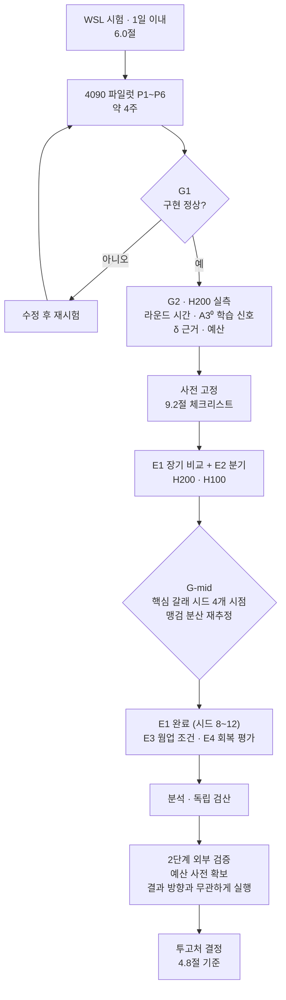

### 5.1 게이트 기준

1차 외부 검토가 제안한 우선순위(① 주장 수정 → ② 비교 단위 확정 → ③ 짧은 구현 검증 → ④ 웜업·분산 측정 → ⑤ 본실험 사전 고정 → ⑥ 외부 핵심 대조)를 게이트에 대응시켰다. ①·②는 v0.5·v0.6 문서로 처리했다. 2차 검토의 필수 수정 1~5(terminal 보상, 샘플링·log-prob 일치, E2 주장 범위, E4 구분, 통계 문구)도 이 문서로 처리했고, "실행 전" 항목 2개(초기화 자원, 절차 전체 시뮬레이션과 자원 계산)는 G1·G-PRE에 들어 있다.

| 게이트 | 시점 | 통과 기준 | 실패 시 |
|---|---|---|---|
| G0 신규성 | 상시 (주 1회) | 2.3절 문단을 유지할 수 있음 (같은 예산의 PPO 대 성공 중심 비교, 또는 VLA의 음수 advantage 마스킹 실험을 한 논문이 없음) | 문단 갱신, 겹치면 범위 재설정 |
| G1 구현 | 파일럿 종료 (우선순위 3·4) | 6.5절 판정표: 데이터 정합성, 정상 기울기, NaN·OOM 없음, 짧은 학습의 정상 동작 | 수정 후 재시험 |
| G2 처리량·신호 | 본실험 전 | H200 실측 라운드 시간과 렌더링 속도, terminal PPO A3⁰ 단기 학습(50라운드 이내)에서 학습 신호(critic 설명 분산 상승, 성공률 또는 수익의 상승 추세) 확인, W1 수집 성공률 재측정, 총 GPU 시간이 예산 안 | **A3⁰에 학습 신호가 없어도 자동으로 A3ˢ로 바꾸지 않는다.** 순서: (1) 구현 점검 — terminal 보상·절단 마스크·critic 학습·log-prob 스케일·성공 공급(C5·C7·C9, P4 항목 재실행). (2) A3⁰에 신호가 없다는 사실 자체를 W2 재시험의 조건으로 삼아(3.7절의 수집 성공률 규칙과 독립), 공통 조건 W2에서 A3⁰를 다시 시험한다. 신호가 있으면 E1의 주 조건을 W2로 바꾸고 이탈 기록에 남긴다. (3) 그래도 없으면 **연구 범위를 명시적으로 바꾼다**: 주 비교를 A2⁺ 대 A3ˢ로 하고 "성공 라벨만 쓰는 방법 대 부분 보상을 추가로 쓰는 PPO"로 질문을 다시 쓰며, E2·E3의 출발점도 A3ˢ로 바꾸고, 이탈 기록에 범위 변경으로 남긴다. A3ˢ는 어느 경우에도 실용 기준선으로 유지. 예산 초과면 5.1절 아래의 축소 순서 |
| G-PRE 사전 고정 | E1 착수 전 (우선순위 5) | 9.2절 체크리스트 완료, 맹검 재추정 절차 전체의 시뮬레이션(4.5절) 완료, 타임스탬프 기록 | 착수 보류 |
| G-mid 분산 재추정 | 핵심 갈래 시드 4개 완료 | 맹검 분산으로 필요한 n 계산, E2·E3·E4-b 대비 분산의 맹검 추정으로 정밀도 전망(표준오차·MDE) 갱신. 분석 등급은 바꾸지 않음 | n을 8~12에서 확정 |
| G3 외부 검증 착수 | E1 완료 (우선순위 6) | 결과 방향과 무관하게 착수 | — |
| G4 투고 전 | 원고 완성 | 독립 재계산으로 모든 수치 일치 | 수정 후 재검산 |

**예산 축소 순서 (사전 고정):** 보호 대상은 A2⁺·A3⁰ 주 비교(시드 8), E2의 핵심 개입(E2-a와 E2-b의 직접 대비), E3의 최소 W1/W2 비교(A2⁺·A3⁰ 각 최소 3), 2단계 외부 핵심 대조다. 제목의 "언제"에 답하는 것이 E3이므로 E3를 먼저 줄이지 않는다. 줄이는 순서: (1) E5 보조(A4 증류, K=5 변형, 전처리 민감도) → (2) A3⁰₊ 조건부 장기 갈래 → (3) A2±·A1·A3ˢ의 반복 수(3 → 유지, 확대 취소) → (4) E2 분기 지점 수(3 → 2) → (5) E3 시드(5 → 3). A2±는 E2-a의 O행 대조와 역할이 겹치므로 시드 3개로 시작하고, 확대는 4.5절의 결과 비의존 규칙(잔여 예산 + 사전 순서 A1 → A3ˢ → A2±)으로만 한다. E2-a의 결과(효과 방향)는 확대 여부에 쓰지 않는다.

**G1 전 H200 사용 규칙 (사전 고정):** 본실험 규모(390라운드 학습)는 G1 통과 전에 쓰지 않는다. 다만 단위 시험(P4의 전체 규모 손실·기울기 확인), 렌더링·처리량 확인, G2 실측(A3⁰·A2⁺ 각 50라운드 이내)은 **합계 60 GPU시간(제안)** 안에서 허용한다. 4090에서 OOM으로 막히는 P5도 이 상한 안에서 H200으로 옮길 수 있다. 상한을 넘기려면 이탈 기록에 사유를 남긴다.

### 5.2 제안 일정 (추정)

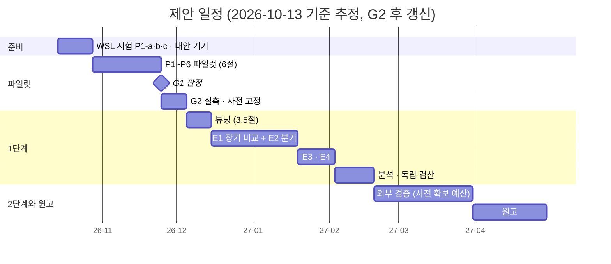

모든 기간은 추정이다. 7.3절의 기본 합계(PPO 약 44회 환산)에 원 논문의 A100 42시간을 곱하면 약 1,850 GPU시간이고, 6장을 쉬지 않고 쓰면 2주 남짓이다. 일정표의 튜닝부터 E4까지 약 60일은 이 값의 약 4배를 잡은 것이다. H100·H200의 렌더링 속도를 모르고(R12), 공용 장비의 가동률과 재실행 여유를 고려했다. G2 실측 후 다시 계산한다. 환경 준비 2주는 WSL 시험(P1-a·b·c)이 실패해 대안 기기를 구하는 경우를 포함한 값이다. 학회 마감일은 공고가 나오면 반영한다.

---

## 6. 4090 파일럿 검증

### 6.0 실행 환경: Windows 4090 + WSL2 (착수 전 시험 필요)

4090 워크스테이션은 Windows이고, 실행은 WSL2(Ubuntu 22.04)로 한다. 문제는 ManiSkill이 WSL에서 GPU 시뮬레이션과 렌더링을 **공식 지원하지 않는다**는 점이다. 그래서 파일럿 맨 앞에 "WSL에서 어디까지 되는가"를 판정하는 시험을 두고, 결과에 따라 경로를 나눈다. 2026-10-13 현재 실험은 이 시험 전까지 보류 상태다.

**ManiSkill 공식 지원 범위** ([설치 문서](https://maniskill.readthedocs.io/en/latest/user_guide/getting_started/installation.html)):

| 환경 | CPU 시뮬레이션 | GPU 시뮬레이션 | 렌더링 |
|---|---|---|---|
| Linux + NVIDIA | 지원 | 지원 | 지원 |
| Windows + NVIDIA | 지원 | 미지원 | 지원 |
| **WSL** | 지원 | **미지원** | **미지원** |

**WSL이 문제가 되는 이유**

- **렌더링:** 카메라 렌더링에는 Vulkan이 필요하다. WSL2의 NVIDIA 드라이버는 CUDA만 제공하고 Vulkan 드라이버는 없다. Vulkan은 Mesa의 Dozen(D3D12 변환) 드라이버로만 쓸 수 있는데, 지원 확장이 매우 적다는 사용자 보고가 있다 ([NVIDIA 포럼](https://forums.developer.nvidia.com/t/enabling-nvidia-support-for-vulkan-on-ubuntu-22-04-through-wsl2/244176)). Ubuntu 기본 Mesa에 Dozen 파일이 빠져 있다는 보고도 있다 ([Khronos 포럼](https://community.khronos.org/t/vulkan-fails-to-detect-nvidia-gpu-on-wsl2-ubuntu-24-04-dzn-driver-files-missing-tested-on-multiple-systems/112045)). ManiSkill의 렌더러(SAPIEN)는 NVIDIA Vulkan 드라이버를 전제로 한다.
- **GPU 시뮬레이션:** ManiSkill 공식 표에서 WSL은 미지원이다. RL4VLA의 평가·롤아웃은 병렬 환경 수가 1보다 커서 GPU 시뮬레이션을 쓴다.
- **CUDA 자체는 WSL2에서 정상 동작한다.** 따라서 렌더링이 필요 없는 학습과 분석은 문제가 없을 것으로 예상한다.

**작업별 WSL2 가능 여부**

| 작업 | 필요 요소 | WSL2 (4090) | 비고 |
|---|---|---|---|
| 시연 SFT 학습 (A1), 저장 배치 단위 시험 (P4) | CUDA | 가능 (예상) | 렌더링 불필요 |
| RLDS 변환, 통계 분석 | CPU | 가능 | |
| 평가 · 롤아웃 수집 (P2, P3, P5) | GPU 시뮬레이션 + 렌더링 | **공식 미지원** | P1 시험 대상 |
| 모션 플래너 시연 생성 (A1용 16k, W2용) | 렌더링 | **공식 미지원** | 한 번 생성하면 재사용 가능 |
| 온라인 갈래 본실험 (A2⁺·A2±·A3⁰·A3ˢ) | 학습 + 매 라운드 시뮬레이션·렌더링 | 공식 미지원 (PPO는 24GB도 부족) | H200·H100 (7.1절) |

**WSL 시험 (P1 앞부분, 1일로 제한)**

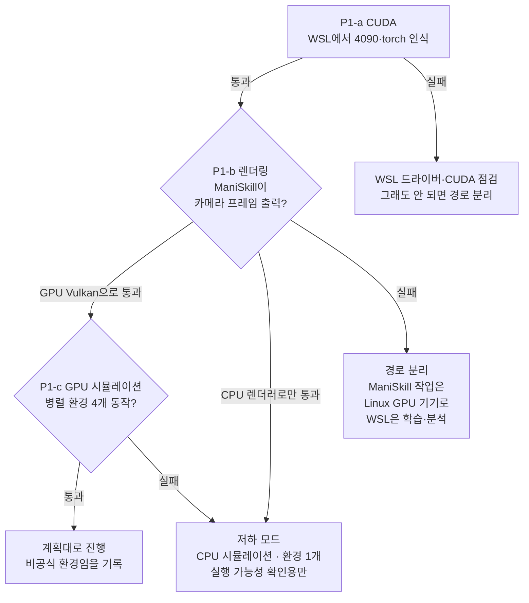

시험 명령 예시 (WSL2 Ubuntu 안에서. 실제로 쓴 명령과 출력은 그대로 기록한다):

```bash
# P1-a CUDA
nvidia-smi
python -c "import torch; print(torch.cuda.is_available(), torch.cuda.get_device_name(0))"

# P1-b 렌더링: Vulkan 장치가 NVIDIA(Dozen 경유)인지 llvmpipe(CPU)인지 확인
sudo apt-get install -y vulkan-tools
vulkaninfo --summary
python -c "import gymnasium as gym, mani_skill.envs; e = gym.make('PickCube-v1', obs_mode='rgb', num_envs=1, sim_backend='cpu'); e.reset(); print('render ok')"

# P1-c GPU 시뮬레이션
python -c "import gymnasium as gym, mani_skill.envs; e = gym.make('PickCube-v1', obs_mode='rgb', num_envs=4, sim_backend='gpu'); e.reset(); print('gpu sim ok')"
```

**판정과 경로**

| 시험 결과 | 경로 | 주의 |
|---|---|---|
| P1-a·b·c 모두 통과 (GPU Vulkan) | 6.1절 이후 절차 그대로 | 비공식 환경임을 기록. 렌더러가 원 논문(Linux NVIDIA Vulkan)과 달라 같은 장면도 픽셀이 다를 수 있다. P2 재현 대조로 그 영향을 함께 점검한다 |
| 렌더링은 CPU 렌더러로만 되거나, GPU 시뮬레이션 실패 | 저하 모드: CPU 시뮬레이션, 병렬 환경 1개 | 매우 느리고, 렌더링 조건이 원 논문과 다르다. 결과는 실행 가능성 확인용으로만 쓰고 논문 근거로 쓰지 않는다 |
| 렌더링 실패 | 경로 분리: 평가·롤아웃·시연 생성은 Linux 네이티브 GPU 기기(사업단 서버 또는 RTX급 클라우드 대여), WSL은 학습·분석만 | 기기 사이에 데이터·체크포인트를 옮기는 절차가 필요하다 (D: 폴더 공유 또는 업로드) |

- **시험 시간은 1일로 제한한다.** 하루 안에 판정이 나지 않으면 "렌더링 실패"로 보고 경로 분리로 간다. 환경 문제에 시간을 무한정 쓰지 않기 위해서다.
- **또 다른 대안: Windows 네이티브 Python.** ManiSkill 공식 지원 범위(CPU 시뮬레이션 + 렌더링)이고 NVIDIA Vulkan 드라이버를 그대로 쓰므로, WSL 저하 모드보다 렌더링은 안정적이다. 다만 RL4VLA 코드(flash-attn, 병렬 환경 전제)를 고쳐야 하고, GPU 시뮬레이션이 없어 느리다.

**작업 방식:** Claude Code 데스크톱 앱 세션은 4090 PC에서 직접 실행된다. 2026-10-13에 이 세션에서 RTX 4090 24GB(드라이버 591.86)와 실행 중인 WSL2 Ubuntu를 확인했다. 따라서 WSL 시험(P1-a·b·c)과 짧은 명령은 연구자의 승인을 받아 Claude가 직접 실행하고 기록할 수 있다. 수 시간 이상 걸리는 학습·평가는 연구자가 실행하고, 결과 로그를 `D:\VLA_ReinforceLearning`(WSL 경로 `/mnt/d/VLA_ReinforceLearning`)에 두면 Claude가 읽고 분석한다. 실행 스크립트 일체도 이 폴더에 미리 준비할 수 있다.

> v0.8 추가: 렌더링이 필요 없는 시험(P4의 수식·저장 배치·log-prob 시험, 분석 함수 점검)은 WSL 시험과 **병행**한다. WSL 시험을 기다릴 이유가 없다.

> v0.5 추가: WSL 시험 결과는 **파일럿을 어디서 할지**만 정한다. 본실험의 온라인 갈래는 모두 매 라운드 시뮬레이션·렌더링이 필요하므로, 본실험 경로는 WSL과 별개로 Linux 기기(H200·H100 또는 그래픽 지원 서버 GPU)로 확정한다 (7.1절). 연구 전체의 착수를 WSL 성공에 묶지 않는다.

### 6.1 목적과 원칙

- 목적은 **가설 검증이 아니라 구현 정상 동작의 확인과 본실험 설계에 필요한 측정**이다. 측정 대상은 성공 데이터 공급, 평가 분산, 처리량이다.
- A2⁺의 성능이 웜업보다 오르는지는 판정 기준이 아니다. 그것은 연구 결과다. 개선이 없으면 먼저 버그를 점검하되, 버그가 없다는 이유로 그 결과를 배제하지 않는다.
- 파일럿 결과는 논문 근거로 쓰지 않는다. 이 원칙을 파일럿 시작 전에 기록한다.
- 환경: RTX 4090 24GB, RAM 64GB, 단일 GPU, **Windows + WSL2 Ubuntu 22.04**. ManiSkill 공식 미지원 환경이므로, 6.0절 시험 결과에 따라 ManiSkill이 필요한 단계(P2·P3·P5의 수집)를 어디서 할지 정해진다.

### 6.2 흐름

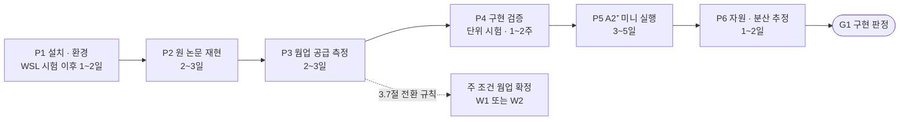

### 6.3 단계별 상세

#### P1 설치·환경 (1~2일. WSL 시험 P1-a·b·c는 5.2절의 준비 기간에 포함)

- **전제**: 6.0절 WSL 시험(P1-a·b·c)의 판정. 렌더링이나 GPU 시뮬레이션이 안 되면, ManiSkill이 필요한 단계는 6.0절에서 정한 기기에서 한다.
- **절차**
  1. `gen-robot/RL4VLA`를 클론하고 커밋 해시를 기록한다 (문서 작성 시 확인한 커밋: `de46e01`). README대로 `rlvla_env`(Python 3.10, PyTorch 2.2.0 + CUDA 12.1, flash-attn 2.7.4)를 설치한다.
  2. `vulkaninfo`로 Vulkan 인식을 확인한다.
  3. 평가 조건 16개의 환경을 각각 생성하고 렌더링해서 자산 로드를 확인한다.
  4. 생성 설정에서 실제 `top_k`, 온도 값을 출력해 기록한다 (C4).
  5. 웜업 데이터 수집용 Octo 환경(JAX)은 설치하지 않는다. W1 웜업 체크포인트가 공개되어 있다.
- **기록**: 드라이버·CUDA·패키지 버전, 커밋 해시, 과제별 로드 성공 여부, 렌더링 FPS (병렬 환경 수별), 디스크 사용량.
- **통과 기준**: 16개 조건이 모두 생성·렌더링된다.

#### P2 원 논문 재현 (2~3일)

- **절차**: 공개 체크포인트 3종(웜업, SFT-16k, RL)으로 핵심 과제 4개를 평가 시드 3개로 평가한다. 핵심 과제는 학습 조건, 새 물체, 로봇 초기 자세, 도중 물체 이동이다.
- **명령 예시** (README 기준. 4090에서는 `--buffer_inferbatch`를 줄이며 메모리를 측정한 뒤 고정한다. README는 40GB GPU에서 16을 권장한다):

```bash
conda activate rlvla_env
cd SimplerEnv

# 체크포인트 3종 (하나씩 지정)
ckpt_path="gen-robot/openvla-7b-rlvla-rl";      unnorm_key="bridge_orig"
# ckpt_path="gen-robot/openvla-7b-rlvla-sft_16k"; unnorm_key="sft"
# ckpt_path="gen-robot/openvla-7b-rlvla-warmup";  unnorm_key="bridge_orig"

for seed in 0 1 2; do
  for env_id in "PutOnPlateInScene25Carrot-v1" \
                "PutOnPlateInScene25EEPose-v1" \
                "PutOnPlateInScene25PositionChangeTo-v1"; do
    CUDA_VISIBLE_DEVICES=0 XLA_PYTHON_CLIENT_PREALLOCATE=false \
    python simpler_env/train_ms3_ppo.py \
      --vla_path="${ckpt_path}" --vla_unnorm_key="${unnorm_key}" \
      --vla_load_path="" \
      --env_id="${env_id}" --seed=${seed} \
      --buffer_inferbatch=8 --no_wandb --only_render
  done
done
# 결과 집계: SimplerEnv/scripts 에서 python calc_statistics.py
```

- **코드로 확인한 동작**: `--only_render`는 `Carrot-v1`의 train split(당근 0~15번, 학습 조건)과 test split(16~24번, 새 물체)을 모두 평가한다. 렌더링 1회는 환경 64개 초기화 1번이므로 split당 시드마다 64 에피소드다. 평가는 온도 0.6으로 샘플링한다 (C4). 공개 SFT-16k는 `sft` 정규화 통계를 쓰므로 재현 확인에만 쓴다 (C1).
- **기록**: 과제별 성공률, 에피소드 수, 에피소드당 소요 시간, 피크 GPU 메모리, 사용한 `buffer_inferbatch`. 같은 체크포인트를 두 번 평가해 평가 반복 분산도 기록한다.
- **통과 기준**: 6.4절 재현 목표의 허용 범위 안에 들고, 실행 2과제에서 RL > SFT 방향이 유지된다.
- **실패 시**: 방향이 반대면 중단하고 원인을 조사한다. 크기만 벗어나면 평가 조건(에피소드 수, 렌더러, 배치)을 대조한 뒤 재판정한다. 재판정은 1회까지만 한다.

#### P3 웜업 공급 측정 (2~3일, 신규)

A2⁺에 중요한 것은 평가 성공률이 아니라 **실제 학습 롤아웃을 수집하는 온도(1.0)에서의 성공률**이다. 웜업이 평가(온도 0.6)에서 잘 된다고 해서 수집에서도 성공 데이터가 충분하다고 단정할 수 없다.

- **절차**: W1 웜업으로 학습 과제 분포에서 **고정된 수의 에피소드** 1,024개(16라운드 × 64)를 온도 1.0, top_k = 0으로 수집한다. 초기 조건은 물체 16종 × 테이블 16종 × 4회의 완전 교차 배치로 **물체별 64회, 테이블별 64회**가 되게 한다. 같은 초기 상태로 온도 0.6에서도 한 번 수집해 비교한다. "성공 300개가 나올 때까지"처럼 결과에 따라 멈추는 규칙은 쓰지 않는다.
- **기록할 것**

| 측정 | 필요한 이유 |
|---|---|
| 수집 온도(1.0)의 성공률과 90% 구간 | A2⁺의 라운드당 성공 데이터 공급량 (64 × p̂) 추정, 3.7절 전환 규칙 |
| 성공이 0개인 라운드의 비율 (실측과 이항 계산) | A2⁺가 업데이트하지 못하는 라운드의 빈도 |
| 물체별·테이블별 성공률과 90% 구간 (각 64회) | 성공 필터링에 따른 난도·조건 편향 확인. 관측 0은 "성공 불가"가 아니라 구간으로 해석 |
| 집기만 성공한 실패 궤적 수 | 부분 보상(A3ˢ)이 활용할 수 있는 정보량 |
| 실패한 뒤 회복해 성공한 궤적 수 (집기 해제 후 재집기 등) | A2⁺가 회복 행동을 실제로 배울 수 있는지 |
| 온도 0.6과 1.0, top-k 50과 0의 성공률 차이 | 평가 성공률로 공급량을 추정하면 얼마나 틀리는지, top-k 해제의 영향 |

- **참고 계산**: 성공률이 15%면 1,024 에피소드에서 성공은 기댓값으로 약 154개이고, 약 절반의 확률로 그보다 적다. 조합(물체 × 테이블)별로는 4회뿐이라 실제 성공률이 15%라도 절반 이상의 조합이 0으로 관측된다. 그래서 조합 단위 판정은 하지 않는다.
- **측정 기기**: P3는 본실험과 같은 렌더러에서 재는 것이 원칙이다. WSL 저하 모드(CPU 렌더러)에서 쟀다면 결과는 잠정치이고, G2에서 다시 잰다 (3.7절).
- **결정**: 3.7절 전환 규칙으로 E1의 주 웜업 조건(W1 또는 W2)을 정한다. W2가 필요하면 W2 시연 수도 여기서 정한다.

#### P4 구현 검증 (1~2주, 신규)

같은 입력에서 각 비교가 **의도한 차이만** 만드는지 확인한다. "원 PPO 코드와 같음"과 "수식과 같음"은 다른 시험이다.

| 시험 | 방법 | 통과 기준 |
|---|---|---|
| 행동 정규화 (C1) | 갈래별 학습 설정에서 같은 행동 토큰 → 역정규화 → 실제 실행 명령(그리퍼 포함)을 비교 | 모든 갈래에서 같은 명령 |
| adapter 초기화 (C2) | 병합 W1 + 새 LoRA(같은 초기화 시드)로 갈래별 학습 시작 시점의 logit을 고정 입력 100개에서 비교. 학습 가능 파라미터 목록 비교 | 수치 오차 범위 안에서 같음. 파라미터 목록 동일 |
| 샘플링 분포 (C4) — 결정적 비교 | 고정 관측·지시문·**고정된 앞선 행동 토큰(prefix)에서**, 샘플링 직전의 처리된 확률벡터(logits processor·온도·top-k·top-p 적용 후)와 학습 경로의 256개 토큰 log-softmax를 토큰 7자리 각각에서 직접 비교. 자기회귀이므로 prefix를 고정하지 않으면 뒤 토큰의 조건부 분포가 매번 달라진다 | top_k = 0, top_p = 1.0, 온도 1.0에서 두 벡터가 수치 오차 안에서 일치 |
| 샘플링 분포 (C4) — 왕복 검사 | 실제 뽑힌 토큰의 저장 log-prob와 학습 경로 재계산값 비교 (저장 배치 전체) | 일치 |
| 샘플링 분포 (C4) — 합성 오류 대조 | top-50 바깥에 충분한 질량(예: 0.2)을 둔 합성 logits로 기본 설정과 top_k = 0 설정을 돌려, 시험이 절단을 탐지하는지 확인 | 기본 설정에서 불일치 탐지, top_k = 0에서 일치. (실제 정책에서는 바깥 질량이 작아 빈도 검정으로는 차이가 안 보일 수 있으므로, 실제 정책의 빈도 검정은 보조로만) |
| 샘플링 분포 (C4) — 샘플러 통계 | 고정 prefix에서 샘플링 빈도를 범주 통합(상위 k개 + 나머지) 또는 다항분포 Monte Carlo 기준으로 점검 | 보조. 기각되지 않음을 "동일 증명"으로 읽지 않음. 동일성의 근거는 결정적 비교와 코드 경로 |
| 보상·라벨·종결 (C5) | 저장한 에피소드에 r_T = Y와 원 Φ 변화량을 다시 계산. 무작위 20개 영상을 사람이 보고 Y 라벨 확인. 중간에 성공했다가 잃은 궤적과 마지막에 처음 성공한 궤적을 골라 두 보상의 수익을 비교. 절단 마스크로 V(s_80)가 쓰이지 않는지 확인 | 불일치 0. terminal 보상에서는 같은 Y면 같은 수익 |
| E2 결과 advantage (3.6절) | 저장 배치로 Ã^O를 계산해 (i) 궤적 안에서 상수, (ii) max(Ã^O, 0)가 성공 궤적에 같은 양의 상수, (iii) 전부 성공·실패 배치에서 0이고 value 스텝은 수행됨, (iv) 진단 크기별 합산 후 1회 정규화 | 모두 확인 |
| E2 분기 코드 | 계보의 실제 라운드 배치를 공통 배치로 써서 C± 첫 업데이트를 수행 | 그 계보의 실제 다음 체크포인트와 수치 오차 안에서 일치 |
| 저장 정확성 (C6) | 저장한 관측·행동·상태를 파일에서 다시 읽음 | byte·배열·해시 완전 일치 |
| 시뮬레이터 재현성 (C6·E4-b) | (i) 같은 상태에서 다시 렌더링 → 픽셀 차이, (ii) 상태 복원 뒤 같은 행동 재생 → 상태·관측·접촉·성공 판정의 재현 오차, (iii) 장시간 폐루프 재실행 → 반복 결과의 비결정성 범위 | 각각 허용 오차를 사전에 정하고 측정값을 기록. 완전 일치를 요구하지 않음 (GPU 시뮬레이션의 결정성은 보장되지 않음) |
| value 손실 경로 (C7) | value 손실만으로 역전파했을 때 공유 LoRA의 기울기가 0이 아님을 확인하고 기록 | 결과를 기록하고 모든 PPO 갈래와 E2 네 칸에 같은 처리 적용 |
| log-prob 형상과 손실 스케일 (C9) — 동일성 시험 | 두 계산 경로를 같은 파라미터·입력·advantage·log-prob로 돌린다. **원 코드형 계산**: joint log-prob를 7칸에 복제한 경로. **통제 학습기 계산**: joint log-prob 1개에 정책 계수 7을 적용한 경로. (i) 수식 검증: 통제 학습기의 정책 손실(계수 적용 전)이 원 코드형의 1/7인지, (ii) 동일성: 두 경로의 총 손실, 클리핑 전·후 총 기울기, 같은 optimizer 상태에서의 1회 업데이트 결과가 수치 오차 안에서 같은지, (iii) 통제 학습 검증: 그 계수와 클리핑 설정으로 짧은 학습이 정상 동작하는지 | (i)·(ii) 허용 오차 안, (iii) NaN·발산 없음. (ii)는 "고정 배치에서 같은 총 손실·기울기"이지 "원 논문의 전체 학습 경로 재현"이 아니다 (C2·C4가 다르므로 후자는 주장하지 않음) |
| 공통 학습기 (C8) | 고정 배치 하나로: (i) 마스크를 끈 통제 학습기 계산이 원 코드형 계산과 총 손실·기울기·1회 업데이트에서 같은지 (C9 행), (ii) 정규화 후 마스킹 순서 확인, (iii) O⁺의 정책 손실 기울기가 성공 중심 BC 기울기에 비례 (1.4절 (5)), (iv) A2± 가중치 스케일 확인, (v) 정책 손실만의 기울기와 총 기울기를 분리해 계산 가능, (vi) 노름이 0에 가까운 기울기의 코사인을 "정의 불가"로 기록 | 허용 오차 안 |
| 상태 복원 (E4-b) | 전체 시뮬레이터·과제 상태(관절·물체 pose·속도, 그리퍼, 제어기 목표, 에피소드 경과 스텝, 과제 래치·카운터, 난수 상태, 장면 식별) 저장 → 복원 → 같은 행동 재생. 과제 내부 판정에 경과 시간이 쓰이는지 확인하고, 복원 뒤 별도 회복 카운터 H스텝이 원래 80스텝 제한과 독립으로 작동하는지 확인 | 상태·관측·접촉·성공 판정의 재현 오차가 허용 범위 안. 래치·카운터가 복원 전후 같음. 70스텝 시점 복원에서도 H스텝 평가가 끝까지 진행 |

- 24GB에서는 PPO 전체 규모를 돌릴 수 없다 (공유 critic 구조로 44.4GB 보고). 그래서 공통 학습기 시험은 저장한 배치와 작은 구성(일부 LoRA 층)으로 하고, 전체 규모의 손실·기울기 확인은 G1 전 H200 제한 사용(5.1절 상한) 안에서 한다.

#### P5 A2⁺ 미니 실행 (3~5일)

- **절차**: 병합 W1 + 새 LoRA에서 출발해 A2⁺를 10라운드 돌린다 (수집 온도 1.0, top_k = 0). 메모리에 따라 병렬 환경 수를 줄일 수 있고, 줄였으면 기록한다. 학습 시드 2개.
- **기록**: 라운드별 성공 수, 0-성공 라운드, 라운드당 optimizer 스텝 수, 손실, 기울기 노름, 피크 메모리, 라운드당 시간, 저장 용량.
- **통과 기준**: NaN·OOM 없음, 기울기가 유한하고 기록됨, 학습 데이터에서 손실이 줄어듦, 저장된 데이터 수가 수집 수와 일치. **성공률이 웜업 이상인지는 기준이 아니다.**
- **실패 시**: 배치 1에서도 OOM이면 4비트 양자화(QLoRA)로 간다. 이 경우 원 조건과 달라지므로 파일럿 한정으로 기록한다. 그래도 안 되면 5.1절 상한 안에서 H200으로 옮긴다. "critic이 없으니 24GB에 들어간다"는 것은 가정하지 않는다. activation, 기울기, 롤아웃 버퍼, 추론 배치가 남기 때문이다.

#### P6 자원·분산 추정 (1~2일)

- **절차**: P1~P5 측정치로 본실험 실행 시간을 외삽한다. PPO 1회 시간은 원 논문 수치(A100 1장 약 42시간)를 1차 추정으로 쓰고, G2에서 H200 실측으로 보정한다.
- **산출물**: 7.3절 실행표의 비용 열, 평가 반복 분산(P2), A2⁺ 단기 시드 간 차이(P5, 기술용).

### 6.4 재현 목표 (P2)

허용 범위는 ±max(10%p, 원 논문 표준편차 × 2)다 (제안).

| 과제 | SFT-16k 목표 | 허용 범위 | RL 목표 | 허용 범위 |
|---|---|---|---|---|
| 학습 조건 | 78.1 | 68.1~88.1 | 93.8 | 83.8~100 |
| 새 물체 | 45.3 | 35.3~55.3 | 71.4 | 61.4~81.4 |
| 로봇 초기 자세 | 33.9 | 23.5~44.3 | 79.7 | 66.9~92.5 |
| 도중 물체 이동 | 28.6 | 18.6~38.6 | 74.5 | 64.5~84.5 |

> 주의: 우리 평가는 과제당 192 에피소드이므로 성공률 50% 근처에서 표준오차가 약 3.6%p다. 원 논문의 표준편차가 평가 반복의 분산이라면 위 범위는 넉넉한 편이다.

### 6.5 파일럿 판정표 (G1)

| 항목 | 통과 | 재검토 | 중단 |
|---|---|---|---|
| 환경 | 16개 조건 모두 동작 | 일부 자산 누락 (대체 가능) | 핵심 4과제 중 하나라도 동작 불가 |
| 재현 | 4과제 모두 범위 안, 방향 유지 | 크기만 1~2과제 이탈 | 실행 과제에서 RL ≤ SFT |
| 웜업 공급 측정 | 측정 완료. 3.7절 규칙(전체 성공률 90% 상한 < 5%, 또는 물체·테이블별 90% 상한 < 8%인 수준이 8종 이상이면 W2)으로 주 조건 확정 | 저하 모드에서 측정함 → G2에서 재측정 | (중단 사유 아님) |
| 구현 검증 | P4 시험 모두 통과 | 허용 오차를 넘는 시험 1~2개 (원인 파악 후 재시험) | 원 PPO 업데이트를 재현하지 못함, 또는 top_k = 0에서도 샘플링 분포와 log-prob 분포가 불일치 |
| A2⁺ 미니 실행 | NaN·OOM 없음, 기울기 정상, 데이터 수 일치 | 4비트 등 축소 설정에서만 동작 | 어떤 설정으로도 동작 불가 |
| 자원 | 총 GPU 시간 추정 가능 | 추정에 필요한 측정 일부 누락 | — |

**성능 향상(A2⁺ ≥ 웜업)은 G1의 기준이 아니다.** v0.4는 파일럿이 가설 검증이 아니라고 하면서 이 기준을 넣어 두 원칙이 충돌했다.

### 6.6 파일럿에서 하지 않는 것

- 원 규모 PPO 학습 (원 규모는 H200에서 확인. 축소 구성의 가능 여부는 실측 대상이지 전제가 아님, 7.4절)
- 시연 16k 재생성과 SFT 재학습 (공개 SFT-16k로 재현만 확인)
- Δ_rep, R, 기타 효과 크기 계산
- 하이퍼파라미터 선택 (3.5절 튜닝은 본실험 예산으로)
- 커버리지 지표 확정 분석 (정의 점검만)

---

## 7. 자원·장비 배치

### 7.1 배치 원칙

v0.5에서 바뀐 점: 성공 중심 갈래(A2⁺·A2±)가 PPO처럼 **매 라운드 롤아웃을 수집**하므로, 렌더링 없이 학습만 하는 갈래는 A1(시연 SFT)뿐이다. 따라서 H100·H200에서 ManiSkill 렌더링이 되는지(R12)가 본실험 전체의 전제가 된다. G2에서 반드시 확인한다.

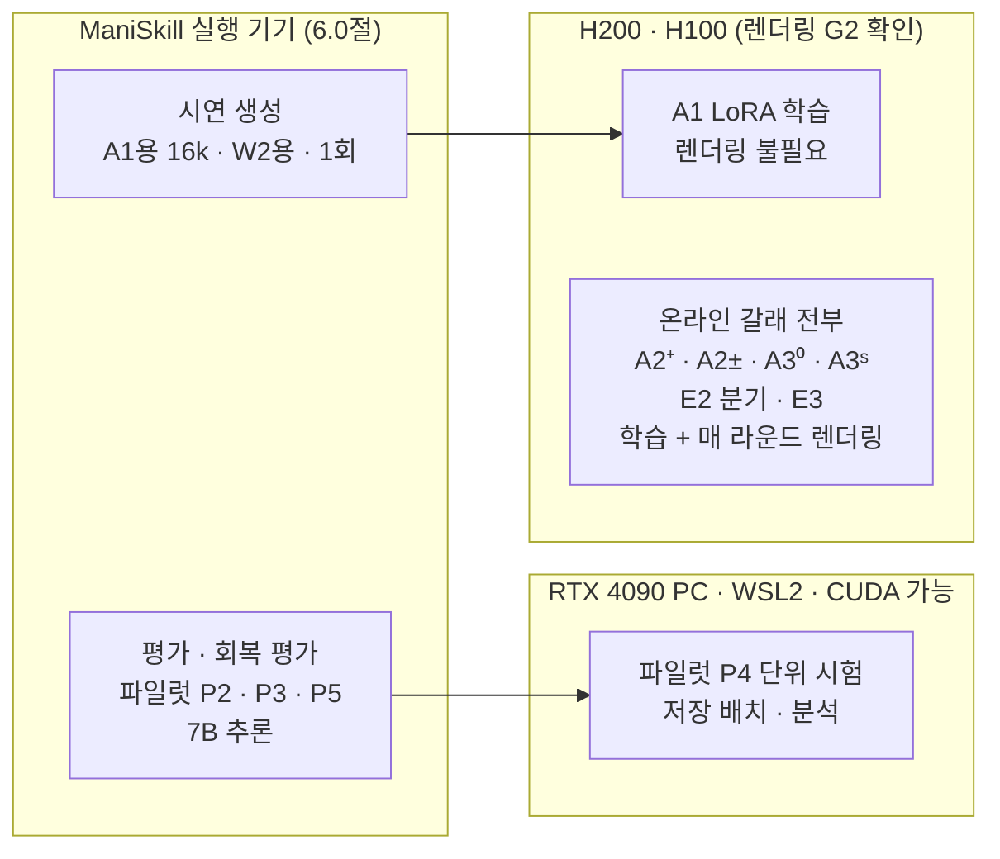

### 7.2 작업별 근거

| 작업 | VLA 모델 | 렌더링 | 권장 장비 | 근거 |
|---|---|---|---|---|
| 모션 플래너 시연 생성 | 불필요 | 필요 | 6.0절 시험에 따라 4090(WSL) 또는 Linux GPU 기기 | 1회 생성 후 재사용 |
| 평가·회복 평가 | 추론 (7B) | 필요 | 6.0절 시험에 따라, 또는 H200·H100 | 체크포인트당 약 3,000 에피소드 + 회복 평가 |
| A1 LoRA 학습 | 학습 | 불필요 | H200·H100 | README 기준 40GB GPU 4장 배치 8, 80GB에서 최대 배치 20 |
| 온라인 갈래 (A2⁺·A2±·A3⁰·A3ˢ) | 학습 + 추론 | 매 라운드 필요 | H200 (G2 실측 후) | README 기준 80GB 1장에 환경·모델 동시. 40GB는 2장으로 분리 |

> H100·H200은 AI 연산용이라 그래픽 처리 하드웨어가 제한적이다. ManiSkill의 기본 래스터화 렌더링은 RT 코어 없이 동작하지만 속도는 실측해야 한다. 원 논문은 RT 코어가 없는 A100 1장으로 PPO를 학습했다. 사업단에 L40S나 RTX 6000 Ada 같은 그래픽 지원 서버 GPU가 있으면 대안이 된다.

### 7.3 실행표 (제안)

PPO 환산은 "원 PPO 1회(390라운드) = 1"로 센 값이다. 성공 중심 갈래는 역전파가 적지만 환경 상호작용 수가 같으므로 보수적으로 1로 센다. 실제 시간·메모리·저장 비용은 측정한다.

| 실험·갈래 | 학습 시드 | 실행 수 | PPO 환산 (추정) | 비고 |
|---|---|---|---|---|
| E1 A1 | 3 (결과 비의존 규칙으로 최대 5) | 3 | 별도 (SFT 60,000스텝, 렌더링 없음) | C1·C2 통일 설정으로 재학습 |
| E1 A2⁺ | 8 (최대 12) | 8 | ≤ 8 | 보호 대상 |
| E1 A2± | 3 (결과 비의존 규칙으로 최대 5) | 3 | ≤ 3 | |
| E1 A3⁰ | 8 (최대 12) | 8 | 8 | 보호 대상, E2 출발점 겸용 |
| E1 A3ˢ | 3 (결과 비의존 규칙으로 최대 5) | 3 | 3 | |
| 튜닝 (3.5절) | 1 | 16개 설정 × 150라운드 | 약 6.2 | 온라인 4갈래 × 후보 4개 |
| E2-a 누적 기울기 진단 | 계보 8 | 8계보 × 3지점 × 배치 8개 수집 + 변형 4 × 기울기 2종(정책 손실·총) + optimizer 적용 Δθ | 약 0.6 | 수집 12,288 에피소드(약 98만 스텝, 학습 1회 롤아웃의 절반) + 기울기 계산. **무시할 수준이 아님** |
| E2-b 분기 | 계보 8 | 8계보 × 3지점 × 4변형 × 20라운드 | 약 4.9 | 보호 대상 (직접 대비) |
| E2 장기 A3⁰₊ (조건부) | 5 | 5 | 5 | 예산 사전 확보 |
| E3 W2 (A2⁺·A3⁰) | 5 + 5 (최소 3 + 3) | 10 | ≤ 10 | 보호 대상. W2 웜업 학습 1회 별도 |
| E5 보조 | 1~3 | 약 6 | ≤ 6 | 예산이 남을 때 |
| 2단계 외부 검증 | 3~5 | 2~3갈래 | 별도 | 1단계 착수 전에 확보 |
| 평가 | — | E1 체크포인트 25개 + 웜업 1개, 각 16조건 × 192 에피소드 (약 8.0만 에피소드) + E4-a·E4-b | P2 측정치로 외삽 | E2·E3 평가 별도 |
| 저장 | — | 7.4절의 계층 설계 기준 1회당 약 15~20GB (실측 전 추정) | — | P1·P5에서 실측 |

- 기본 합계(E1 + 튜닝 + E2-a·b + E3): **PPO 약 44회 환산**. 조건부·보조를 모두 하면 약 55회. 원 논문의 A100 42시간을 그대로 곱하면 A100 약 1,850~2,300시간이지만, H200 처리량과 렌더링 속도를 모르므로 이 숫자로 예산을 잡지 않는다. G2 실측으로 바꾼다.
- 시드가 12개로 늘면 핵심 갈래에서 PPO 8회 환산이 추가된다.

### 7.4 비용 확정 절차와 메모리 주의

1. P6: 4090 측정치로 평가·A2⁺ 라운드·A1 학습 시간을 외삽한다.
2. G2: H200에서 A3⁰를 50라운드 이내로 돌려 라운드 시간, 렌더링 속도, 학습 신호를 확인한다. A2⁺도 같은 길이로 돌려 비용 차이를 잰다 (δ 근거, 4.2절).
3. 총 GPU 시간과 비용표를 만들고, 예산 안이면 착수한다. 넘으면 5.1절 G2의 축소 순서를 따른다.

**메모리:** 원 논문 보고로 PPO의 공유 actor-critic 구조는 44.4GB, 별도 critic 구조는 81.3GB를 썼다 (별도 구조가 83% 더 쓰고 35% 느림). critic은 별도 7B 모델이 아니라 공유 backbone 위의 작은 value head다. 그러므로 value head를 빼도 24GB에 들어간다는 보장이 없다. A2⁺가 PPO보다 싸고 4090에서 돌아갈 가능성은 있지만, **실측 사항**이다. 반대로 44.4GB는 원 규모(환경 64, 추론 배치 포함) 기준이므로, 축소 구성의 PPO가 24GB에서 불가능하다고 일반화하지도 않는다. 방침은 "원 규모는 H200에서 검증, 4090은 작은 구성의 시험"이고, 불가능성을 입증하려고 추가 실험하지 않는다.

**궤적 저장 (C6의 계층 설계):** 640×480 RGB를 uint8로 그대로 저장하면 프레임당 921,600바이트이고, 한 온라인 학습(1,996,800스텝)을 전부 보존하면 약 1.84TB, E1의 온라인 학습 22회면 압축 전 약 40TB다. 전량 원시 저장은 하지 않고 목적별로 나눈다.

| 계층 | 내용 | 범위 | 1회당 추정 |
|---|---|---|---|
| 1 학습·재현용 저차원 기록 | 시뮬레이터 상태(관절·물체 pose·속도), 행동 토큰, 역정규화 행동, 저장 log-prob, 보상, Y, 라운드, 환경 시드 | 모든 스텝 | 스텝당 ~1KB → 약 2GB |
| 2 학습 관측 (RGB) | 학습에 실제 들어간 픽셀 | 현재 라운드만 보존 (A2⁺·A2± 학습 입력), 라운드 종료 후 삭제. 단 라운드 20·150·300은 전체 보존, 그 외 라운드는 환경 2개분 보존 | PNG 기준 약 10~15GB |
| 3 정성 분석용 영상 | mp4 | 라운드 40마다 환경 4개 | 수백 MB |

- 계층 2를 MP4로 압축하면 학습에 쓴 픽셀이 그대로 보존되지 않으므로, 재현 기준은 "계층 1의 상태에서 재렌더링 + 계층 2의 보존 라운드로 픽셀 일치 확인"으로 둔다. GPU 시뮬레이션의 결정성은 보장되지 않으므로 재렌더링 일치율도 P1에서 측정한다.
- 실제 용량과 처리 시간은 P1·P5에서 재고, 저장 공간은 E1 착수 전에 확보한다 (R30).

---

## 8. 위험·한계·우려 사항

### 8.1 위험 지도

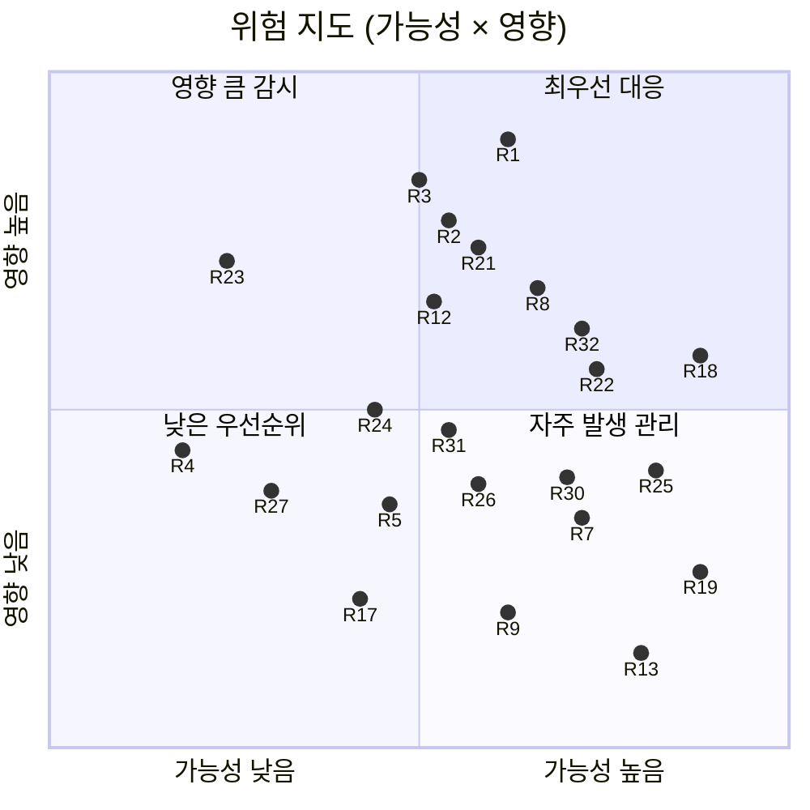

**지금 당장의 차단 요인은 R20(실행 플랫폼)이다.** 점의 위치는 등록부의 가능성·영향 등급을 따른다. 이것이 풀린 뒤 최우선 대응(오른쪽 위)은 R1 신규성, R2 정밀도 부족, R3 재현 실패, R8 시드 분산, R12 서버 GPU 렌더링, R18 신규 코드 작업량, R21 terminal PPO 학습 실패, R22 성공 데이터 공급이다. 영향이 커서 감시할 것(왼쪽 위)은 R23 통제 실패다. 지도에서 뺀 것: R6·R28·R29(설계로 처리, P4 확인 대상), R10(R24로 통합), R11·R33(확정된 한계), R20(확정된 차단 요인), 영향이 낮은 인프라 위험 R14·R15·R16. R32(E2·E3 검정력)는 최우선 대응에 든다. 위치는 파일럿 후 갱신한다.

### 8.2 위험 등록부

| ID | 범주 | 위험 | 가능성 | 영향 | 감지 시점 | 대응 |
|---|---|---|---|---|---|---|
| R1 | 신규성 | PLD·Batch Online RL로 이미 좁아진 질문에서, 같은 예산 PPO 대 성공 중심 비교나 VLA 음수 마스킹 실험이 먼저 발표됨 | 중 | 상 | 상시 (주 1회 인용 알림) | 2.3절 문단을 G0 기준으로 감시. 1단계 주요 결과 직후 arXiv 선공개. 주장은 2.4절 범위로 제한 |
| R2 | 정밀도 | 시나리오 E: 구간이 −δ를 가로질러 답을 못 냄 | 중 | 상 | G-mid, E1 완료 | 시드 8~12 사전 규칙. 그래도 넓으면 "답할 수 없음"으로 보고 (발견으로 포장하지 않음) |
| R3 | 내적 타당도 | 공개 체크포인트로 원 논문 수치가 재현되지 않음 | 중 | 상 | P2 | 평가 조건(시드, 에피소드 수, 렌더러, 배치, 온도) 대조. 방향이 반대면 중단 |
| R4 | 설계 | 라운드 안 32번 optimizer 스텝 때문에 후반 미니배치가 약간 off-policy. 갈래마다 라운드당 업데이트 수가 다름 | 하 | 중 | 설계 | 라운드 구조는 통일. 라운드당 optimizer 스텝 수를 모두 기록하고 한계로 명시 |
| R5 | 설계 | A2⁺·A2± 세부(학습률, 반복 수, 0-성공 라운드 처리)가 결과를 좌우 | 중 | 중 | P5, 튜닝 | 3.5절 동일 튜닝 예산. 0-성공 라운드는 업데이트 생략으로 사전 고정 |
| R6 | 설계 | 보상 정보 교란: v0.5의 A3⁰(성공 항 잠재함수 변화량)는 중간 성공 도달·이탈 시점을 보상에 넣어 A2⁺와 정보가 달랐음 | 하 (설계로 처리) | 상 | P4 | **v0.6에서 terminal 보상으로 재정의** (C5). P4의 보상·라벨 시험(같은 Y면 같은 수익)을 통과해야 해소로 표시. 셰이핑 효과는 A3⁰ 대 A3ˢ로 분리. 남는 위험은 R21 |
| R7 | 해석 | A2± 대 A3⁰ 차이에 critic·GAE·클리핑이 묶여 있어 구성 요소별로 나뉘지 않음 | 상 | 중 | 해석 | "PPO 구성의 추가 효과"로만 표현. 음의 업데이트 몫은 E2로 따로 봄 |
| R8 | 통계 | 학습 시드 분산이 커서 시드 12개로도 정밀도 부족. 원 논문 표준편차는 평가 반복 분산일 수 있어 사전 정보가 없음 | 중 | 상 | G-mid | 맹검 분산 재추정. σ ≥ 6%p면 정밀도 한계 보고 (δ는 결과를 본 뒤 바꾸지 않음) |
| R9 | 측정 | 평가 잡음 (온도 0.6 샘플링, GPU 비결정성, 렌더링 차이) | 중 | 하 | P2 | 평가 시드·초기 상태 고정, 192 에피소드, 같은 장비 안에서만 비교 |
| R10 | 측정 | 커버리지 지표 선택 | — | — | — | **R24로 통합** |
| R11 | 일반화 | 단일 과제군·단일 모델·시뮬레이션 전용·모션 플래너 시연 | 확정 | 중 | — | 2단계 연결 실험 (3.10절). 범위 명시 (8.3절) |
| R12 | 인프라 | H100·H200에서 ManiSkill 렌더링이 느리거나 안 됨. v0.5에서는 **모든 온라인 갈래**가 영향을 받음 | 중 | 상 | G2 | G2에서 실측. 컨테이너 드라이버 기능에 graphics 포함 확인. 안 되면 그래픽 지원 서버 GPU 확보 (부록 D) |
| R13 | 인프라 | 4090 24GB 메모리 부족 (A2⁺ 포함, critic이 없어도 보장 안 됨) | 상 | 하 | P5 | 배치 축소, 병렬 환경 축소, 4비트 (파일럿 한정), 5.1절 상한 안의 H200 제한 사용 |
| R14 | 인프라 | 저장소 고정 버전(PyTorch 2.2, CUDA 12.1, flash-attn 2.7.4) 충돌 | 중 | 하 | P1 | 컨테이너 고정, 버전·해시 기록 |
| R15 | 인프라 | 16k 궤적 RLDS 변환과 온라인 갈래 궤적 저장의 디스크 부담 (README에 `ulimit` 경고) | 중 | 하 | P1, P5 | 라운드당 저장량 측정, 저장 공간 사전 확보 |
| R16 | 법적 | 자산(Objaverse, Sketchfab)의 개별 라이선스, OpenVLA 가중치의 Llama 2 라이선스 | 하 | 중 | 공개 전 | 자산은 재배포하지 않고 원 저장소 경로를 안내. 라이선스 표기 |
| R17 | 일정 | 처리량 미확정으로 일정 추정이 크게 틀림 | 중 | 하 | G2 | 2027년 5월 가능 여부를 지금 단정하지 않음. G2·G-mid에서 재산정 |
| R18 | 작업량 | 신규 코드가 많음: 공통 학습기, 궤적 저장, 회복 평가 환경(상태 조작), 정규화·adapter 통일 | 상 | 중 | P4 | 단위 시험 우선. 작성 시간을 일정에 별도 계상 (P4 1~2주) |
| R19 | 비교 가능성 | 공개 체크포인트는 시드 1개뿐이고, SFT-16k는 다른 정규화 통계를 쓰며, config의 궤적 수 표기가 코드와 다름 | 상 | 하 | P2 | 공개분은 재현 확인에만. 본 비교는 C1·C2 통일 설정의 자체 학습분 |
| R20 | 인프라 | 4090 PC는 Windows이고 WSL2로 실행해야 함. ManiSkill은 WSL에서 GPU 시뮬레이션·렌더링을 공식 지원하지 않고, WSL2의 NVIDIA 드라이버는 Vulkan을 제공하지 않음 | 확정 | 상 | 2026-10-13 확인 | 6.0절 WSL 시험(1일 이내). 결과는 파일럿 위치만 정하고, 본실험 경로는 Linux로 확정 |
| R21 | 설계 | terminal PPO A3⁰가 희소·지연 보상 때문에 잘 학습되지 않아 주 비교가 성립하지 않음. v0.6의 terminal 보상은 v0.5 정의보다 더 희소하므로 이 위험이 커짐 | 중~상 | 상 | G2 | G2 단기 학습 신호 확인. 자동 교체 없음: 구현 점검 → W2 → 명시적 범위 변경 (5.1절 G2 행) |
| R22 | 데이터 | 수집 온도 성공률이 낮거나 특정 조건에 몰려, A2⁺의 학습 데이터가 부족하거나 쉬운 조건에 편중 | 상 | 중 | P3 | P3 측정, 3.7절 전환 규칙. 조건별 공급을 결과와 함께 보고. A2⁺만 따로 돕지 않음 |
| R23 | 구현 | 정규화 통계·adapter 초기화·전처리 통제가 실제로는 어긋남 | 하 | 상 | P4 | P4 단위 시험 (C1·C2·C5·C6·C8). 통제 항목별 설정 해시 기록 |
| R24 | 해석 | OOD 성공률 상승을 강건성 향상으로, 행동 분포 지표를 원인으로 오해. 지표 선택이 결론을 좌우 | 중 | 중 | 분석 | ID 대비 하락 보고, 측정 대상 구분 (2.2절), 인과 근거는 E4·E2로 한정, 지표 정의 사전 고정 |
| R25 | 식별 | E2가 지우는 것은 정책 손실의 음의 항뿐 (critic은 실패로 학습하고, value 손실이 공유 LoRA로 들어감 — 확인됨). 상호작용이 유의해도 시간적 credit을 고유 원인으로 고를 수 없음. 짧은 분기에서는 데이터가 갈라짐 | 상 | 중 | 해석 | E2-a(같은 데이터, 세 층위 기울기)와 E2-b(각자 on-policy)를 구분 보고. 직접 대비와 상호작용 분리. 메커니즘은 후보로만 (2.4절) |
| R26 | 공정성 | 단축 예산 튜닝이 초반에 빨리 오르는 갈래에 유리. PPO 후보는 원 저자가 튜닝한 설정 주변이라 출발점이 유리 | 중 | 중 | 튜닝 | 갈래별 같은 후보 수(4개)와 같은 예산, ID 검증으로만 선택, 한계로 명시 |
| R27 | 외적 타당도 | 2단계에서 모델과 벤치마크를 함께 바꾸면 차이의 원인을 가를 수 없음. flow 계열에는 1.4절 관계가 그대로 옮겨지지 않음 | 하 | 중 | 2단계 설계 | 한 번에 하나만 변경 (3.10절). flow 계열 주장 범위 조정 |
| R28 | 구현 | 샘플링 분포(기본 top-k 50)와 학습 log-prob 분포(256개 전체)가 달라 기준선 불변성(1.4절 (2))과 on-policy 가정이 깨짐. NLL 정규화 대상·EOS 처리가 갈래마다 다를 수 있음 | 하 (설계로 처리) | 상 | P4 | 통제 연구에서 top_k = 0, top_p = 1.0 명시, 256개 토큰 분포로 통일, EOS 제외 (C4). P4 결정적 확률벡터 비교·왕복·합성 오류 대조 시험 |
| R29 | 구현 | 공개 웜업은 병합 전체 모델이라 "웜업 LoRA 이어 학습"이 불가능. 원 PPO 레시피와 SFT 레시피의 LoRA 대상 모듈도 다름 | 확정 | 중 | 2026-10-14 확인 | 모든 갈래가 병합 W1 위에 같은 LoraConfig·같은 초기화 시드의 새 LoRA (C2). 원 레시피 재현은 공개 RL 체크포인트 평가(P2)로만 |
| R30 | 인프라 | 전량 원시 RGB 저장은 학습 1회당 약 1.84TB, E1 전체 약 40TB로 불가능. MP4 압축은 학습 픽셀을 보존하지 않음 | 상 | 중 | P1, P5 | 계층 저장 설계 (7.4절): 저차원 상태 전량 + RGB는 보존 라운드와 환경 2개분 + 재렌더링 일치율 측정. 용량 실측 후 확보 |
| R31 | 측정 | E4-a는 교란 전 수행 능력·상태 차이·남은 시간이 섞임. E4-b의 공통 상태 집합은 기준 정책(W1)이 도달하는 상태에 치우침. 상태 복원에 과제 래치·카운터·시간·난수가 빠지면 같은 상태가 아님 | 중 | 중 | P4, 분석 | E4-a·E4-b 분리 보고, 도달률·조건부/무조건부 성공률 병기, 과제 상태까지 포함한 복원 검증 (P4), S_rec의 편향을 한계로 명시 |
| R32 | 통계 | E2·E3 대비의 검정력이 미확인. 같은 계보에서 갈라진 변형은 상관이 커서 대비 분산을 원 성공률 분산으로 추정할 수 없음. 다중비교 문턱(9개 묶음이면 계보 8개에서 약 7%p)이 높음 | 상 | 중 | G-mid | 세 묶음 분리와 묶음별 통제 범위 명시(4.3절), 분석 함수 분리와 MDE(80% 검정력) 정의, G-mid 맹검 대비 분산 추정으로 정밀도 전망 갱신(4.5절). 정밀도가 부족하면 미판정. 유의하지 않음을 효과 없음으로 읽지 않음 |
| R33 | 신규성 | 실행 중 교란 회복 평가(OGPO의 LIBERO-ReAct 등)와 PPO + self-BC 결합 방법(Action-Chunked PPO)이 이미 있음 | 확정 | 하 | 2026-10-15 확인 | E4의 교란 종류를 기여로 내세우지 않음. 기여는 조합(2.3절). OGPO 원문은 이쪽 환경에서 접근 실패 → G0에서 확인 |

### 8.3 확정된 한계 (논문에 명시할 것)

1. 시뮬레이션 결과만으로 실물 로봇 일반화를 주장할 수 없다.
2. 1단계 결론은 OpenVLA(자기회귀, LoRA)와 원 논문 집기-놓기 과제에 한정된다.
3. 주 비교는 terminal 성공 보상 조건(A3⁰)에서의 비교다. A3⁰ 대 A3ˢ는 "같은 튜닝 예산에서 terminal 보상 PPO 대 원 보상 PPO"의 비교이고, 차이에는 중간 보상 정보, 보상 시점과 할인 수익, 각자 선택된 하이퍼파라미터가 섞여 있다. 통제 연구의 PPO는 C2·C4 때문에 원 레시피와 다르며(C9는 총 손실을 원 코드와 같게 둔다), 원 결과 재현은 공개 체크포인트 평가로만 확인한다.
4. E2는 정책 손실의 음의 actor-loss 항만 제거한다. critic은 여전히 실패 데이터로 학습하고, value 손실이 공유 LoRA로 역전파되므로 실패 데이터가 행동 확률에 간접적으로 영향을 준다 (네 칸에 같게 적용). E2의 결과(직접 대비·상호작용)는 추정기 의존성을 보여 주지만, 시간적 credit·상태별 재가중·추정 오차 중 어느 것이 원인인지는 고르지 못한다.
5. A1과 A2⁺는 데이터 생성자, 방문 상태, 전처리, 오프라인 대 온라인 학습이 함께 다르다.
6. SFT 시연은 모션 플래너가 생성한 것이다. 사람 원격조작 시연의 다양성은 반영되지 않는다.
7. 1.4절의 등식은 가정 아래 정확하다. 실제 학습 절차에는 등식에 없는 요소가 있다: 라운드 안 32번 optimizer 스텝 때문에 후반 미니배치는 약간 off-policy이고, 클리핑·Adam·배치 정규화가 개입한다. 같은 기대 기울기 방향이 같은 최종 성능을 보장하지도 않는다.
8. 튜닝은 단축 예산(150라운드)에서 했다.
9. 학습 시드 수의 한계로 작은 차이(δ보다 작은 차이)는 구분하지 못할 수 있다.
10. E3는 두 웜업 조건(W1·W2)의 비교이고, 두 조건은 성공 데이터 공급 외에 데이터 구성도 다르다. 임계 성공률 같은 일반 조건은 제시하지 않는다.
11. E4-b의 공통 상태 집합은 기준 정책이 도달하는 상태에 치우친다. E4는 교란 반응의 측정이지 학습 경로의 인과 증명이 아니다. 교란 종류 자체는 선행연구에 있다.
12. 비열등 결과는 "대체 가능성 재현"까지 지지한다. 실제 배포에 "충분"한지는 응용의 요구 수준이 있어야 판단할 수 있고, 이 연구는 그 수준을 정하지 않는다.
13. 보조 분석의 오류 통제는 묶음별이고 전체 통합 통제가 아니다. E3(네 평균 대비, 표본 5·5·8·8)와 E4-b(8 대 8)는 E2보다 정밀도가 낮아, 작은 효과는 미판정으로 남을 수 있다. 그 경우 추정값과 구간으로 보고한다.

### 8.4 해석상 주의

| 결과 | 주장해도 되는 것 | 주장하면 안 되는 것 |
|---|---|---|
| Δ_rep 비열등 | 이 설정·이 웜업·이 예산에서 성공 중심 학습이 terminal PPO의 실행 OOD 성공률을 δ 안에서 재현했다. 절대 성공률과 비용은 각각 이렇다 | "RL은 필요 없다" (다른 모델·과제·웜업 미검증). "충분하다" (응용 요구 수준 없이) |
| A3ˢ ≠ A3⁰ | 같은 튜닝 예산에서 원 보상 PPO와 terminal 보상 PPO의 성능이 달랐다 | "집기 부분 보상의 효과", "보상 함수만의 효과" |
| PPO가 δ 넘게 우세 | 이 조건에서 성공 중심 학습으로는 부족했다 | "실패 신호 때문" (E2 없이) |
| A2± ≠ A2⁺ | 부호 있는 결과 업데이트가 이 유한 표본 조건에서 차이를 만들었다 | "실패 정보가 새 방향을 줬다" |
| E2에서 D_C = C± − C⁺ > 0 | GAE advantage에서 음의 actor-loss 항을 지우면 국소적으로 실행 성능이 낮아졌다 | "모든 실패 정보가 필요하다", "시간적 credit 때문이다" |
| E2에서 I > 0 | 음의 항 제거의 효과가 결과 상수 기준선 행과 GAE 행에서 다르다 | "GAE 행에서 음의 항이 유익하다" (D_C를 따로 봐야 함) |
| E2에서 ⑥·⑦ 유의하지 않음 | 이 E2로는 연결을 확정하지 못했다 | "음의 항은 효과가 없다" |
| R 높음 | 성공 중심 학습이 격차의 대부분을 재현했다 | "이득의 대부분이 자기 데이터 때문" |
| 행동 분포 지표와 성공률의 관계 | 탐색적 관찰 | 인과 |
| 파일럿 결과 | 구현 정상 동작, 공급량·처리량 | 어떤 효과 크기도 |

---

## 9. 사전 고정 체크리스트와 기록 항목

### 9.1 파일럿 착수 전

- [ ] WSL 실행 가능성 시험 (6.0절, 1일 이내): CUDA, 렌더링, GPU 시뮬레이션 판정과 파일럿 경로 결정
- [ ] 파일럿 판정표(6.5절)와 재현 허용 범위(6.4절) 확정, 타임스탬프 기록
- [ ] "파일럿 결과는 논문 근거로 쓰지 않는다" 원칙 기록
- [ ] P3 수집 에피소드 수(제안 1,024), 조건 분류, 회복 성공의 정의
- [ ] P4 단위 시험 항목과 허용 오차
- [ ] 3.7절 웜업 전환 규칙 (전체 90% 상한 < 5%, 또는 물체·테이블별 90% 상한 < 8%인 수준 8종 이상)과 완전 교차 수집 배치

### 9.2 E1 착수 전 (G2 이후)

- [ ] 갈래 정의(3.3절)와 통제 항목 C1~C9의 최종 설정 (terminal 보상, top_k = 0·top_p = 1.0, 256개 토큰 NLL·EOS 제외, joint log-prob [B, 1], 정책 손실 계수 7·value 계수 1, 병합 W1 + 새 LoRA 초기화 시드)
- [ ] 비열등성 한계 δ와 그 근거 (G2 비용 측정)
- [ ] 주 웜업 조건 (W1 또는 W2), W2 시연 수
- [ ] 핵심 갈래 시드 8개, 맹검 분산 재추정 시점(시드 4개)과 n 결정 대응표 (8~12), 절차 전체 시뮬레이션 결과 (Δ = −δ에서 1종 오류, Δ = 0에서 검정력)
- [ ] 튜닝 후보와 선택 규칙 (3.5절)
- [ ] 체크포인트 규칙 (4.7절)
- [ ] E2 분기 지점(라운드 20·150·300), 계보 8개, 변형, 결과 advantage 식 Ã^O와 ε, 전부 성공·실패 배치 처리, 진단 지표(세 층위, 진단 크기 1·2·4·8은 합산 후 1회 정규화), E2-a 복제본 폐기와 E2-b 재시작 규칙(첫 업데이트 = 1라운드째), C± 재현 검사, 분기 길이(20라운드), value 손실 처리, 판정량(D_C, I), A3⁰₊ 착수 임계값(계보 평균 |D_C| 5%p)
- [ ] E4-a 교란 정의(종류, 크기, 단계 기준 시점)와 도달률 보고 규칙, E4-b 공통 상태 집합 S_rec(M_rec, 기준 정책, 전체 상태 항목), 경과 시간 보존과 별도 회복 카운터 H
- [ ] 진단 롤아웃 M, N, 성공 다양성 최소 표본 m_min(제안 5), 방문 엔트로피 격자
- [ ] 확증 1개, 보조 확증 세 묶음(A ①②, B ⑥⑦, C ⑧⑨)의 단위와 검정 방법, 결론 범위 문구(4.3절), 반박·미판정 규칙, 기술·탐색 목록
- [ ] 확증·기술 분석 구분의 최종 고정 (G-mid에서 바꾸지 않음), 묶음별 오류 통제 범위 문구 (4.3절)
- [ ] E2(짝지은 대비)·E3(네 평균 선형 대비, 공분산 구조)·E4-b(독립 두 집단)의 분석 함수와 합성 자료 1종 오류 점검, MDE(검정력 80%) 계산 스크립트 (4.5절)
- [ ] G-mid 절차: 맹검 대비 분산 추정 스크립트(평균·부호 비출력), 정밀도 전망 갱신 양식
- [ ] 보조 갈래 시드 확대의 결과 비의존 규칙 (잔여 예산 기준값, 순서 A1 → A3ˢ → A2±)
- [ ] G1 전 H200 제한 사용 상한 (제안 60 GPU시간)과 허용 용도 (5.1절)
- [ ] 불확실성 방법과 경계(Δ = −δ) 보정 점검, 비열등성용 순열 검정 정의 (4.6절)
- [ ] G2에서 A3⁰ 학습 신호가 없을 때의 순서(구현 점검 → W2 → 명시적 범위 변경)와 범위 변경 시 질문 재서술 양식
- [ ] 2단계 외부 검증 설정과 예산, 예산 축소 순서 (5.1절)
- [ ] 저장 계층 설계와 용량 확보 (7.4절), 저장 정확성·재렌더링·상태 복원·장시간 재실행의 허용 오차 (P4)
- [ ] 이탈 기록 양식 (사전 고정에서 벗어난 모든 변경을 날짜·사유와 함께)

### 9.3 모든 실행에서 기록

| 항목 | 내용 |
|---|---|
| 코드 | 커밋 해시, 수정 diff |
| 환경 | GPU 종류, 드라이버, CUDA, PyTorch, 주요 패키지 버전, 생성 설정(온도, top_k) |
| 설정 | 설정 파일 전체, 시드, 정규화 통계 해시, adapter 초기 가중치 해시 |
| 산출물 | 체크포인트 해시, 평가 원자료 (에피소드별 성공 여부) |
| 라운드별 | 성공 수, 0-성공 라운드, 조건별 성공 수, optimizer 스텝 수, 손실, 기울기 노름 |
| 롤아웃 | 온라인 갈래 학습 데이터 (궤적, Y, 보상, 라운드) |
| E2 | 세 층위(정책 손실·총 기울기·Δθ)의 코사인·노름, KL, log-likelihood 변화, 평균 배치 수별 값 |
| 생성 설정 | top_k, top_p, 온도, 허용 토큰 범위 (갈래·단계별) |
| 자원 | 소요 시간, 피크 메모리 |
| 이탈 | 사전 고정과 다르게 한 점과 사유 |

---
## 10. 참고문헌과 공개 자원

표시: ✔ = 2026-10-13~15에 본문 직접 확인, △ = 일부만 확인(초록 등), 표시 없음 = 검토 의견 기준.

### 출발 논문과 공개 자원

- ✔ Liu et al., *What Can RL Bring to VLA Generalization? An Empirical Study*, NeurIPS 2025. [arXiv](https://arxiv.org/abs/2505.19789) (v1 2025-05-26 … v4 2026-01-14, v4가 현재 판. 2026-10-15 v4 HTML 목차 확인: 부록 A.1~A.4, B.1~B.6, C. **B.4 sim-to-real 예비 평가(Franka Panda), B.5 행동 청크 비교, B.6 관절 물체 열기 확장이 있다.** 10-13·10-14의 두 차례 "없음" 판정은 이쪽 조회 오류였다) · [Proceedings](https://proceedings.neurips.cc/paper_files/paper/2025/hash/8c0fabe372177d2aded596be2d3b4544-Abstract-Conference.html) · [프로젝트 페이지](https://rlvla.github.io)
- ✔ 코드 (MIT): [gen-robot/RL4VLA](https://github.com/gen-robot/RL4VLA) (커밋 `de46e01`, 2025-08-25. 2026-10-13·14 확인)
- ✔ 공개 체크포인트 파일 구성 (병합 전체 모델, adapter 없음, `generation_config.json`은 bos/eos/pad만): [warmup](https://huggingface.co/gen-robot/openvla-7b-rlvla-warmup/tree/main) · [rl](https://huggingface.co/gen-robot/openvla-7b-rlvla-rl/tree/main) · [sft_16k](https://huggingface.co/gen-robot/openvla-7b-rlvla-sft_16k/tree/main)
- ✔ transformers 4.40.1 `GenerationConfig` 기본값 (top_k 50, top_p 1.0): [문서](https://huggingface.co/docs/transformers/v4.40.1/main_classes/text_generation) · `generate()`의 `logits`(처리 전)와 `scores`(처리 후) 구분: [문서](https://huggingface.co/docs/transformers/v4.40.0/en/internal/generation_utils)
- 체크포인트: [HuggingFace 컬렉션](https://huggingface.co/collections/gen-robot/rlvla-684bc48aa6cf28bac37c57a2) (`openvla-7b-rlvla-warmup`, `-sft_16k`, `-rl`)

### 근접 선행연구 (2.1절)

- ✔ Xiao et al., *Self-Improving Vision-Language-Action Models with Data Generation via Residual RL* (PLD), ICLR 2026. [arXiv](https://arxiv.org/abs/2511.00091) · [Proceedings](https://proceedings.iclr.cc/paper_files/paper/2026/hash/163a875ab0c2631ed30b7435c4c9b8f1-Abstract-Conference.html)
- ✔ Dong, Mirchandani, Sadigh, Finn, *What Matters for Batch Online Reinforcement Learning in Robotics?*, ICLR 2026. [arXiv](https://arxiv.org/abs/2505.08078) · [ICLR](https://iclr.cc/virtual/2026/poster/10006859)
- ✔ Mirchandani, Belkhale, Hejna, Choi, Islam, Sadigh, *So You Think You Can Scale Up Autonomous Robot Data Collection?*, CoRL 2024 (PMLR 270). [arXiv](https://arxiv.org/abs/2411.01813) · [PMLR](https://proceedings.mlr.press/v270/mirchandani25a.html)
- △ Cao et al., *Dissecting Advantage-Guided Post-Training for Vision-Language-Action Policies*, arXiv 2026-09. [arXiv](https://arxiv.org/abs/2609.28161) (표 II: 2026-10-13·14·15 세 차례 모두 이쪽 환경에서 arXiv HTML이 "DAgger 0.65"(과제 진행도 열로 추정)에서 잘리고 PDF는 429로 거부됨. Weight 0.74는 초록의 "+0.63 over SFT 0.11"로 확인. **3차 외부 검토(10-15)가 원문 PDF 7쪽 표 II를 이미지로 열어 Task success Mean을 SFT Init 0.11, DAgger 0.45, Weight 0.74, Filter 0.50으로 확인했다고 보고**. 출처 이력: 작성 환경은 접근 실패, 후속 검토에서 원문 확인)
- ✔ Shenfeld, Pari, Agrawal, *RL's Razor: Why Online Reinforcement Learning Forgets Less*, ICLR 2026. [arXiv](https://arxiv.org/abs/2509.04259) · [Proceedings](https://proceedings.iclr.cc/paper_files/paper/2026/hash/618c95f4557c15b253fb0e6f548ea0c0-Abstract-Conference.html)
- ✔ Li et al., *Many Ways to Succeed: Diversity-Driven RL Fine-Tuning for VLA Generalization* (DRIVE), arXiv 2026-10. [arXiv](https://arxiv.org/abs/2610.09943)
- ✔ Zhong et al., *VLA-OPD: Bridging Offline SFT and Online RL for Vision-Language-Action Models via On-Policy Distillation*, arXiv 2026-03. [arXiv](https://arxiv.org/abs/2603.26666)
- *Human-in-the-loop Online Rejection Sampling (Hi-ORS)*. [arXiv](https://arxiv.org/abs/2510.26406)
- *Debunk the Myth of SFT Generalization*. [arXiv](https://arxiv.org/abs/2510.00237)
- *Why Does RL Generalize Better Than SFT? A Data-Centric Perspective on VLM Post-Training*. [arXiv](https://arxiv.org/abs/2602.10815)
- HABC (외부 검토 제시, 본문 미확인). [arXiv](https://arxiv.org/abs/2606.17043)
- △ Wang et al., *VLA Model Post-Training via Action-Chunked PPO and Self Behavior Cloning*, arXiv 2025-09 (MetaWorld). [arXiv](https://arxiv.org/abs/2509.25718) (2026-10-15 초록 확인)
- *OGPO: Offline Goal-conditioned Policy Optimization for Recoverable VLA Models*, arXiv 2026-10-09 (3차 검토 제시: LIBERO-ReAct 실행 중 교란 평가 포함). [arXiv](https://arxiv.org/abs/2610.12914) (이쪽 환경에서 접근 실패 — 429)

### VLA RL 구현·후속 방법

- *πRL: Online RL Fine-tuning for Flow-based VLA Models*. [arXiv](https://arxiv.org/abs/2510.25889)
- *OmniVLA-RL*. [arXiv](https://arxiv.org/abs/2604.17706)
- *What to Ignore, What to React: Visually Robust RL Fine-Tuning of VLA Models*. [arXiv](https://arxiv.org/abs/2605.13105)
- RLinf LIBERO·LIBERO-Pro/Plus RL 예제. [문서](https://rlinf.readthedocs.io/en/release-v0.3/rst_source/examples/embodied/libero.html)

### 통계·평가 신뢰성

- ✔ Agarwal, Schwarzer, Castro, Courville, Bellemare, *Deep Reinforcement Learning at the Edge of the Statistical Precipice*, NeurIPS 2021. [arXiv](https://arxiv.org/abs/2108.13264)
- *LIBERO-Plus: In-depth Robustness Analysis of VLA Models* (CVPR 2026). [arXiv](https://arxiv.org/abs/2510.13626)
- *LIBERO-PRO*. [arXiv](https://arxiv.org/abs/2510.03827)
- *What Makes an Efficient VLA?* (학습 시드 분산 점검 포함. 이 연구의 분산 근거로 빌려 쓰지 않음). [arXiv](https://arxiv.org/abs/2609.13984)
- *Same Scene, Different Answer: Variance and Rollout Budgets for Flow-Policy Evaluation* (NeurIPS 2026 워크숍). [OpenReview](https://openreview.net/forum?id=GWoS5WMwr4) (외부 검토에서 원문 확인 실패. 검정력 근거로 쓰지 않음)

### 인프라

- SimplerEnv (ManiSkill3) GPU 요구사항: [GitHub](https://github.com/IrvingF7/SimplerEnv)
- ManiSkill3 (Vulkan 설정): [GitHub](https://github.com/haosulab/ManiSkill)
- ManiSkill 설치 문서 (운영체제별 지원 범위, Vulkan 문제 해결): [문서](https://maniskill.readthedocs.io/en/latest/user_guide/getting_started/installation.html)
- NVIDIA 포럼, WSL2에서 Vulkan 사용 (Dozen 경유, 제한적 확장): [링크](https://forums.developer.nvidia.com/t/enabling-nvidia-support-for-vulkan-on-ubuntu-22-04-through-wsl2/244176)
- Khronos 포럼, WSL2 Ubuntu에서 Dozen 드라이버 누락 보고: [링크](https://community.khronos.org/t/vulkan-fails-to-detect-nvidia-gpu-on-wsl2-ubuntu-24-04-dzn-driver-files-missing-tested-on-multiple-systems/112045)
- NVIDIA 포럼, H100 그래픽 지원: [링크](https://forums.developer.nvidia.com/t/h100-pcie-doesnt-have-graphic-support/246884)

---

## 부록 A. 용어 정리

| 용어 | 이 문서에서의 뜻 |
|---|---|
| VLA (Vision-Language-Action) | 카메라 영상과 언어 지시를 받아 로봇 동작을 출력하는 모델 |
| OpenVLA-7B | Llama 2 7B 기반의 공개 VLA. 동작을 256개 구간의 토큰으로 출력하는 자기회귀 방식 |
| flow 계열 VLA | π0, π0.5처럼 동작을 연속값으로 생성(flow matching)하는 VLA. 2단계 후보 |
| 웜업 W1 / W2 | RL 전에 소량 시연으로 기본 동작을 맞춘 체크포인트. W1은 공개분(시연 140개), W2는 모든 갈래가 공유하는 강화 웜업 (3.7절) |
| SFT (지도 미세조정) | 남이 만든 시연을 정답으로 삼아 따라 하도록 학습 (A1) |
| 성공 중심 온라인 학습 | 매 라운드 자기 정책으로 롤아웃을 새로 수집하고, 최종 성공한 궤적만 지도학습 (A2⁺). 필터링 BC, 0-1 REINFORCE, self-bootstrap과 같은 계열 |
| 결론 범위 (시나리오 A) | 비열등 결과가 지지하는 주장은 "대체 가능성 재현"까지. 절대 성공률과 실측 비용을 병기하고, "충분하다"는 응용 요구 수준 없이는 쓰지 않음 |
| 배치 표준화 결과 advantage Ã^O | E2 O행의 advantage: (Y − Ȳ)/(√(Ȳ(1−Ȳ)) + ε). 궤적 전체에 같은 값. E1의 A2± 가중치와 같은 결과 신호이지만 정규화·클리핑 때문에 같은 업데이트 규칙은 아님 |
| 부호 있는 결과 업데이트 | 같은 롤아웃 전체를 쓰되 (Y − b)/Ȳ 가중치로 실패 궤적에 음의 가중치를 주는 업데이트 (A2±) |
| A3⁰ / A3ˢ | terminal 성공 보상(마지막 스텝에서만 Y)을 쓰는 PPO / 원 논문 보상(잠재함수 변화량: 집기·연속 집기·성공 상태)을 쓰는 PPO |
| terminal 보상 | 에피소드의 마지막 스텝에서만 주는 보상. r_t = Y·𝟙[t = T]. 중간 성공 도달·이탈 시점이 수익에 들어가지 않음 |
| 잠재함수 변화량 보상 | r_t = Φ_t − Φ_{t−1}. 원 코드의 보상 형태. 성공 상태를 얻으면 +, 잃으면 − |
| PPO | 원 논문의 RL 알고리즘. critic으로 시점별 advantage를 추정하고, 클리핑으로 한 번에 너무 크게 바뀌지 않게 업데이트 |
| critic (value head) | 상태의 기대 수익을 예측하는 부분. 원 코드에서는 backbone을 공유하는 작은 MLP |
| advantage | 어떤 행동이 그 상태의 기대보다 얼마나 나았는지. 양수면 확률을 올리고 음수면 내림 |
| 결과 advantage | 에피소드의 최종 성공 Y에서 기준선 b를 뺀 값. 궤적의 모든 시점에 같은 값 |
| GAE | critic을 이용해 시점별 advantage를 추정하는 방법 (λ = 0.95) |
| 기준선 (baseline) | advantage 계산에서 빼는 값. 행동에 의존하지 않으면 기대 기울기를 바꾸지 않고 분산만 줄임 (control variate) |
| 음의 actor update | 정책(actor)에서 특정 행동의 확률을 직접 낮추는 업데이트 |
| 시간적 credit assignment | 에피소드 안에서 어느 시점의 행동이 결과에 책임이 있는지 나누는 것 |
| 음수 마스킹 | 공통 정규화 뒤 advantage의 음수 부분을 0으로 바꾸는 것: max(Â, 0). 정책 손실의 음의 actor-loss 항만 없어지고 critic 학습은 그대로 |
| advantage 추정기 | advantage를 어떻게 계산하는가. 이 문서에서는 결과 상수 기준선(Y − b)과 GAE(Â_t) 두 가지 |
| 직접 대비 D_C / 상호작용 I | D_C = C± − C⁺ (GAE 행에서 음의 항 제거의 효과). I = D_C − D_O (두 추정기 사이의 차이). 다른 질문이다 |
| G-mid | 핵심 갈래 시드 4개 시점. 주 비교의 n 조정(8~12)과, E2·E3·E4-b 대비 분산의 맹검 추정으로 정밀도 전망을 갱신하는 시점. 분석의 확증·기술 등급은 바꾸지 않음 |
| MDE (최소 탐지 차이) | 선택한 검정과 다중비교 절차 아래에서 검정력 80%를 주는 효과 크기. 임계 t × 표준오차("유의성 문턱에 대응하는 관측 차이")와 다름 |
| 묶음별 오류 통제 | 보조 분석을 연구 질문별 검정군 안에서 Holm으로 통제하는 것. 연구 전체의 통합 5% 통제가 아님 |
| top-k 절단 | 샘플링할 때 확률 상위 k개 토큰만 남기는 것. 라이브러리 기본값 50. 학습 log-prob 분포(256개)와 달라지므로 통제 연구에서는 해제 |
| O± · O⁺ · C± · C⁺ | E2의 네 변형. O는 결과 advantage, C는 critic advantage, ±는 부호 유지, ⁺는 음수 마스킹 |
| 라운드 | 롤아웃 수집 1번 + 업데이트 1번. 원 PPO 설정은 환경 64 × 80스텝 = 5,120전이, 390라운드 |
| on-policy | 현재 학습 중인 정책이 만든 데이터로 학습하는 것 |
| Δ_replacement (Δ_rep) | SR(A2⁺) − SR(A3⁰). 이 연구의 주지표 |
| 비열등성 검정, δ | "차이가 −δ보다 크다"를 보이는 검정. δ는 감수할 수 있는 최대 성능 손실 |
| 맹검 분산 재추정 | 중간에 갈래 이름을 가린 채 분산만 다시 추정해서 필요한 시드 수를 정하는 절차 |
| R (격차 회복 비율) | (A2⁺ − A1) / (A3⁰ − A1). 원인 기여율이 아님 (4.4절) |
| C_c | (A2⁺ − A1) − c(A3⁰ − A1). 비율을 나누지 않고 같은 질문을 다루는 값 |
| ID 대비 하락 | 학습 조건 성공률 − OOD 성공률. 갈래 간에 비교해서 강건성을 봄 |
| OOD (분포 밖) | 학습 때 보지 못한 조건. 시각·의미·실행 세 축 |
| 시각 / 의미 / 실행 축 | 테이블·질감·노이즈 변화 / 새 물체·접시·지시문 / 위치·초기 자세·도중 이동 변화 |
| 회복 평가 E4-a / E4-b | E4-a: 각 정책이 스스로 도달한 상태에서 교란 (배포형). E4-b: 사전 고정한 공통 물리 상태에서 교란하고 같은 스텝 수를 줌 (공통 상태). 메커니즘 근거는 E4-b |
| S_rec | E4-b의 공통 상태 집합. 기준 정책으로 만든 전체 시뮬레이터 상태(관절·물체 pose·속도·제어기 상태)에 교란을 적용한 것 |
| 진단 롤아웃 | 행동 분포를 재기 위해 최종 정책을 고정 초기 상태에서 온도 1.0으로 반복 샘플링한 롤아웃 |
| 성공 조건부 다양성 | 같은 초기 상태에서 나온 성공 궤적들 사이의 차이. 성공이 적으면 "추정 불가" |
| Pass@K / Coverage@K | K번 시도 중 한 번이라도 성공할 확률 / 기준(SFT) 성공 행동을 K번 안에 얼마나 덮는지 (DRIVE) |
| LoRA | 큰 모델의 가중치는 고정하고 작은 보조 행렬만 학습하는 미세조정 방식 (rank 32) |
| 행동 정규화 통계 | 연속 행동을 토큰 구간으로 바꿀 때 쓰는 분위수. `bridge_orig`와 `sft`가 실제로 다름 (C1) |
| ManiSkill · SimplerEnv | 원 논문이 쓴 GPU 병렬 로봇 시뮬레이터와 그 평가 환경 |
| RLDS | OpenVLA 학습 코드가 읽는 로봇 데이터 형식 |
| LIBERO-Plus / PRO | 섭동을 준 LIBERO 확장 벤치마크. 2단계 후보 |
| 사전 고정 | 결과를 보기 전에 분석·판정 규칙을 확정하고 기록하는 것 |
| Holm 보정 | 여러 검정을 동시에 할 때 우연한 유의를 막는 다중비교 보정 |
| Vulkan · RT 코어 | ManiSkill 렌더링에 필요한 그래픽 API · 광선추적 전용 하드웨어. 기본 렌더링에는 RT 코어가 필요 없음 |
| WSL2 | Windows 안에서 Linux를 실행하는 기능. CUDA는 지원하지만 NVIDIA Vulkan 드라이버는 없고, ManiSkill GPU 시뮬레이션·렌더링은 공식 미지원 |
| Dozen (dzn) | Vulkan 명령을 Windows의 D3D12로 변환하는 Mesa 드라이버. WSL2에서 Vulkan을 쓰는 유일한 GPU 경로이나 기능이 제한적 |

---

## 부록 B. 주제 선정 경위

**출발점:** 사업단 GPU(H200·H100)로 기존 우수 논문을 스케일업해 논문을 쓰는 방향을 검토했다. 그동안의 문제는 "가설이 맞아야 논문이 되는 설계" 때문에 가설이 틀리면 시간이 버려진다는 점이었다. 그래서 결과가 어느 쪽이든 결론이 되는 구조를 우선 기준으로 삼았다.

**검토 후 제외한 후보**

| 후보 | 제외 이유 |
|---|---|
| 산업 이상탐지의 계산 예산별 구성 선택 (AnomalyDINO·SubspaceAD 기반) | 선택기가 볼 수 있는 정보(정상 이미지)와 정답을 정하는 요인(결함 크기·종류)이 분리되어 있어, 강한 고정 구성을 이기기 어렵다. 개발용 MVTec AD·VisA는 성능이 포화됐다. 라벨 없이 탐지기를 고르는 선행연구(SWSA)가 있다. GPU가 병목이 아니다 |
| 원 논문의 단순 재현·확장 (다른 모델군, LIBERO-Plus, 시각 강건성) | πRL(flow 계열), OmniVLA-RL(LIBERO-Plus), What to Ignore(시각 OOD)가 이미 수행. 최상위 학회에서 증분적이라는 평을 받기 쉽다 |
| VLA 학습·평가 시드 분산 감사 | 평가 분산 분해와 학습 시드 분산 보고가 이미 있다 |
| (참고) 기존 ROBO-IRT | 접은 것은 아니다. 원본 LIBERO에서는 초기 상태를 고정해도 결과 분산의 61~84%가 남는다는 보고가 있어, 항목 간 차이가 큰 LIBERO-PRO·Plus 쪽이 유리하다 |

**이 주제를 고른 이유 (v0.5 갱신)**

1. 결과가 어느 방향이든 결론이 된다. 비열등이면 "시험한 조건에서 성공 중심 학습이 terminal PPO를 대체할 수 있다(절대 성공률·비용 병기)", 열등이면 "대체하지 못한 조건과 E2가 보여 주는 국소 효과"가 결론이다. 단, 정밀도가 부족한 결과(시나리오 E)는 결론이 아니다 (4.8절).
2. 큰 질문은 선행연구(PLD, Batch Online RL)가 이미 다뤘지만, **같은 예산의 on-policy PPO 대 성공 중심 비교와 동일 배치 음의 업데이트 개입**이라는 좁은 빈칸이 남아 있다 (2.3절). v0.4의 "원 논문과 DRIVE의 해석 충돌을 판정한다"는 동기는 오독에 근거했으므로 뺐다.
3. VLA 온라인 RL 학습은 큰 GPU가 실제 병목인 실험이다.
4. 코드(MIT)·체크포인트·평가 과제가 모두 공개되어 재현 위험이 비교적 낮다. 다만 통제 연구를 위한 신규 코드(공통 학습기, 궤적 저장, 회복 평가, 상태 복원)와 원 코드에서 고쳐야 할 점(C4·C9)이 적지 않다 (R18).
5. 기존 로봇 연구(LIBERO, robomimic, 밝기 변형 강건성)에서 쌓은 경험을 그대로 쓸 수 있다.

**투고 경로를 정한 근거**

- SCIE 저널(IEEE RA-L, TNNLS, Neural Networks, JMLR 등)을 우선한다.
- 우수학회 목록이 사업단 실적으로 인정되고 홍보 효과도 크기 때문에, 신규성·식별 수준·정밀도·외부 검증이 모두 강하면 최상위 학회(CoRL·NeurIPS·ICLR)를 먼저 노린다 (4.8절). 결과의 방향으로 정하지 않는다.
- 대안 경로: JMLR(SCIE)·TMLR 게재 후 NeurIPS·ICML·ICLR의 Journal-to-Conference 트랙으로 발표할 수 있다. TMLR은 재현성 인증 시 MLRC 트랙과도 연결된다. TMLR의 SCIE 등재는 확인하지 못했다.

**4090 파일럿을 먼저 하는 이유:** H200 인스턴스 비용이 높다. 구현 검증과 공급량 측정은 4090으로 충분하다. 원 규모 PPO는 G2에서 H200으로 짧게 확인하고, 축소 구성의 24GB 가능 여부는 실측 대상으로 둔다 (7.4절). 단, 4090 PC는 Windows(WSL2)라서 ManiSkill이 어디까지 동작하는지 먼저 시험해야 한다 (6.0절).

---

## 부록 C. 결정 기록과 변경 이력

**결정 기록**

| 날짜 | 결정 | 근거 |
|---|---|---|
| 2026-10-13 | 주제: VLA RL 일반화 이득을 자기 데이터와 실패 신호로 분해 | 부록 B (v0.1) |
| 2026-10-13 | 투고: SCI 저널 기본, 결과가 뚜렷하면 최상위 학회 우선 (**v0.5에서 대체**, 아래 투고처 결정 행) | 우수학회 목록이 사업단 실적으로 인정되고 홍보 효과가 큼 |
| 2026-10-13 | 4090 파일럿 먼저, G1 통과 전 H200 미사용 | H200 인스턴스 비용 |
| 2026-10-13 | 연구 문서는 Markdown으로 관리 | 연구자 요청 |
| 2026-10-13 | 4090 실행은 WSL2(Ubuntu)로 한다. 듀얼부팅은 하지 않는다 | 워크스테이션이 Windows (연구자 조건) |
| 2026-10-13 | 실험 보류, 문서화 우선 (**v0.8에서 파일럿 착수 가능으로 전환**) | ManiSkill이 WSL을 공식 지원하지 않음 (R20). 연구자 지시 |
| 2026-10-13 | **질문 재정의**: 분해(기여율)에서 대체 가능성(RQ1)과 메커니즘(RQ2)으로 | 외부 검토. 1.3·1.4절 |
| 2026-10-13 | 갈래 A1·A2⁺·A2±·A3⁰·A3ˢ, 성공 중심 갈래는 PPO와 같은 390라운드 갱신 | 외부 검토, 코드 확인 (C7) |
| 2026-10-13 | E2 동일 배치 분기를 2×2(결과·critic × 부호 유지·마스킹)로 설계 | 1.4절 (5)·(6)의 관계 |
| 2026-10-13 | 주지표: 실행 축 Δ_rep 비열등성. R은 보조 기술 | 외부 검토. 1.2절 ID 대비 하락 |
| 2026-10-13 | 핵심 갈래 학습 시드 8개 + 맹검 분산 재추정 (최대 12) | 4.5절 검정력 시뮬레이션 |
| 2026-10-13 | 행동 정규화 `bridge_orig`로 통일, adapter "웜업 LoRA 이어 학습"으로 통일 (**adapter 부분은 v0.6에서 대체**, 아래 10-14 행) | 코드 확인 (C1·C2) |
| 2026-10-13 | A4는 보조, A5는 제외 | E2가 실패 신호 주장 검증에 더 직접적 |
| 2026-10-13 | "미판정이면 SCI" 경로 삭제. 투고처는 신규성·식별·정밀도·외부 검증으로 결정 | 외부 검토 |
| 2026-10-13 | WSL 시험은 파일럿 위치만 정함. 본실험은 Linux 경로로 확정 | 외부 검토, 온라인 갈래 전부 렌더링 필요 |
| 2026-10-13 | 2단계 외부 검증 예산을 1단계 전에 확보하고, 한 번에 하나만 변경 | 외부 검토 |
| 2026-10-14 | **A3⁰ 보상을 terminal(r_T = Y)로 재정의.** v0.5의 "성공 항 잠재함수 변화량"은 중간 이력이 수익에 들어가 A2⁺와 정보가 달랐음 | 2차 외부 검토. 코드 확인 (C5) |
| 2026-10-14 | adapter 통제를 "병합 W1 + 같은 LoraConfig·초기화 시드의 새 LoRA"로 변경 (v0.5의 "웜업 LoRA 이어 학습" 대체) | 공개 웜업이 병합 전체 모델이고 adapter가 없음 (R29) |
| 2026-10-14 | 통제 연구의 생성 설정을 top_k = 0, top_p = 1.0으로 명시. NLL은 256개 행동 토큰, EOS 제외 | 기본 top-k 50이 샘플링·학습 분포를 어긋나게 함 (C4, R28) |
| 2026-10-14 | joint log-prob [B, 1] 저장, 정책 손실 1회 합산, value 계수 1/7 고정 (**계수는 v0.7에서 7·1로 대체**) | 원 코드의 7칸 복제로 정책 손실이 7배 (C9) |
| 2026-10-14 | E2의 측정 대상을 "두 advantage 추정기에서 음의 항 제거 효과의 차이"로 한정. 판정량을 직접 대비 D_C와 상호작용 I로 분리 | 2차 외부 검토. 1.4절 (6) |
| 2026-10-14 | E4를 E4-a(배포형)와 E4-b(공통 상태)로 분리 | 같은 단계 ≠ 같은 상태 |
| 2026-10-14 | 시나리오 A에 사전 적용 조건 추가 (**v0.7에서 삭제**). 반박·미판정 구분. 시나리오 C 결론 수정 | 비열등 ≠ 충분, 비유의 ≠ 효과 없음 |
| 2026-10-14 | G2의 A3ˢ 자동 교체 규칙 삭제. 구현 점검 → W2 → 명시적 범위 변경 | 자동 교체는 연구 질문을 바꿈 |
| 2026-10-14 | 예산 축소 순서 변경 (E3 보호). A2±·A1·A3ˢ는 시드 3개로 시작 | 제목의 "언제"는 E3가 답함 |
| 2026-10-14 | 원 논문 v4 부록에 Franka·OFT·관절 물체 실험이 있다는 2차 검토 주장은 두 차례 직접 확인에서 재현되지 않음. 미결로 유지 (**10-15에 정정**, 아래) | 10-13·10-14 v4 HTML 조회 |
| 2026-10-15 | **정정:** 원 논문 v4 부록에 B.4~B.6이 있음을 확인. 이전 두 차례의 "없음"은 이쪽 조회 오류 | 10-15 v4 HTML 목차·본문 재조회 |
| 2026-10-15 | 시나리오 A의 "A3⁰ − A1 ≥ 10%p" 적용 조건 삭제. 결론은 "대체 가능성 재현"까지, 절대 성공률·비용 병기 | 3차 외부 검토. 조건이 유용한 결과를 버리고 낮은 결과를 통과시킴 |
| 2026-10-15 | E2 결과 advantage를 배치 표준화 이진 결과 Ã^O로 확정. 전부 성공·실패 배치는 정책 손실 0 + value 스텝 수행. E2-a는 합산 후 1회 정규화, 복제본에서 폐기. E2-b는 원 체크포인트에서 재시작 | 3차 외부 검토 |
| 2026-10-15 | P4 샘플링 검증을 결정적 확률벡터 비교·왕복 검사·합성 오류 대조로 교체 | 자기회귀 prefix, 256범주 표본 부족, 작은 바깥 질량 |
| 2026-10-15 | A3⁰ 대 A3ˢ의 이름을 "같은 튜닝 예산에서 terminal 대 원 보상 PPO"로 | 보상 정보·시점·할인 수익·하이퍼파라미터가 함께 다름 |
| 2026-10-15 | C9 계수를 정책 7·value 1로 (v0.6의 value 1/7 대체) | 총 손실을 원 코드와 같게 해 클리핑·Adam 동작 보존 |
| 2026-10-15 | 보조 확증을 세 묶음으로 분리, ③④⑤는 기술 보고. G-mid 정밀도 규칙 도입. 시드 확대는 결과 비의존 규칙 | 3차 외부 검토 (Holm 부담, RQ2 검정력 미확인) |
| 2026-10-15 | G1 전 H200 제한 사용 허용 (단위 시험·렌더링·G2 실측, 합계 60 GPU시간 제안) | 운영 규칙의 미정 부분 정리 |
| 2026-10-15 | 묶음별 오류 통제 범위 명시 (전체 통합 통제 아님). MDE를 검정력 80% 기준으로 정의. E2·E3·E4-b 분석 함수 분리 | 4차 외부 검토 |
| 2026-10-15 | G-mid의 확증 강등 규칙 삭제. 등급은 G-PRE에서 고정, G-mid는 n 조정과 정밀도 전망만 | 4차 외부 검토. 절차 단순화, 미판정 범주로 충분 |
| 2026-10-15 | C9 동일성 시험을 "원 코드형 계산 대 통제 학습기 계산"으로 명명. 계수 7·1 유지 | 4차 외부 검토 |
| 2026-10-15 | E2-a 코사인 예측은 정책 손실 기울기에 한정. E4-b 시간 복원과 회복 카운터 분리 | 4차 외부 검토 |
| 2026-10-15 | 학습 없는 단위 시험은 WSL 시험과 병행. 파일럿 착수 가능 상태로 전환 | 4차 외부 검토 ("파일럿 착수") |

**변경 이력**

| 버전 | 날짜 | 변경 |
|---|---|---|
| v0.1 | 2026-10-13 | 초안: 설계, 분석 계획, 로드맵, 4090 파일럿, 장비 배치, 위험 등록부 |
| v0.2 | 2026-10-13 | 핵심 직관 그림, 가설과 예측(H1~H5), 데이터와 공개 자원, 용어 정리, 주제 선정 경위 추가 |
| v0.3 | 2026-10-13 | WSL2 실행 조건 반영: 6.0절(WSL 시험 절차와 경로), R20, 장비 배치 재구성, 실험 보류 상태, 일정 재조정, 결정 기록·미결 사항 추가 |
| v0.4 | 2026-10-13 | (절 번호는 v0.4 기준) 검토 반영: 6.4절 로봇 초기 자세 SFT 허용 범위 정정(23.9~43.9 → 23.5~44.3, SD 5.2 × 2 = 10.4). 커버리지 측정을 모든 갈래 공통의 진단 롤아웃 기준으로 변경(3.6절, A1에 학습 롤아웃이 없는 문제). 평가 행동 선택 방식 명시(3.5절). 격차 하한 기준과 R 범위 밖 처리(4.2절), 검정 방법(4.3절) 추가. R8 시드 확대에 A1 포함. A2의 on-policy 정도 한계 추가(8.3절 7, R5). P2 split 확인, 4090 PC에서 Claude가 직접 실행 가능함을 반영(6.0절). 미결 11·12 추가 |
| v0.5 | 2026-10-13 | 외부 검토(v0.4 대상) 반영 전면 개정. 제목·질문 재정의(RQ1 대체 가능성, RQ2 메커니즘). 1.3절 실패 신호 네 요소, 1.4절 이진 결과 보상의 관계, ID 대비 하락 추가. DRIVE 재해석(2.2절)과 근접 선행연구(PLD, Batch Online RL, So You Think) 추가, 하지 않을 주장(2.4절). 갈래 재편(A2⁺·A2±·A3⁰·A3ˢ, 390라운드), E2 분기 2×2, E3 웜업 조건, E4 회복 평가. 공개 코드 확인 결과로 통제 항목 C1~C8. 주지표 Δ_rep 비열등성, 검정력 시뮬레이션, 시드 8~12, 부트스트랩 판정 사용 중단. 파일럿 재구성(P3 공급 측정, P4 구현 검증, G1 성능 기준 삭제). 위험 R21~R27 추가, R6 해소, R10 통합. v0.4 미결 11·12 해소. v0.4 1행 제목의 버전 표기(v0.3) 오류 수정. 부록 E 추가. 내부 독립 검토 반영: E2 분기 지점(라운드 20·150·300)과 계보 8개, value 손실 처리, 튜닝 후보 수 통일, 시나리오 E의 시드 추가 규칙 삭제, 보조 확증 판정 방법, 1.4절 (4)식의 토큰 수·부호, 일정·비용 정합화 |
| v0.6 | 2026-10-14 | 2차 외부 검토(v0.5 대상) 반영. A3⁰ terminal 보상(C5, 반례 계산 수록). 코드 추가 확인: top-k 기본값과 log-prob 분포 불일치(C4), log-prob 7칸 복제와 손실 스케일(C9), value 경로 detach 없음(C7), 공개 웜업 병합 모델·adapter 부재(C2 재정의). 1.4절 (5)~(7) 재서술(상황별 기준선 반례, 샘플링 분포 가정). E2: 측정 대상 한정, 세 층위 기울기, 누적 기울기 하나 비교, 배치 1·2·4·8, D_C와 I 분리, C⁺ₙ 명칭. E3: W2 정의, 주장 범위, 전환 규칙(완전 교차 수준별 64회, 구간 상한 기준). E4-a/E4-b 분리와 S_rec. 통계: 보조 확증 9개, 시나리오 A 적용 조건, A′ 추가, 반박·미판정 구분, 시나리오 C 수정, 절차 전체 시뮬레이션(Δ = −δ), 비열등성용 순열 검정. G2 자동 교체 삭제, 축소 순서 변경, 시드 재배분(A1·A2±·A3ˢ 3). E2-a 비용 항목, 저장 계층 설계(7.4절). 위험 R6·R21·R25 갱신, R28~R31 추가. 부록 E-2 추가, 부록 D 갱신 |
| v0.7 | 2026-10-15 | 3차 외부 검토(v0.6 대상) 반영. 시나리오 A 적용 조건·A′ 삭제와 결론 범위 문구(4.3절). E2 결과 advantage 식 확정, 전부 성공·실패 배치 처리, E2-a 합산 정규화·복제본 폐기, E2-b 재시작·C± 재현 검사(3.6절). P4 샘플링 검증 교체, 저장 정확성·시뮬레이터 재현성 분리, E4-b 상태 항목 확장. A3⁰ 대 A3ˢ 명칭. C9 계수 7·1. 보조 확증 세 묶음, G-mid 정밀도 규칙, 결과 비의존 시드 확대 규칙, G1 전 H200 제한 사용 규칙. 1.4절 등식/실제 학습 구분, H2 경험적 가설화. 문헌 정정(원 논문 B.4~B.6 확인, Dissecting 표 II 검토자 확인 기록), 근접 연구 2편 추가, R32·R33. 부록 E-3 추가 |
| v0.8 | 2026-10-15 | 4차 외부 검토(v0.7 대상) 반영. 설계 변경 없음. 통계 명세: 묶음별 오류 통제 범위, 유의성 문턱과 MDE(80% 검정력) 구분, E2·E3·E4-b 분석 함수와 표준오차·MDE 표, G-mid 강등 규칙 삭제(미판정 범주 사용). C9 동일성 시험 명명, E2-a 코사인 예측 범위, E4-b 시간 복원·회복 카운터 분리. 문구 정합성(H1, 8.3 #7, 환경 상호작용 수, 24GB, 부록 B, 상태 줄). 부록 E-4 추가 |

---

## 부록 D. 미결 사항

| # | 미결 사항 | 정해야 하는 시점 | 관련 절 |
|---|---|---|---|
| 1 | WSL 시험 결과에 따른 파일럿 ManiSkill 작업 위치 (4090 WSL, 사업단 Linux 서버, RTX급 클라우드 대여, Windows 네이티브) | WSL 시험 직후 | 6.0, R20 |
| 2 | **H100·H200에서 ManiSkill 렌더링 가능 여부와 속도**, 사업단에 그래픽 지원 서버 GPU(L40S, RTX 6000 Ada 등)가 있는지. v0.5에서 모든 온라인 갈래의 전제가 됨 | G2 | 7.1, R12 |
| 3 | 본실험 GPU 예산 (시간·비용 상한) | G2 | 7.3, 7.4 |
| 4 | 비열등성 한계 δ의 값과 근거 | G2 후, E1 전 | 4.2 |
| 5 | 주 웜업 조건(W1 또는 W2)과 W2 시연 수 | P3 직후 | 3.7 |
| 6 | 회복 평가 교란의 구체 정의와 ManiSkill 상태 조작 구현 가능성 | P4 | 3.8, R18 |
| 7 | E2 분기 지점·분기 길이·A3⁰₊ 착수 임계값 최종값 | E1 전 | 3.6 |
| 8 | 튜닝 후보 격자와 단축 예산 길이 (150라운드 제안) | E1 전 | 3.5, R26 |
| 9 | 통제 연구의 생성 설정(top_k = 0, top_p = 1.0)이 실제 런타임에서 적용되는지, 기본 설정의 top-k 50이 실제로 작동했는지 (P4 결정적 확률벡터 비교·합성 오류 대조) | P4 | C4, R28 |
| 10 | 2단계 연결 실험의 선택: 모델 변경(ManiSkill + π0) 또는 벤치마크 변경(LIBERO-Plus·PRO) | E1 전 (예산 확보와 함께) | 3.10, R27 |
| 11 | ~~원 논문 B.4~B.6의 출처~~ → **해소 (2026-10-15)**: v4 HTML 목차에 B.4 sim-to-real(Franka Panda), B.5 행동 청크, B.6 관절 물체가 있음을 확인. 이전 두 차례 "없음"은 이쪽 조회 오류. 남는 것: B.4~B.6의 본문 수치를 2단계 설계 시 직접 읽기 | 2단계 설계 전 | 3.10, 부록 E-3 #12 |
| 12 | 공개 체크포인트 config의 궤적 수(146, 16,424)와 코드(140, 16,384)가 다른 이유 | P2 | 3.2, R19 |
| 13 | NeurIPS·CoRL 2027 마감일, 사업단 실적에서 TMLR·JMLR 게재가 인정되는지 | 공고 시, 투고 전 | 4.8, 부록 B |
| 14 | 공동 연구자나 사전 리뷰어 | E1 분석 전 | 4.8 |
| 15 | ~~원 코드에서 value 손실 기울기가 공유 LoRA로 역전파되는지~~ → **확인됨 (2026-10-14)**: value 경로에 detach 없음, 손실 합산 후 1회 역전파, 공동 클리핑. P4에서는 수치로만 재확인 | P4 | 1.3, 3.6, C7 |
| 16 | W2 구성의 세부 (추가 시연 수, 학습 스텝, 병합 절차)와 W2에서 E1 주 조건 전환 시 공개 체크포인트와의 관계 | P3 직후 | 3.7 |
| 17 | E4-b 상태 복원에 필요한 ManiSkill 상태 항목의 완전성 (속도·제어기 상태·접촉) | P4 | 3.8, R31 |
| 18 | 저장 계층 설계의 실제 용량과 재렌더링 일치율 | P1, P5 | 7.4, R30 |
| 19 | ~~value 계수 1/7~~ → v0.7에서 정책 7·value 1로 변경. 남는 것: P4 (ii) 총 기울기 일치 시험 통과 여부 | P4 | C9 |
| 20 | E2·E3·E4-b 대비의 분산 (G-mid에서 맹검 추정)과 그에 따른 정밀도 전망. E3의 공분산 구조 가정 | G-PRE (구조), G-mid (분산) | 4.5, R32 |
| 21 | G1 전 H200 제한 사용 상한의 최종값과 허용 용도 | 파일럿 착수 전 | 5.1 |
| 22 | OGPO(2610.12914) 원문 확인: LIBERO-ReAct의 교란 정의와 E4-b의 겹침 범위 | G0 | 2.1, R33 |
| 23 | Dissecting 표 II 수치의 이쪽 환경 원문 확인 (검토자 보고 수치의 재확인) | 투고 전 | 10절 |

**해소된 것**

- v0.5 #15 value 손실의 공유 역전파: 확인됨 (위 표 15번).
- v0.5 #9의 "실제 top_k 값": 코드와 공개 config 어디에도 top_k 지정이 없으므로 transformers 4.40.1 기본값 50이 적용된다. 설계로 처리했고(C4), 런타임 적용 여부만 P4에서 확인한다.
- v0.6 #11 원 논문 부록 B.4~B.6: 존재 확인 (위 표 11번).

- v0.4 #11 공개 SFT-16k의 출발점: README의 SFT 명령은 **병합된 웜업 체크포인트**에서 출발한다 (README L217). 단, 정규화 통계(`sft`)와 adapter 방식이 RL과 다르다 (C1·C2).
- v0.4 #12 평가 행동 선택과 split: 평가는 **온도 0.6 샘플링**이다 (C4). `--only_render`는 `Carrot-v1`의 train·test split을 모두 평가한다.

---

## 부록 E. 외부 검토 대응표

### E-1. v0.4에 대한 1차 검토 (2026-10-13 수신)

지적별 판단과 반영 위치다. "확인 결과"는 문서 작성 중 원문·코드를 직접 확인한 내용이다. 절 번호는 v0.5 기준이며 v0.6·v0.7에서도 같다.

| # | 검토 지적 | 판단 | 반영 위치 | 확인 결과 |
|---|---|---|---|---|
| 1 | DRIVE는 전체 수축과 성공 다양성 증가를 함께 보고. H5와 '정면 충돌' 서사 수정 | 수용 | 1.6 H5, 2.2 | DRIVE 원문: "RL contracts behavior globally, yet diversifies successful trajectories." 붕괴 해석에 명시적으로 반대 |
| 2 | Coverage@K는 SFT 성공 기준. 기존 성공 접근과 새 능력 획득 구분 | 수용 | 2.2, 3.8 | 원문 3절에서 SFT 성공(K=256)을 기준으로 정의함을 확인 |
| 3 | PLD·Batch Online RL이 상당 부분 선행. 넓은 신규성 방어 불가 | 수용 | 2.1, 2.3, 2.4 | PLD(ICLR 2026): self-bootstrap = 0-1 REINFORCE 명시, 같은 데이터 양·학습 예산 비교 확인. Batch Online RL(ICLR 2026), So You Think(CoRL 2024) 확인 |
| 4 | Dissecting은 통제 연구이며 필터는 전이 단위 advantage 필터 | 수용 | 1.3, 2.1 | 전이 단위 분위수 필터 확인. 0.74는 원문과 일치, 0.50은 원문 표가 잘려 2차 요약으로만 확인 (10-14 재시도에서도 같음) |
| 5 | VLA-OPD ≠ A4. 획득 비용과 이전 비용 구분 | 수용 | 2.1, 2.4, 3.9 | KL 종류 비교는 부록이 아니라 본문 4.4절에 있음 |
| 6 | 실패 신호를 네 요소로 구분 | 수용 | 1.3 | — |
| 7 | 이진 REINFORCE: 기준선·±1 보상은 기대 방향을 바꾸지 않음 | 수용, 확장 | 1.4 | 확장: 공통 상수 기준선의 결과 advantage에서는 음수 마스킹이 모든 표본에서 성공 중심 학습에 비례. v0.5의 "critic advantage에서만 기대 방향이 달라짐"은 **v0.6에서 (6)으로 완화** (상태 의존 기준선이면 critic 없이도 재가중이 달라짐, E-2 #4) |
| 8 | 같은 롤아웃으로 두 정책 모두 on-policy 유지 불가 | 수용 | 3.6 (E2-a·E2-b 분리) | — |
| 9 | RQ1 대체 가능성 / RQ2 메커니즘 분리, 제목 | 수용 | 표지, 0, 1.5 | — |
| 10 | 5갈래(A1·A2⁺·A2±·A3⁰·A3ˢ), A4 보조, A5 제외 | 수용 | 3.3, 3.9 | — |
| 11 | A2는 K=5가 아니라 PPO와 같은 갱신 주기(약 390라운드) | 수용 | 3.3, C7 | 코드 확인: `steps_max` 2M, 환경 64, 에피소드 80 → `max_episodes` = 390 (L326) |
| 12 | 실용 비교는 같은 크기의 튜닝 예산, 메커니즘 비교는 업데이트 규칙 통제 | 수용 | 3.5 | — |
| 13 | 음의 PPO advantage만 지우는 대조, 공통 정규화 후 마스킹, 짧은 분기부터 | 수용 | 3.6 | 코드 확인: advantage는 버퍼 전체로 정규화 (`replay_buffer.py` L57–60) |
| 14 | 수집 온도와 평가 온도 구분. 평가는 greedy가 아님 | 수용 | C4, P3 | 코드 확인: 학습 1.0, 평가 0.6, `deterministic=True`여도 샘플링 |
| 15 | 조건별 성공 공급, 집기만 성공, 회복 성공 측정. 15%면 300개는 기댓값일 뿐 | 수용 | P3, 3.8 | 이항 계산으로 약 절반 확률로 미달 |
| 16 | 성공률이 낮다고 A2만 돕지 말 것 | 수용 | 3.7 | — |
| 17 | G1의 "성공률 ≥ 웜업"은 파일럿 원칙과 충돌 | 수용 | 6.1, 6.5 | — |
| 18 | R은 격차 회복 비율. 주지표는 Δ_replacement와 비열등성, δ는 비용 근거로 | 수용 | 4.2, 4.4 | — |
| 19 | 분모 점추정 10%p 기준 불충분. C_c 대안 | 수용 | 4.4 | — |
| 20 | 시드 3개는 에피소드로 대체 불가. 5개 이상 + 8~10개까지 검정력 시뮬레이션 | 수용 | 4.5 | 시뮬레이션: σ = 4%p, δ = 5%p면 검정력 0.8에 시드 10~12 필요 → 8개 배정 + 맹검 재추정(최대 12) |
| 21 | 실행 축을 확증 주 분석으로, 의미·시각은 보조 | 수용 | 4.3 | 1.2절 ID 대비 하락 계산이 같은 결론을 지지 |
| 22 | 부트스트랩 "반대 꼬리 2배" p값의 소수 군집 타당성 점검. Holm은 이를 고치지 않음 | 수용 | 4.6 | 부트스트랩을 판정에서 제외. 오류율 점검은 **v0.6에서 Δ = −δ 경계로 변경** (E-2 #15) |
| 23 | OOD 성공률 상승 ≠ 강건성. 시각 12.4 − 15.7 = −3.3%p | 수용 | 1.2, 3.8 | — |
| 24 | 커버리지 측정 ≠ 원인 검증. 고정 교란 회복 평가, 성공이 적으면 "추정 불가" | 수용 | 3.8 (E4) | 실행 축의 '도중 물체 이동'은 이미 교란형 과제이므로 E4는 이와 다른 교란으로 구성 |
| 25 | 코드 확인 사항 (SFT 출발점, split, 평가 온도, 390라운드, 기록 구조 존재) | 수용, 일부 정정 | 3.2, 부록 D | 기록 구조는 "있음"이 아니라 **수집 후 버림** (`render()`는 mp4와 통계만 저장). `eval_ms3_collect.py`는 성공 스텝 6개 이상만 저장 |
| 26 | 정규화 키 `sft` 대 `bridge_orig`: 같다는 확인이 없음 | 수용, 강화 | C1 | 공개 config에서 **수치가 실제로 다름**을 확인 |
| 27 | 병합 후 새 LoRA 대 기존 LoRA 이어 학습 | 수용 | C2 | 확인: RL은 웜업 LoRA를 이어 학습, SFT는 병합 후 새 LoRA |
| 28 | 시연 전처리로 약 1/3 행동 제거 | 수용 | C3 | 원 논문 부록 A.2와 코드 일치 확인 |
| 29 | "critic이 없으니 24GB에서 쉽다"는 근거 부족 | 수용 | P5, 7.4, R13 | 44.4GB 대 81.3GB 확인. v0.4에 그 문장은 없었지만 P3 계획이 이를 전제했으므로 실측 사항으로 명시 |
| 30 | 원 논문 부록에 Franka 실물, OpenVLA-OFT, 관절 물체 과제 포함 | **10-15 정정: 검토가 맞음** | 3.10, 부록 D #11 | 10-13·10-14의 두 차례 조회에서는 부록 A.1~A.4, B.1~B.3, C만 보였으나, 10-15 재조회에서 B.4(sim-to-real, Franka Panda)·B.5(행동 청크)·B.6(관절 물체)을 확인. 이전 판정은 이쪽 조회 오류 |
| 31 | 모델과 벤치마크를 한꺼번에 바꾸지 말 것. 외부 핵심 대조 예산 미리 확보 | 수용 | 3.10 | — |
| 32 | "미판정이면 SCI" 제거. 정밀한 부정 결과와 미판정 구분 | 수용 | 4.8 | — |
| 33 | 2027년 5월 가능 여부는 지금 판단 불가 | 수용 | 4.8, 5.2, R17 | — |
| 34 | WSL 성공에 착수를 묶지 말고 Linux 경로 확정 | 수용 | 6.0 추가 문단 | — |
| 35 | *Same Scene, Different Answer* 원문 확인 실패 → 검정력 근거로 쓰지 말 것 | 수용 | 4.5, 10 | — |
| 36 | 우선순위 1~6 | 수용 | 5.1 | ①·② 이 문서로 처리, ③~⑥은 게이트에 대응 |

### E-2. v0.5에 대한 2차 검토 (2026-10-14 수신)

검토의 종합 판단("주제와 RQ1/RQ2·E1~E4 구조 유지, 정의·구현·판정 규칙을 맞춘 뒤 본실험")에 동의한다. "확인 결과"는 2026-10-14에 코드 커밋 `de46e01`, 공개 HuggingFace 체크포인트, arXiv 원문을 직접 확인한 내용이다.

| # | 검토 지적 | 판단 | 반영 위치 | 확인 결과 |
|---|---|---|---|---|
| 1 | A3⁰(성공 항 잠재함수 변화량)는 terminal-only가 아님. 중간 성공 도달·이탈이 수익에 들어감 | **수용 (최우선)** | C5, 3.2 설명, 3.3, 3.4 | 코드: 보상 = Φ_t − Φ_{t−1}, 성공은 매 스텝 재판정(래치 아님), 집기 항만 래치. 절단은 GAE에서 마스크 0으로 종결 처리 |
| 2 | 반례: 10스텝 성공 유지 후 80스텝 실패(0.4615) > 80스텝 첫 성공(0.4520) | 수용 | 3.2 | 산술 확인: 0.99⁹ = 0.9135, 0.99⁷⁹ = 0.4520 |
| 3 | G2의 A3ˢ 자동 교체 규칙은 연구 질문을 바꿈 | 수용 | 5.1 G2, R21 | — |
| 4 | "critic advantage뿐"은 과한 표현. 상황별 기준선이면 시간적 credit 없이도 재가중이 달라짐 (p = 0.2/0.8 반례) | 수용 | 1.4절 (5)·(6), 1.7, 2.3 | — |
| 5 | E2는 "두 추정기에서 음의 항 제거 효과의 차이"를 재는 것. 시간적 credit은 후보 메커니즘 | 수용 | 3.6, 1.6 H3, 2.4, 8.3 #4 | — |
| 6 | 기울기 진단을 세 층위(정책 손실·총 기울기·Δθ)로 분리. value 경로에 detach 없음. C⁺ₙ은 보정 진단 | 수용 | 3.6 E2-a, C7 | 코드: `detach` 0건, 정책+value 손실 합산 1회 역전파, LoRA·value head 공동 클리핑 노름 10 |
| 7 | A2⁺와 A2±의 라운드당 optimizer 스텝 수 차이 (2 대 32). E2-a는 공통 배치의 누적 기울기 하나 비교 | 수용 | 3.2, 3.3, 3.4, 3.6 | 코드: 스텝 수 ⌈N/160⌉, 마지막 부분 묶음은 손실을 항상 20으로 나눠 과소 스케일 |
| 8 | top_k 기본값 50과 256개 전체 log-prob의 불일치. 기준선 기대값 ≠ 0. ratio = 1 검사만으로 부족 | 수용, 강화 | C4, 1.4절 (7), P4, R28 | 코드: `top_k`·`top_p` 미지정, 공개 `generation_config.json`은 bos/eos/pad만, transformers 4.40.1 기본 top_k 50. log-prob는 처리 전 logits의 256개 slice, EOS 제외 |
| 9 | 공개 웜업은 병합 전체 모델이고 adapter가 없음. "이어 학습"이 필수는 아님 | 수용 | C2, 3.7 W2, R29 | HF 파일 목록 확인 (safetensors 4개, adapter 파일 없음). 추가 발견: 원 PPO 레시피(명시 모듈, gaussian)와 SFT 레시피(all-linear)의 LoRA 대상 모듈이 다름 |
| 10 | log-prob가 7칸으로 복제되어 정책 손실이 7배 | 수용 | C9, P4 | 코드: 버퍼 `[ep_len, num_env, 7]`, 정책 반환 `[B, 1]`, 손실 `.sum(dim=-1)` → 정책:가치 실효 7:1. 통제 학습기는 1회 합산 + value 계수 1/7 (**v0.7에서 정책 7·value 1로 대체**, E-3 #6) |
| 11 | E3는 공급량만의 효과가 아님. 임계 성공률 주장 금지 | 수용 | 3.7, 1.6 H4, 8.3 #10 | — |
| 12 | "성공 0 조건 과반" 기준은 표본 수에 민감 ((1 − 0.15)⁴ ≈ 52%) | 수용 | 3.7, P3 | 조건을 물체 16·테이블 16 주변부(각 64회, 완전 교차)로 고정, 90% 구간 상한 기준(전체 5%, 수준별 8%)으로 변경 |
| 13 | E4의 "같은 단계"는 "같은 상태"가 아님. 배포형과 공통 상태 회복 평가 구분, 남은 시간·미도달 처리 | 수용 | 3.8 E4-a/E4-b, R31 | — |
| 14 | 검정력 수치 일치 (0.853, 0.694, 0.855, 0.596 등) | 확인 | 4.5 | — |
| 15 | 맹검 재추정 절차 전체의 오류율 검증 필요. 1종 오류는 Δ = −δ 경계에서. 순열 검정은 비열등성에 맞게 | 수용 | 4.5, 4.6, G-PRE | — |
| 16 | 비열등 ≠ 충분. 시나리오 A에 적용 조건 | 수용 | 4.3, 4.8, 0절 | v0.6의 "A3⁰ − A1 ≥ 10%p" 조건과 A′는 **v0.7에서 삭제** (E-3 #1). 대신 결론 범위를 "대체 가능성 재현"으로 제한 |
| 17 | I > 0이어도 C⁺ > C±일 수 있음. 직접 대비를 별도 검정으로 | 수용 | 3.6, 4.3 ⑥·⑦ | — |
| 18 | 시나리오 C 논리 오류. 비유의 ≠ 효과 없음. 반박·미판정 구분. E3는 상호작용 대비로 | 수용 | 4.8, 1.6, 4.3 | — |
| 19 | 원 논문 v4 HTML에 B.4 Franka, B.5 OFT, B.6 관절 물체가 있음 | **10-15 정정: 검토가 맞음** | 부록 D #11, E-1 #30, E-3 #12 | 10-14 조회에서는 보이지 않았으나 10-15 재조회에서 목차와 본문을 확인. 이쪽의 "불일치" 판정이 오류였다 |
| 20 | Dissecting 표 II의 Filter 0.50을 원문 PDF에서 확인 | 이쪽 환경 재확인 실패, 검토자 확인 기록 | 10절, E-1 #4 | PDF는 429로 거부, HTML은 "DAgger 0.65"에서 잘림. 0.74는 초록 산술로 확인. 3차 검토가 PDF 7쪽 표 II에서 0.50(및 DAgger 0.45)을 직접 확인했다고 보고 (E-3 #13) |
| 21 | 기여를 "critic에서만 방향이 바뀐다"는 관계에 걸지 말 것 | 수용 | 1.7, 2.3 | — |
| 22 | E2-a 비용은 무시할 수준이 아님 (16배치면 약 197만 스텝) | 수용 | 3.6 (배치 1·2·4·8), 7.3 | 8배치로 줄여 약 98만 스텝 + 기울기 계산 ≈ PPO 0.6회 환산 |
| 23 | 전량 원시 RGB 저장은 약 48TB. MP4는 학습 픽셀을 보존하지 않음 | 수용 | 7.4 저장 계층, C6, R30 | 22회 기준 약 40TB로 재계산 (시드 재배분 반영) |
| 24 | 예산 부족 시 E3부터 줄이는 것은 제목과 맞지 않음. A2±·A4·K=5·A1 반복 수를 먼저 조정 | 수용 | 5.1 축소 순서, 7.3 | A2±·A1·A3ˢ 시드 3으로 시작, E3 보호 |
| 25 | 우선순위표 (필수 1~5, 실행 전 2) | 수용 | 5.1 | 필수 1~5는 v0.6에서 처리, 실행 전 2개는 G1·G-PRE |

**검토와 다르게 판단한 점**

- #19 원 논문 부록: v0.6에서는 "확인 안 됨"을 유지했으나 **v0.7에서 정정**했다. 10-15 재조회에서 B.4~B.6을 확인했다 (E-3 #12).
- #20 Dissecting 0.50: 이쪽 환경에서는 원문 접근이 세 번 모두 막혔다. 3차 검토의 원문 확인 보고를 출처 이력과 함께 기록한다 (2.1절·10절).

### E-3. v0.6에 대한 3차 검토 (2026-10-15 수신)

검토의 종합 판단("네 가지 명세 수정과 함께 파일럿 착수")에 동의한다. 네 가지는 모두 이 판에서 수정했다. "확인 결과"는 2026-10-15에 이쪽 환경에서 확인한 내용이다.

| # | 검토 지적 | 판단 | 반영 위치 | 확인 결과 |
|---|---|---|---|---|
| 1 | "A3⁰ − A1 ≥ 10%p" 적용 조건은 유용한 결과(90·94·93%)를 버리고 낮은 결과(2·15·14%)를 통과시킴. 비열등은 "대체 가능성 재현"까지, 절대 성능·비용 병기. A′ 명칭 삭제 | **수용 (필수 ①)** | 4.3, 4.8, 0절, 2.4, 8.3 #12, 8.4 | 가상 사례의 판정을 규칙에 대입해 확인 |
| 2 | E2 outcome advantage가 두 방식으로 기술됨. 배치 표준화 식으로 확정: (Y − Ȳ)/(√(Ȳ(1−Ȳ)) + ε). 전부 성공·실패 배치 처리, E2-a 합산 방식 명시 | **수용 (필수 ②)** | 3.6, P4, 9.2 | Y_i − b₋ᵢ = N/(N−1)·(Y_i − Ȳ)와 표준화 결과 (Y_i − Ȳ)/√(Ȳ(1−Ȳ))를 검산 |
| 3 | 1.4절 등식은 정확한 등식이고 실제 학습법이 그와 다른 것. H2는 경험적 가설 | 수용 | 1.4, 1.6 H2 | — |
| 4 | P4 샘플링 검증: 자기회귀 prefix 고정 필요, 256범주에 1,000표본은 부족(기대 빈도 3.9), top-k 바깥 질량 10⁻⁵면 1,000회에서 99%는 탐지 못함. 결정적 확률벡터 비교·왕복·합성 오류 대조로 교체 | **수용 (필수 ③)** | C4, P4 | (1 − 10⁻⁵)¹⁰⁰⁰ ≈ 0.990 확인 |
| 5 | A3⁰ 대 A3ˢ를 "집기 부분 보상만의 효과"로 부르면 안 됨. 하이퍼파라미터도 각자 선택됨 | **수용 (필수 ④)** | 3.3, 3.4, 4.3 ⑤, 8.3 #3, 8.4 | — |
| 6 | C9의 value 1/7은 상대 비율은 지키지만 총 기울기 크기가 바뀌어 클리핑·Adam 동작이 달라짐. 수식 검증·통제 학습 검증·원 코드 재현을 구분 | 수용, 계수 변경 | C9, P4 | 정책 7·value 1로 바꾸면 L = 7L_π + L_V로 원 코드 총 손실과 수치적으로 같음 |
| 7 | E2-a 진단과 E2-b 시작점 분리. "20라운드"에 첫 공통 배치 업데이트 포함 여부 명시. C±가 A3⁰의 실제 경로와 대응하는지 검증 | 수용 | 3.6, P4 | 공통 배치를 계보의 실제 라운드 배치로 두면 C± 첫 업데이트가 실제 다음 체크포인트와 같아야 함 — 검사로 추가 |
| 8 | 파일 저장 정확성과 시뮬레이터 재현성은 다른 기준. E4-b 상태에 시간·래치·카운터·난수·장면 식별 포함 | 수용 | P4, 3.8, R31 | 코드상 집기·연속 집기 래치와 80스텝 절단이 있음 (C5) |
| 9 | RQ2·E3 대비의 검정력도 계산해야 함. 변형 간 상관이 중요 | 수용 | 4.5 G-mid 규칙, R32 | 사전 자료가 없어 G-mid 맹검 추정으로 처리 |
| 10 | Holm 9개 묶음 부담 (계보 8, SD 5%p면 첫 문턱 약 7.0%p). 시드만 늘리지 말고 확증 범위를 사전 결정 | 수용 | 4.3 세 묶음, 4.5 | t(0.05/9, df 7) ≈ 3.95 → 7.0%p, 묶음당 2개면 t ≈ 2.84 → 5.0%p 확인 |
| 11 | 보조 갈래 시드 확대는 결과 비의존 규칙으로 | 수용 | 4.5, 5.1, 7.3 | — |
| 12 | 원 논문 v4 HTML에 B.4~B.6 본문 존재 (PDF는 미확인) | **수용, 이쪽 정정** | 3.10, 10절, 부록 D #11, E-1 #30, E-2 #19 | 10-15 재조회에서 목차 B.4 "Performance comparison on sim-to-real generalization", B.5 "…with action chunk", B.6 "…opening articulated objects" 확인. 본문 검색에서 "Franka"는 감사의 글에서 확인. 이전 두 차례의 "없음"은 이쪽 조회 오류 |
| 13 | Dissecting 표 II (PDF 7쪽 이미지): SFT Init 0.11, DAgger 0.45, Weight 0.74, Filter 0.50 (Task success Mean) | 수용 (검토자 확인 기록) | 10절, E-2 #20 | 이쪽 환경은 PDF 429, HTML 절단으로 세 번째도 실패. 출처 이력을 구분해 기록 |
| 14 | 근접 연구 추가: Action-Chunked PPO + Self BC (PPO + 자기 BC 결합), OGPO (LIBERO-ReAct 교란 평가). E4 교란 종류를 기여로 강조하지 말 것 | 수용 | 2.1, 2.3, 2.4, 3.8, R33 | 2509.25718 초록 확인 (MetaWorld, 성공률 0.93). 2610.12914는 429로 접근 실패 → G0 확인 항목 |
| 15 | "G1 전 H200 미사용"과 "안 되면 H200 단기" 예외의 미정 부분을 한 번만 결정 | 수용 | 0절 원칙 2, 5.1 | 제한적 사용 허용, 상한 60 GPU시간 제안 |
| 16 | 44.4GB 보고로 축소 구성의 24GB 불가능을 일반화하지 말 것 | 수용 | 7.4 | — |
| 17 | 권장 실행 순서: 명세 정리 → 학습 없는 시험 → 플랫폼 확인 → 최소 실행 → 본실험 동결 | 수용 | 상태 줄, 5.1, 6.2 | 명세 정리는 이 판. 다음은 P4 단위 시험과 6.0절 WSL 시험 |

**이 판에서 바꾸지 않은 것:** terminal 보상, D_C와 I의 분리, E4-a/E4-b, 결과 방향과 무관한 외부 검증, 핵심 갈래 시드 8~12와 맹검 재추정. 검토도 이것들은 유지하라고 했다.

### E-4. v0.7에 대한 4차 검토 (2026-10-15 수신)

검토의 최종 판정("파일럿 착수, 학습 설계 유지, 통계 명세는 본실험 전에 정리")에 동의한다. 설계는 바꾸지 않았고, 통계 명세와 문구를 고쳤다. "확인 결과"는 이쪽에서 검산한 내용이다.

| # | 검토 지적 | 판단 | 반영 위치 | 확인 결과 |
|---|---|---|---|---|
| 1 | 네 가지 필수 수정(적용 조건 삭제, E2 식, P4 샘플링, A3⁰ 대 A3ˢ)은 정리됨. 다시 논의 불필요 | 확인 | — | — |
| 2 | 묶음별 Holm은 묶음 안의 오류만 통제. 세 묶음이 전체 5%는 아님 (독립 가정 시 ≈ 14.3%). 범위를 명시하고 "확증된 발견 목록"으로 제시하지 말 것 | 수용 | 4.3, 8.3 #13, 부록 A | 1 − 0.95³ = 0.1426 확인 |
| 3 | 임계 t × SE(≈ 5.0%p)는 유의성 문턱이지 MDE가 아님. 효과 5%p의 검정력 ≈ 53%, 80% 검정력 MDE ≈ 6.7%p | 수용 | 4.3, 4.5 | 비중심 t로 검산: 검정력 0.532, MDE 6.70%p |
| 4 | E3는 네 평균의 선형 대비(표본 5·5·8·8). 독립 가정 시 SE ≈ 4.03%p로 E2의 1.77%p와 다름. E4-b는 짝지음 여부를 정의. 분석 함수 세 개로 분리 | 수용 | 4.5 표, 1.6 H4, 4.8 D행 | SE 4.03, Welch 자유도 ≈ 17, MDE ≈ 13.4%p. E4-b 8 대 8 독립: SE 2.5, MDE ≈ 8.5%p |
| 5 | G-mid의 확증 강등 규칙은 없애고, 등급은 G-PRE에서 고정. G-mid는 n 조정과 정밀도 전망만. 정밀도 부족은 미판정 | 수용 | 4.5, 5.1 G-mid, 9.2, 부록 A | — |
| 6 | C9 정책 7·value 1 유지. "C9를 끄면 원 PPO 재현" 표현을 "원 코드형 계산 대 통제 학습기 계산"의 동일성 시험으로 | 수용 | C8, P4 | — |
| 7 | E2-a 코사인 예측은 actor-only 기울기에 한정. 총 기울기·Δθ는 비례가 깨짐. 노름 0 근처 코사인은 정의 불가 | 수용 | 3.6, 1.6 H3, P4 | — |
| 8 | E4-b: 경과 시간 복원과 회복 시간 H 부여를 분리 (70스텝 복원 + 80스텝 제한이면 10스텝 뒤 종료) | 수용 | 3.8, P4, 9.2 | — |
| 9 | 문구 정합성 6건 (H1 "실용적으로 같은 수준", 8.3 #7 "근사", "롤아웃 비용이 같다", "24GB 불가", 부록 B "충분한 조건", 상태 줄의 "WSL 전 모든 실험 보류") | 수용 | 1.6, 8.3, 1.1, 7.3, 6.6, 부록 B, 상태 줄, 6.0 | — |
| 10 | 원고의 중심은 E1(대체 가능성 판정)·E2(개입 결과)·E3/E4-b(적용 범위). E1 평균표만 남으면 차별성이 약함 | 수용 | 4.8 논문화 원칙 (변경 없음, 기존 문구와 일치) | — |
| 11 | 실행 순서: P4·플랫폼 시험은 지금, 통계 명세는 G-PRE에서 확정 | 수용 | 상태 줄, 6.0, 5.1 | — |

---

*v0.8 · 2026-10-15 · 파일럿 착수 가능 판. 다음 갱신: P4 학습 없는 단위 시험과 WSL 시험(6.0절) 결과 반영 후 (통제 항목·경로 확정), 이어서 P3·P5·G2 후 (주 웜업 조건·δ·예산·시드 확정), G-PRE에서 통계 명세 최종 고정*
